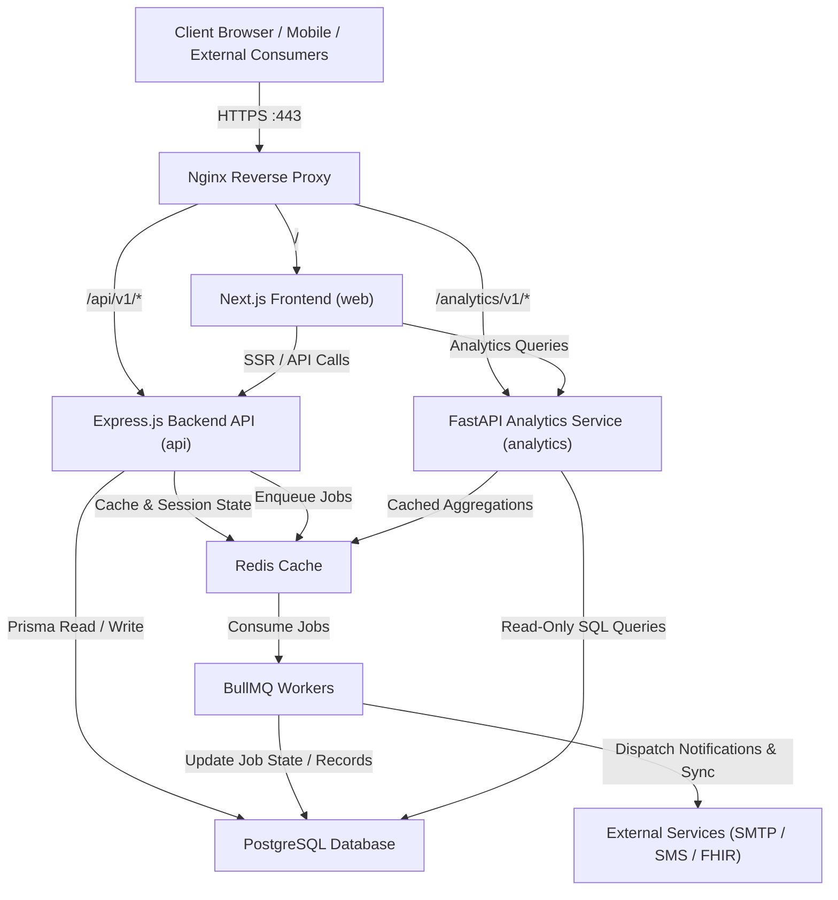

# MediCore Codebase Analysis

**Project:** MediCore — Hospital, Appointment & Patient Care Management Platform  
**Repository Path:** `c:\Users\chinn\Downloads\Medicore`  
**Analysis Date:** 2026-11-26  
**Repository State:** Greenfield (no application source code, no database schemas, no git commits, no installed dependencies)

---

## 1. Repository Discovery Summary

A full recursive inspection of `c:\Users\chinn\Downloads\Medicore` confirms that the repository is a **greenfield project** with **zero implemented application code**, **zero database schemas or migrations**, **zero test suites**, **zero Docker/Nginx configurations**, and **no git commit history** (`master` branch has no commits yet).

> **Note on Observed Files vs. Empty Baseline:** While the project was expected to contain only `.vscode/settings.json` with no `package.json`, disk inspection found that an initial **untracked workspace skeleton** (`2026-11-26 15:16`) has already been placed alongside `.vscode/settings.json`. No dependencies are installed (`node_modules` and lockfiles do not exist) and all source directories are completely empty.

### Inventory of Observed Files

| Path | Size | Status | Description |
| :--- | :--- | :--- | :--- |
| `.vscode/settings.json` | 261 B | Untracked | Editor file-exclusion rules (`files.exclude` for `.git`, `.DS_Store`, etc.) |
| `.gitignore` | 715 B | Untracked | Ignore rules for Node.js, Next.js, TypeScript, Python, `.env*`, Docker overrides, and logs |
| `.env.example` | 3,976 B | Untracked | Environment variable template for Web, API, PostgreSQL, Redis, Analytics, SMTP/SMS, and FHIR |
| `package.json` | 1,561 B | Untracked | npm workspace root (`apps/*`, `packages/*`) defining placeholder dev/build/test/db/docker scripts |
| `apps/api/package.json` | 1,904 B | Untracked | Backend API manifest (`@medicore/api`) declaring planned Express/Prisma/BullMQ dependencies |
| `apps/api/tsconfig.json` | 801 B | Untracked | Strict TypeScript configuration targeting `ES2022` with path aliases (`@modules/*`, etc.) |

### Observed Empty Directory Tree

All functional directories exist only as empty placeholders:

- `apps/web/` (empty — no `package.json`, no Next.js app)
- `apps/api/src/` (empty — no server entry point, modules, middleware, or Prisma schema)
- `apps/analytics/` (empty — no Python environment, `pyproject.toml`/`requirements.txt`, or FastAPI app)
- `database/schemas/`, `database/migrations/`, `database/seeds/`, `database/documentation/` (all empty)
- `packages/api-contracts/`, `packages/shared-config/`, `packages/shared-types/` (all empty)
- `infrastructure/docker/`, `infrastructure/monitoring/`, `infrastructure/nginx/`, `infrastructure/scripts/` (all empty)
- `docs/` (empty prior to this report), `postman/` (empty)

---

## 2. Existing Implementation Analysis

**Nothing exists in terms of runnable software or domain implementation.**

- **Frontend (`apps/web`):** No `package.json`, Next.js configuration, routing, UI components, state management, or API client exists.
- **Backend API (`apps/api`):** While `apps/api/package.json` and `apps/api/tsconfig.json` define intended packages and compiler paths (`@config/*`, `@common/*`, `@middleware/*`, `@modules/*`, `@utils/*`), `apps/api/src/` is completely empty. No Express server, routes, auth middleware, BullMQ queues/workers, or Prisma `schema.prisma` exist.
- **Analytics Service (`apps/analytics`):** Completely empty. No FastAPI entry point (`app/main.py` referenced in root `package.json`), Python dependency manifest, or read-only database queries exist.
- **Database Layer (`database/`):** No DDL schemas, Prisma models, migrations, or seed scripts exist.
- **Shared Packages (`packages/*`):** No shared TypeScript types, configuration packages, or OpenAPI/Zod contracts exist.
- **Infrastructure & Operations (`infrastructure/`):** No `Dockerfile`s, `docker-compose.yml` (referenced by root `package.json` `docker:up` script), Nginx reverse proxy configuration, monitoring stack, or CI/CD workflows exist.
- **Verification & Tests:** No unit, integration, or end-to-end tests exist; no dependencies are installed (`npm install` has not been run).

---

## 3. Technology Stack Assessment

Based on the proposed platform requirements, root `package.json`, `.env.example`, and `apps/api/package.json`, the following technology stack needs to be provisioned and configured from scratch:

| Layer | Target Technology | Current Setup Status | What Needs to Be Set Up |
| :--- | :--- | :--- | :--- |
| **Monorepo Tooling** | npm Workspaces (`Node >=20`, `npm >=10`), TypeScript | Root `package.json` present; `node_modules` absent | Install root devDependencies (`concurrently`, `typescript`), align TS versions (`5.3.3` in root vs `5.6.3` in `apps/api`), add root linting/formatting & lockfile |
| **Reverse Proxy** | Nginx | Directory `infrastructure/nginx/` empty | `nginx.conf`, upstream routing (`/`, `/api/`, `/analytics/`), TLS termination, rate limiting, security headers, WebSocket/SSE proxy settings |
| **Frontend (`web`)** | Next.js (React + TypeScript) | Directory `apps/web/` empty | Initialize `apps/web/package.json`, Next.js App Router, Tailwind/UI system, auth session handling, API client, testing (Vitest/Playwright) |
| **Backend API (`api`)** | Express.js + TypeScript + Prisma + Zod + Argon2 + JWT + Pino | `package.json` & `tsconfig.json` present; `src/` & `prisma/` empty | Install packages, create `src/server.ts` & `src/app.ts`, RBAC/JWT auth, Argon2id hashing, Pino logging, Swagger/OpenAPI, Vitest/Supertest setup |
| **Background Jobs** | BullMQ + `ioredis` | Declared in `apps/api/package.json`; no worker code | Queue definitions, worker processes (email/SMS notifications, appointment reminders, FHIR sync, report generation), DLQ & retry policies |
| **Analytics Service (`analytics`)** | Python + FastAPI + Uvicorn + Pytest | Directory `apps/analytics/` empty | Python virtual environment / `pyproject.toml` or `requirements.txt`, `app/main.py`, API-key auth (`ANALYTICS_API_KEY`), read-only DB client (`ANALYTICS_DATABASE_URL`) |
| **Primary Database** | PostgreSQL | `.env.example` & `database/` dirs only | Provision Postgres instance, separate `medicore_user` and `medicore_readonly` roles, Prisma schema + SQL migrations, indexing, audit logging, seed data |
| **Cache & Queue Broker** | Redis | `.env.example` only | Provision Redis instance, configure persistence (AOF) for BullMQ reliability, key-prefix strategy for cache vs. queues vs. rate limiting |
| **External Integrations** | SMTP (Mailtrap/prod), SMS provider, HL7 FHIR | Env vars stubbed in `.env.example` | Adapter interfaces with sandbox/mock implementations, retry/circuit-breaker logic for FHIR (`FHIR_TIMEOUT_MS`, `FHIR_RETRY_ATTEMPTS`) |
| **Containerization** | Docker & Docker Compose | `infrastructure/docker/` empty; no `docker-compose.yml` | Multi-stage Dockerfiles per service, root `docker-compose.yml` for local dev & production parity, health checks |

---

## 4. Gap Analysis

Because no functional software exists yet, the gap between the current repository and a production-ready healthcare platform is **100% of the functional and operational surface**:

1. **Core Domain & Data Modeling (Critical Gap):**
   - No entity-relationship model for Patients, Providers/Doctors, Departments, Appointments, Medical Records/Encounters, Prescriptions, Billing, or Audit Logs.
   - No PHI (Protected Health Information) data classification, encryption-at-rest strategy, or immutable audit trail schema.
2. **Authentication, Authorization & Security (Critical Gap):**
   - No JWT access/refresh token issuance, rotation, or revocation (Redis blocklist/session store).
   - No Argon2 password hashing service, RBAC/ABAC policy enforcement (Admin, Doctor, Nurse, Receptionist, Patient), or inter-service API key validation.
3. **Application Services (Complete Gap):**
   - `apps/web`: No patient portal, clinician dashboard, scheduling UI, or analytics views.
   - `apps/api`: No REST API endpoints (`/api/v1/*`), input validation schemas (Zod), error handling middleware, or OpenAPI spec.
   - `apps/analytics`: No FastAPI endpoints for hospital KPIs, bed/appointment utilization, no-show prediction, or cohort reporting.
4. **Asynchronous Processing & Integrations (Complete Gap):**
   - No BullMQ worker runtime, queue topology, or notification/FHIR sync processors.
5. **Shared Contracts & Packages (Complete Gap):**
   - `packages/shared-types`, `packages/api-contracts`, and `packages/shared-config` are empty, meaning no compile-time contract sharing exists yet between `web` and `api`.
6. **Infrastructure, Observability & QA (Complete Gap):**
   - No Nginx reverse proxy config, Docker Compose orchestration, Prometheus/Grafana/health-check monitoring, CI/CD pipelines, or automated test suites.

---

## 5. Technical Debt Inventory

**N/A — Greenfield Project.**  
There is no legacy code, deprecated dependency usage, or accumulated architectural debt to refactor.

*Preventive Hygiene Observations on Initial Skeleton:*
- **TypeScript Version Drift:** Root `package.json` specifies `"typescript": "^5.3.3"` while `apps/api/package.json` specifies `"typescript": "^5.6.3"`. Standardize on a single TypeScript version across workspaces before adding `apps/web` and `packages/*`.
- **Unresolved Workspace Scripts:** Root `package.json` invokes `docker compose`, `apps/web`, and `apps/analytics` scripts whose target files (`docker-compose.yml`, `apps/web/package.json`, `apps/analytics/app/main.py`) do not exist yet.
- **No Initial Commit or Lockfile:** Initialize git history cleanly once baseline workspace configuration and linting/pre-commit hooks are in place.

---

## 6. Architecture Comparison

### Existing Architecture vs. Proposed Architecture

| Dimension | Existing Architecture (Current State) | Proposed Target Architecture |
| :--- | :--- | :--- |
| **Runtime Topology** | None — empty directories and 6 untracked config/manifest files | Multi-service containerized architecture fronted by Nginx Reverse Proxy |
| **Edge / Routing** | None | **Nginx Reverse Proxy** handling TLS, static/SSR routing to `web`, API routing to `api` & `analytics`, and rate limiting |
| **Frontend** | None | **Next.js Frontend (`web`)** serving SSR/CSR portals for patients, clinicians, and administrators |
| **Core Backend** | Manifest only (`apps/api/package.json`) | **Express.js Backend API (`api`)** with modular domain services, JWT/Argon2 auth, Zod validation, and Prisma ORM |
| **Analytics Engine** | None | **FastAPI Analytics Service (`analytics`)** isolated for read-heavy reporting, aggregations, and ML/predictive workloads |
| **Async Processing** | `bullmq` declared; no workers | **BullMQ Workers** decoupled from HTTP request threads for email/SMS reminders, report exports, and FHIR synchronization |
| **Data Persistence** | None | **PostgreSQL Database** as system of record (read/write for `api`, dedicated read-only user for `analytics`) |
| **Caching & Messaging** | None | **Redis Cache** serving both low-latency application caching/session state and BullMQ job queues |
| **Cross-Service Contracts** | None | Shared TypeScript types/contracts (`packages/*`) and OpenAPI schemas across `web`, `api`, and `analytics` |

### Proposed High-Level Architecture Diagram

---

## 7. Risk Assessment for Greenfield Development

| Risk | Likelihood | Impact | Mitigation Strategy |
| :--- | :--- | :--- | :--- |
| **Healthcare Compliance & PHI Exposure (HIPAA/GDPR)** | High | Critical | Design field-level encryption, strict RBAC, audit logging, and PII-redacted structured logging (Pino) from Day 1—retrofitting compliance later is costly. |
| **Distributed Monorepo Complexity Early On** | Medium | High | Running 3 apps (`web`, `api`, `analytics`) + Workers + Nginx + Postgres + Redis simultaneously can slow early iteration. Use a unified `docker-compose.yml` for infra dependencies while keeping domain boundaries clean. |
| **Cross-Language Schema & Contract Drift (TS vs. Python)** | High | Medium | `api` uses TypeScript/Prisma while `analytics` uses Python/SQL. Make PostgreSQL migrations the single source of truth for schema and publish OpenAPI specs for API contracts. |
| **Analytics Queries Contending with OLTP Traffic** | Medium | High | Enforce the dedicated `medicore_readonly` PostgreSQL role (already anticipated in `.env.example`), apply statement timeouts, and cache heavy aggregations in Redis. |
| **BullMQ Job Idempotency & Data Consistency** | Medium | High | Ensure notification and FHIR sync jobs are idempotent (deduplication keys), configure dead-letter queues, and avoid holding DB transactions open across external calls. |
| **Security Misconfiguration of Secrets & CORS** | Medium | High | Validate all environment variables at startup with Zod/Pydantic (fail-fast), enforce strict CORS origins, and never bake `.env.example` placeholder secrets into deployments. |
| **Lack of Early Test & CI Automation** | Medium | Medium | Establish Vitest, Pytest, typechecking, and lint gates in CI before feature velocity ramps up. |

---

## 8. Recommendations for Phased Implementation

### Phase 1: Foundation, Infrastructure & Contracts
- Standardize monorepo tooling (align TypeScript versions, install root & `api` dependencies, configure ESLint/Prettier, initialize git commit history).
- Implement `infrastructure/docker/docker-compose.yml` for **PostgreSQL**, **Redis**, and **Nginx Reverse Proxy** (`infrastructure/nginx/nginx.conf`), plus health check endpoints.
- Design the core **PostgreSQL** schema (Users, Roles, Patients, Providers, Departments, Appointments, Clinical Encounters, Audit Logs) using Prisma migrations and database role separation (`medicore_user` vs. `medicore_readonly`).
- Scaffold `packages/shared-types`, `packages/shared-config`, and `packages/api-contracts`.

### Phase 2: Core Backend API (`apps/api`) & Auth
- Build the **Express.js Backend API (`api`)** foundation: typed env validation, Pino structured logging, Helmet/CORS/rate-limiting middleware, global error handler, and Swagger/OpenAPI docs.
- Implement Authentication & RBAC (Argon2id password hashing, JWT access/refresh tokens with Redis revocation, role guards).
- Implement core REST modules (`/api/v1/patients`, `/api/v1/providers`, `/api/v1/appointments`, `/api/v1/encounters`) with Vitest + Supertest integration tests.

### Phase 3: Asynchronous Workers & External Integrations
- Implement **BullMQ Workers** (either as a dedicated worker entrypoint in `apps/api` or separate container) backed by **Redis**.
- Build notification pipelines (SMTP email and SMS appointment reminders) and HL7 **FHIR** synchronization jobs with retry/backoff and dead-letter handling.
- Add Redis caching layer for high-read endpoints (doctor schedules, department directories).

### Phase 4: Next.js Frontend (`apps/web`)
- Scaffold **Next.js Frontend (`web`)** with App Router, TypeScript, and shared types from `packages/shared-types`.
- Implement authentication flows, role-based dashboards (Admin, Clinician, Receptionist, Patient), appointment booking/calendar workflows, and patient chart views.
- Add frontend unit tests and end-to-end smoke tests against the Nginx-proxied stack.

### Phase 5: FastAPI Analytics Service (`apps/analytics`) & Hardening
- Scaffold **FastAPI Analytics Service (`analytics`)** with `pyproject.toml`, Pydantic settings, API-key middleware, and async read-only PostgreSQL pooling.
- Implement operational analytics endpoints (appointment utilization, wait times, no-show metrics, departmental throughput) with Redis caching and Pytest coverage.
- Finalize observability (`infrastructure/monitoring/`), security audit (OWASP headers, RBAC penetration tests), load testing, and CI/CD deployment pipelines.
