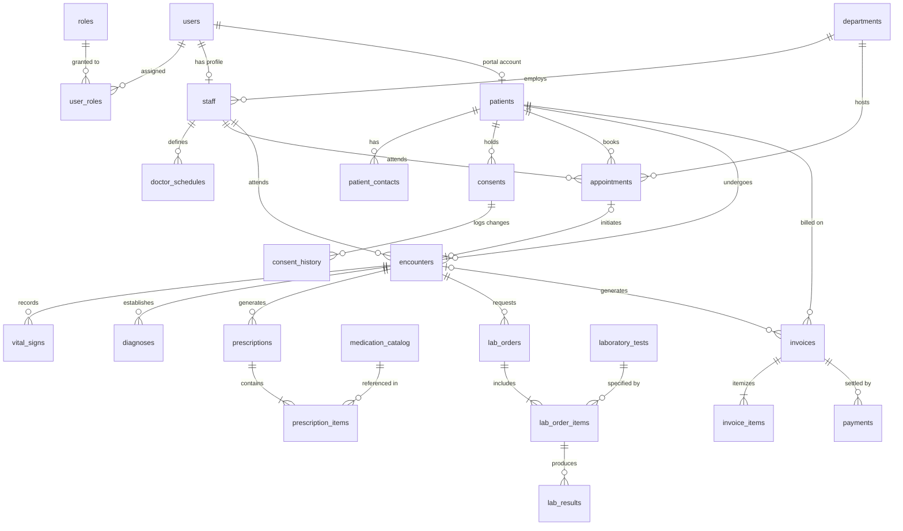

# MediCore Hospital Management Platform — Database Design Document

**Database Engine:** PostgreSQL 16+  
**Database Name:** `medicore_db` (schema: `public`)  
**Total Tables:** 34 (32 Core Domain Entities + 2 Supplementary Clinical/Facility Tables)  
**Primary Access Layers:** Express.js API (`apps/api` via Prisma Client) & FastAPI Analytics Service (`apps/analytics` via `medicore_readonly`)

---

## Table of Contents

1. [Design Principles](#1-design-principles)
2. [Entity List (32 Core + 2 Supplementary Tables)](#2-entity-list-32-core--2-supplementary-tables)
3. [Table Schemas](#3-table-schemas)
   - [3.1 Identity & Access Control (RBAC)](#31-identity--access-control-rbac)
   - [3.2 Organization, Staff & Scheduling](#32-organization-staff--scheduling)
   - [3.3 Patient Registry & Consent](#33-patient-registry--consent)
   - [3.4 Appointments & Clinical Encounters](#34-appointments--clinical-encounters)
   - [3.5 Pharmacy & Medications](#35-pharmacy--medications)
   - [3.6 Laboratory Orders & Diagnostics](#36-laboratory-orders--diagnostics)
   - [3.7 Billing & Payments](#37-billing--payments)
   - [3.8 Audit, Notifications, Interoperability & Reliability](#38-audit-notifications-interoperability--reliability)
4. [Key Design Decisions](#4-key-design-decisions)
5. [Index Strategy](#5-index-strategy)
6. [Transaction Boundaries](#6-transaction-boundaries)
7. [ER Diagram](#7-er-diagram)
8. [Migration Strategy](#8-migration-strategy)
9. [Seed Data Strategy](#9-seed-data-strategy)

---

## 1. Design Principles

### 1.1 Normalization & Controlled Historical Snapshots
- **Third Normal Form (3NF / BCNF):** All entities are normalized to eliminate repeating groups, partial dependencies, and transitive dependencies. Multi-valued relationships (e.g., `user_roles`, `role_permissions`, `prescription_items`, `lab_order_items`, `invoice_items`, `patient_contacts`) are decomposed into explicit junction and line-item tables. Master catalogs (`medication_catalog`, `laboratory_tests`, `departments`, `clinical_rooms`) are separated from transactional orders.
- **Controlled Point-in-Time Snapshots:** Where legal, clinical, or financial accuracy forbids retroactive mutation when catalog prices or reference ranges change, transactional line items store immutable point-in-time snapshots (e.g., `invoice_items.unit_price`, `prescription_items.unit_price_snapshot`, `lab_order_items.price_snapshot`, `lab_results.reference_range_snapshot`).

### 1.2 Referential Integrity & Least-Privilege Roles
- **Strict Foreign Keys:** Every cross-table relationship is enforced by database-level `FOREIGN KEY` constraints with explicit `ON DELETE` and `ON UPDATE` semantics.
  - Clinical, billing, consent, and audit references use `ON DELETE RESTRICT` to prevent accidental destruction of medical-legal records.
  - Ephemeral/owned structural links (e.g., `role_permissions`, `user_roles`, `refresh_tokens`) use `ON DELETE CASCADE` where parent lifecycle removal is valid.
- **Database Role Separation:**
  - `medicore_migrator`: Schema owner used exclusively during CI/CD migrations (`prisma migrate deploy`).
  - `medicore_user`: Runtime application role used by `apps/api`; granted `SELECT, INSERT, UPDATE, DELETE` on mutable tables, but **`SELECT, INSERT` only** on `audit_logs` and `consent_history`.
  - `medicore_readonly`: Read-only role used by the Python FastAPI analytics service (`apps/analytics` via `ANALYTICS_DATABASE_URL`).

### 1.3 UTC Timestamps & Temporal Precision
- Every timestamp column uses `TIMESTAMPTZ` (`TIMESTAMP WITH TIME ZONE`), stored internally in UTC.
- Database sessions and pools enforce `SET TIME ZONE 'UTC'`.
- All mutable tables define:
  - `created_at TIMESTAMPTZ NOT NULL DEFAULT now()`
  - `updated_at TIMESTAMPTZ NOT NULL DEFAULT now()` (automatically maintained by a shared `BEFORE UPDATE` trigger `trg_set_updated_at()`).
- Append-only immutable tables (`audit_logs`, `consent_history`) intentionally store only `created_at TIMESTAMPTZ NOT NULL DEFAULT now()` because rows are never updated.
- Local presentation timezones are stored as explicit IANA timezone strings (e.g., `doctor_schedules.timezone`, `patients.preferred_timezone`) so UI and reminder services format UTC instants accurately.

### 1.4 Soft Deletes Only Where Justified
- **Soft deletion is restricted strictly to `users` and `patients`** via `is_active BOOLEAN NOT NULL DEFAULT true` (paired with `deactivated_at TIMESTAMPTZ`). Hard-deleting a user or patient would either break clinical/financial audit trails or violate `RESTRICT` foreign keys on `encounters`, `prescriptions`, `invoices`, `consents`, and `audit_logs`.
- **All other tables avoid blanket `deleted_at` columns:**
  - Operational entities (`appointments`, `encounters`, `prescriptions`, `lab_orders`, `invoices`, `payments`, `notification_jobs`, `fhir_sync_records`) use explicit domain lifecycle `status` state machines (e.g., `CANCELLED`, `VOID`, `EXPIRED`).
  - Reference catalogs (`medication_catalog`, `laboratory_tests`, `departments`, `clinical_rooms`) use `is_active BOOLEAN NOT NULL DEFAULT true` to retire items from new orders without invalidating historical records.
  - Auth tokens (`refresh_tokens`) use `revoked_at` and `expires_at` with scheduled cleanup after retention.

### 1.5 Append-Only Audit & Immutability
- `audit_logs` and `consent_history` are **append-only ledgers**.
- Regular application roles (`medicore_user`, `medicore_readonly`) have no `UPDATE` or `DELETE` privileges on these tables.
- Defensive PostgreSQL `BEFORE UPDATE OR DELETE` triggers reject mutations even from privileged sessions unless explicitly overridden during legally mandated retention purges.

### 1.6 Database-Enforced Invariants
- Required PostgreSQL extensions: `pgcrypto` (for `gen_random_uuid()` and cryptographic hashing helpers) and `btree_gist` (for multi-column GiST exclusion constraints).
- Domain invariants (non-negative currency, `end_time > start_time`, vital sign physiological bounds, valid state enums) are enforced with `CHECK` constraints at the database layer in addition to application-level Zod validation.

---

## 2. Entity List (32 Core + 2 Supplementary Tables)

### Core Entities (32 Required Entities)

| # | Table Name | Domain | Description |
|---|---|---|---|
| 1 | `users` | Identity & Access | Authenticated platform accounts (staff, admins, portal patients) storing credentials, MFA flags, lockout state, and soft-deactivation status (`is_active`). |
| 2 | `roles` | Identity & Access | System and hospital RBAC roles (the 7 core roles: `ADMIN`, `DOCTOR`, `NURSE`, `RECEPTIONIST`, `PHARMACIST`, `LAB_TECHNICIAN`, `PATIENT`). |
| 3 | `permissions` | Identity & Access | Fine-grained `resource:action` authorization capabilities (e.g., `patients:read`, `prescriptions:dispense`, `lab_results:verify`). |
| 4 | `user_roles` | Identity & Access | Many-to-many assignment of roles to users with optional expiration and assignment provenance. |
| 5 | `role_permissions` | Identity & Access | Many-to-many mapping defining which permissions belong to each role. |
| 6 | `patients` | Patient Registry | Master patient index (MPI) containing Medical Record Number (`mrn`), demographics, blood group, FHIR patient ID, and `is_active` soft-delete flag. |
| 7 | `patient_contacts` | Patient Registry | Emergency contacts, next of kin, legal guardians, and insurance subscribers linked to a patient. |
| 8 | `staff` | Organization & Staff | Hospital personnel profiles linking `users` to `departments`, employee codes, clinical specializations, NPI, and medical license expirations. |
| 9 | `departments` | Organization & Staff | Clinical and operational hospital departments (e.g., Cardiology, Pediatrics, Pathology, Pharmacy) with department head reference. |
| 10 | `doctor_schedules` | Scheduling | Recurring weekly availability blocks and date-specific overrides/blackouts for doctors, including slot duration and timezone. |
| 11 | `appointments` | Scheduling | Scheduled patient visits with `tstzrange` time slots and a GiST `EXCLUDE` constraint preventing overlapping bookings per doctor and room. |
| 12 | `encounters` | Clinical Care | Clinical visits/episodes (outpatient, inpatient, emergency, telehealth) linking appointments, attending doctors, clinical notes, and sign-off metadata. |
| 13 | `vital_signs` | Clinical Care | Time-stamped physiological measurements (BP, heart rate, temperature, SpO2, respiratory rate, height, weight, pain score) recorded during an encounter. |
| 14 | `diagnoses` | Clinical Care | Coded clinical diagnoses (ICD-10 / SNOMED CT) per encounter and patient, tracking primary/secondary classification and clinical status. |
| 15 | `medication_catalog` | Pharmacy | Normalized hospital drug formulary with NDC/RxNorm codes, dosage form, strength, controlled schedule, unit price, and inventory stock levels. |
| 16 | `prescriptions` | Pharmacy | Medication order headers authored by clinicians during an encounter, tracking issuance, expiry, and pharmacy dispensing sign-off. |
| 17 | `prescription_items` | Pharmacy | Individual drug line items within a prescription, storing dosage instructions, quantities prescribed/dispensed, refills, and price snapshots. |
| 18 | `laboratory_tests` | Laboratory | Master catalog of diagnostic tests with LOINC codes, specimen requirements, reference ranges, turnaround times, and pricing. |
| 19 | `lab_orders` | Laboratory | Diagnostic test order headers placed during an encounter, capturing clinical priority (`ROUTINE`, `URGENT`, `STAT`) and specimen collection state. |
| 20 | `lab_order_items` | Laboratory | Individual tests requested within a `lab_orders` header, carrying specimen barcodes, item status, and price snapshots. |
| 21 | `lab_results` | Laboratory | Verified diagnostic findings for `lab_order_items`, supporting versioned amendments, abnormal flags, performer/verifier sign-off, and FHIR observation IDs. |
| 22 | `invoices` | Billing & Payments | Patient billing headers aggregating encounter/service charges, discounts, taxes, totals, paid amounts, and due dates. |
| 23 | `invoice_items` | Billing & Payments | Normalized billable line items linked to an invoice, storing immutable unit price, quantity, tax rate, and source entity reference. |
| 24 | `payments` | Billing & Payments | Payment and refund transactions applied against invoices, recording payment method, gateway reference, and settlement timestamps. |
| 25 | `consents` | Compliance & Consent | Current active state of each patient consent category (`TREATMENT`, `DATA_SHARING`, `HIPAA_NOTICE`, `TELEHEALTH`, `RESEARCH`, `PORTAL_ACCESS`). |
| 26 | `consent_history` | Compliance & Consent | Immutable, append-only audit trail recording every consent grant, denial, policy version update, and revocation with IP/signature evidence. |
| 27 | `audit_logs` | Security & Audit | Immutable, append-only compliance log of all authentication, PHI access, clinical sign-off, and mutation events across the platform. |
| 28 | `notifications` | Notifications | User-facing notification records (in-app inbox and read-state tracking) for reminders, lab results, prescriptions, and billing alerts. |
| 29 | `notification_jobs` | Notifications | Asynchronous delivery outbox/tracking records mapped to BullMQ jobs for `EMAIL`, `SMS`, and `PUSH` dispatch, retries, and dead-letter state. |
| 30 | `refresh_tokens` | Security & Auth | Hashed JWT refresh tokens with token family tracking (`family_id`) for rotation, device metadata, and reuse-detection revocation. |
| 31 | `fhir_sync_records` | Interoperability | Bidirectional synchronization ledger mapping local MediCore entities to external HL7 FHIR resources, version IDs, payload hashes, and retry state. |
| 32 | `idempotency_records` | API Reliability | Request deduplication store keyed by `(scope, idempotency_key)` and SHA-256 request hash to guarantee safe retries on mutations (especially payments and bookings). |

### Supplementary Tables (2 Supporting Entities — Bringing Total to 34 Tables)

| # | Table Name | Domain | Description |
|---|---|---|---|
| 33 | `patient_allergies` | Clinical Care | Structured patient allergy & adverse reaction registry (medications, food, environmental) checked during prescribing and clinical triage. |
| 34 | `clinical_rooms` | Organization & Staff | Physical consultation, exam, procedure, and lab collection rooms within `departments`, referenced by `doctor_schedules` and `appointments` to prevent room double-booking. |

---

## 3. Table Schemas

> **Conventions used below:**
> - All `id` primary keys are `UUID NOT NULL DEFAULT gen_random_uuid()` unless stated otherwise.
> - All mutable tables include `created_at TIMESTAMPTZ NOT NULL DEFAULT now()` and `updated_at TIMESTAMPTZ NOT NULL DEFAULT now()`.
> - `ON UPDATE CASCADE` is used on FK definitions where applicable; `ON DELETE` behavior is explicitly specified per FK.

---

### 3.1 Identity & Access Control (RBAC)

#### 1. `users`
Stores authentication identity and account security state for staff and portal patients.

| Column | PostgreSQL Type | Constraints & Default | Description |
|---|---|---|---|
| `id` | `UUID` | `PRIMARY KEY DEFAULT gen_random_uuid()` | Unique user identifier |
| `email` | `VARCHAR(255)` | `NOT NULL UNIQUE` | Login email (normalized lowercase via CHECK/app) |
| `password_hash` | `TEXT` | `NOT NULL` | Argon2id password hash |
| `first_name` | `VARCHAR(100)` | `NOT NULL` | Given name |
| `last_name` | `VARCHAR(100)` | `NOT NULL` | Family name |
| `phone` | `VARCHAR(32)` | `NULL` | E.164 formatted contact phone |
| `is_active` | `BOOLEAN` | `NOT NULL DEFAULT true` | Soft-deletion flag (`false` = deactivated) |
| `is_email_verified` | `BOOLEAN` | `NOT NULL DEFAULT false` | Email verification status |
| `mfa_enabled` | `BOOLEAN` | `NOT NULL DEFAULT false` | Multi-factor authentication enabled flag |
| `failed_login_attempts` | `SMALLINT` | `NOT NULL DEFAULT 0 CHECK (failed_login_attempts >= 0)` | Consecutive failed login counter |
| `locked_until` | `TIMESTAMPTZ` | `NULL` | Temporary brute-force lockout expiration |
| `last_login_at` | `TIMESTAMPTZ` | `NULL` | Last successful authentication timestamp |
| `deactivated_at` | `TIMESTAMPTZ` | `NULL` | Timestamp when `is_active` became `false` |
| `created_at` | `TIMESTAMPTZ` | `NOT NULL DEFAULT now()` | Record creation time (UTC) |
| `updated_at` | `TIMESTAMPTZ` | `NOT NULL DEFAULT now()` | Last update time (UTC) |

**Table Constraints:**
- `CHECK (email = lower(email))`
- `CHECK ((is_active = true AND deactivated_at IS NULL) OR (is_active = false AND deactivated_at IS NOT NULL))`

---

#### 2. `roles`
Defines the 7 RBAC roles in MediCore.

| Column | PostgreSQL Type | Constraints & Default | Description |
|---|---|---|---|
| `id` | `UUID` | `PRIMARY KEY DEFAULT gen_random_uuid()` | Unique role identifier |
| `code` | `VARCHAR(50)` | `NOT NULL UNIQUE` | Machine code (e.g., `ADMIN`, `DOCTOR`, `NURSE`, `RECEPTIONIST`, `PHARMACIST`, `LAB_TECHNICIAN`, `PATIENT`) |
| `name` | `VARCHAR(100)` | `NOT NULL UNIQUE` | Human-readable role title |
| `description` | `TEXT` | `NULL` | Role scope and responsibilities |
| `is_system` | `BOOLEAN` | `NOT NULL DEFAULT true` | Prevents accidental deletion of built-in roles |
| `created_at` | `TIMESTAMPTZ` | `NOT NULL DEFAULT now()` | Record creation time (UTC) |
| `updated_at` | `TIMESTAMPTZ` | `NOT NULL DEFAULT now()` | Last update time (UTC) |

**Table Constraints:**
- `CHECK (code = upper(code))`

---

#### 3. `permissions`
Defines atomic authorization capabilities enforced by API middleware.

| Column | PostgreSQL Type | Constraints & Default | Description |
|---|---|---|---|
| `id` | `UUID` | `PRIMARY KEY DEFAULT gen_random_uuid()` | Unique permission identifier |
| `code` | `VARCHAR(100)` | `NOT NULL UNIQUE` | Canonical key (`<resource>:<action>`, e.g., `encounters:sign`) |
| `resource` | `VARCHAR(60)` | `NOT NULL` | Domain resource name |
| `action` | `VARCHAR(40)` | `NOT NULL` | Action verb (`read`, `create`, `update`, `cancel`, `dispense`, `verify`, `export`, etc.) |
| `description` | `TEXT` | `NULL` | Explanation of granted access |
| `created_at` | `TIMESTAMPTZ` | `NOT NULL DEFAULT now()` | Record creation time (UTC) |
| `updated_at` | `TIMESTAMPTZ` | `NOT NULL DEFAULT now()` | Last update time (UTC) |

**Table Constraints:**
- `UNIQUE (resource, action)`

---

#### 4. `user_roles`
Assigns one or more roles to a user with audit provenance.

| Column | PostgreSQL Type | Constraints & Default | Description |
|---|---|---|---|
| `id` | `UUID` | `PRIMARY KEY DEFAULT gen_random_uuid()` | Unique assignment identifier |
| `user_id` | `UUID` | `NOT NULL REFERENCES users(id) ON DELETE CASCADE` | Target user |
| `role_id` | `UUID` | `NOT NULL REFERENCES roles(id) ON DELETE RESTRICT` | Assigned role |
| `assigned_by_user_id` | `UUID` | `NULL REFERENCES users(id) ON DELETE SET NULL` | Admin who granted the role |
| `assigned_at` | `TIMESTAMPTZ` | `NOT NULL DEFAULT now()` | Assignment timestamp |
| `expires_at` | `TIMESTAMPTZ` | `NULL` | Optional expiration for temporary elevation |
| `created_at` | `TIMESTAMPTZ` | `NOT NULL DEFAULT now()` | Record creation time (UTC) |
| `updated_at` | `TIMESTAMPTZ` | `NOT NULL DEFAULT now()` | Last update time (UTC) |

**Table Constraints:**
- `UNIQUE (user_id, role_id)`
- `CHECK (expires_at IS NULL OR expires_at > assigned_at)`

---

#### 5. `role_permissions`
Maps permissions to roles.

| Column | PostgreSQL Type | Constraints & Default | Description |
|---|---|---|---|
| `id` | `UUID` | `PRIMARY KEY DEFAULT gen_random_uuid()` | Unique mapping identifier |
| `role_id` | `UUID` | `NOT NULL REFERENCES roles(id) ON DELETE CASCADE` | Target role |
| `permission_id` | `UUID` | `NOT NULL REFERENCES permissions(id) ON DELETE CASCADE` | Granted permission |
| `created_at` | `TIMESTAMPTZ` | `NOT NULL DEFAULT now()` | Record creation time (UTC) |
| `updated_at` | `TIMESTAMPTZ` | `NOT NULL DEFAULT now()` | Last update time (UTC) |

**Table Constraints:**
- `UNIQUE (role_id, permission_id)`

---

### 3.2 Organization, Staff & Scheduling

#### 9. `departments`
Hospital clinical and support departments. *(Note: `head_staff_id` FK is added after `staff` creation via `ALTER TABLE` to resolve the mutual reference cleanly.)*

| Column | PostgreSQL Type | Constraints & Default | Description |
|---|---|---|---|
| `id` | `UUID` | `PRIMARY KEY DEFAULT gen_random_uuid()` | Unique department identifier |
| `code` | `VARCHAR(20)` | `NOT NULL UNIQUE` | Short department code (e.g., `CARD`, `EMER`, `PATH`) |
| `name` | `VARCHAR(120)` | `NOT NULL UNIQUE` | Department display name |
| `description` | `TEXT` | `NULL` | Clinical services offered |
| `head_staff_id` | `UUID` | `NULL REFERENCES staff(id) ON DELETE SET NULL` | Department head (deferred FK) |
| `phone_extension` | `VARCHAR(20)` | `NULL` | Internal hospital extension |
| `location_floor` | `VARCHAR(40)` | `NULL` | Building / floor location |
| `is_active` | `BOOLEAN` | `NOT NULL DEFAULT true` | Whether department accepts new schedules/orders |
| `created_at` | `TIMESTAMPTZ` | `NOT NULL DEFAULT now()` | Record creation time (UTC) |
| `updated_at` | `TIMESTAMPTZ` | `NOT NULL DEFAULT now()` | Last update time (UTC) |

---

#### 34. `clinical_rooms` *(Supplementary)*
Physical consultation, exam, procedure, and sample-collection rooms belonging to a department.

| Column | PostgreSQL Type | Constraints & Default | Description |
|---|---|---|---|
| `id` | `UUID` | `PRIMARY KEY DEFAULT gen_random_uuid()` | Unique room identifier |
| `department_id` | `UUID` | `NOT NULL REFERENCES departments(id) ON DELETE RESTRICT` | Owning department |
| `room_number` | `VARCHAR(30)` | `NOT NULL UNIQUE` | Unique facility room code (e.g., `C-204`) |
| `room_type` | `VARCHAR(30)` | `NOT NULL CHECK (room_type IN ('CONSULTATION', 'EXAM', 'PROCEDURE', 'LAB_COLLECTION', 'TELEHEALTH_BOOTH'))` | Functional classification |
| `floor` | `VARCHAR(20)` | `NULL` | Floor indicator |
| `is_active` | `BOOLEAN` | `NOT NULL DEFAULT true` | Room operational availability |
| `created_at` | `TIMESTAMPTZ` | `NOT NULL DEFAULT now()` | Record creation time (UTC) |
| `updated_at` | `TIMESTAMPTZ` | `NOT NULL DEFAULT now()` | Last update time (UTC) |

---

#### 8. `staff`
Hospital employees and clinicians linked 1:1 to a `users` account.

| Column | PostgreSQL Type | Constraints & Default | Description |
|---|---|---|---|
| `id` | `UUID` | `PRIMARY KEY DEFAULT gen_random_uuid()` | Unique staff identifier |
| `user_id` | `UUID` | `NOT NULL UNIQUE REFERENCES users(id) ON DELETE RESTRICT` | Associated login account |
| `department_id` | `UUID` | `NOT NULL REFERENCES departments(id) ON DELETE RESTRICT` | Primary home department |
| `employee_code` | `VARCHAR(32)` | `NOT NULL UNIQUE` | HR employee badge/code |
| `staff_type` | `VARCHAR(30)` | `NOT NULL CHECK (staff_type IN ('DOCTOR', 'NURSE', 'PHARMACIST', 'LAB_TECHNICIAN', 'RECEPTIONIST', 'ADMIN'))` | Staff classification |
| `specialization` | `VARCHAR(120)` | `NULL` | Medical specialty (e.g., Interventional Cardiology) |
| `license_number` | `VARCHAR(64)` | `NULL UNIQUE` | Professional clinical/pharmacy license number |
| `license_expires_at` | `DATE` | `NULL` | Credential renewal date |
| `npi_number` | `VARCHAR(20)` | `NULL UNIQUE` | National Provider Identifier (when applicable) |
| `consultation_fee` | `NUMERIC(12,2)` | `NOT NULL DEFAULT 0.00 CHECK (consultation_fee >= 0)` | Default consultation fee |
| `is_accepting_patients` | `BOOLEAN` | `NOT NULL DEFAULT true` | Whether clinician appears in booking search |
| `hire_date` | `DATE` | `NOT NULL` | Employment start date |
| `termination_date` | `DATE` | `NULL` | Employment end date |
| `created_at` | `TIMESTAMPTZ` | `NOT NULL DEFAULT now()` | Record creation time (UTC) |
| `updated_at` | `TIMESTAMPTZ` | `NOT NULL DEFAULT now()` | Last update time (UTC) |

**Table Constraints:**
- `CHECK (termination_date IS NULL OR termination_date >= hire_date)`

---

#### 10. `doctor_schedules`
Defines recurring weekly shifts and date-specific schedule overrides/blackouts for doctors.

| Column | PostgreSQL Type | Constraints & Default | Description |
|---|---|---|---|
| `id` | `UUID` | `PRIMARY KEY DEFAULT gen_random_uuid()` | Unique schedule rule identifier |
| `doctor_id` | `UUID` | `NOT NULL REFERENCES staff(id) ON DELETE RESTRICT` | Clinician owning the schedule |
| `department_id` | `UUID` | `NOT NULL REFERENCES departments(id) ON DELETE RESTRICT` | Department where clinic hours occur |
| `room_id` | `UUID` | `NULL REFERENCES clinical_rooms(id) ON DELETE SET NULL` | Default assigned consultation room |
| `day_of_week` | `SMALLINT` | `NULL CHECK (day_of_week BETWEEN 0 AND 6)` | 0=Sunday..6=Saturday (for recurring rules) |
| `override_date` | `DATE` | `NULL` | Specific date for holiday/leave/extra clinic override |
| `start_time` | `TIME` | `NOT NULL` | Shift start wall-clock time in `timezone` |
| `end_time` | `TIME` | `NOT NULL` | Shift end wall-clock time in `timezone` |
| `slot_duration_minutes` | `SMALLINT` | `NOT NULL DEFAULT 30 CHECK (slot_duration_minutes BETWEEN 5 AND 180)` | Standard appointment slot length |
| `timezone` | `VARCHAR(64)` | `NOT NULL DEFAULT 'UTC'` | IANA timezone (e.g., `America/New_York`) |
| `is_available` | `BOOLEAN` | `NOT NULL DEFAULT true` | `false` marks a leave/blackout override |
| `effective_from` | `DATE` | `NOT NULL DEFAULT CURRENT_DATE` | Start date when rule takes effect |
| `effective_until` | `DATE` | `NULL` | Optional end date for rule |
| `created_at` | `TIMESTAMPTZ` | `NOT NULL DEFAULT now()` | Record creation time (UTC) |
| `updated_at` | `TIMESTAMPTZ` | `NOT NULL DEFAULT now()` | Last update time (UTC) |

**Table Constraints:**
- `CHECK (end_time > start_time)`
- `CHECK ((day_of_week IS NOT NULL AND override_date IS NULL) OR (day_of_week IS NULL AND override_date IS NOT NULL))`
- `CHECK (effective_until IS NULL OR effective_until >= effective_from)`

---

### 3.3 Patient Registry & Consent

#### 6. `patients`
Master Patient Index (MPI). Portal access is optional (`user_id` may be `NULL` for walk-in/unregistered portal patients).

| Column | PostgreSQL Type | Constraints & Default | Description |
|---|---|---|---|
| `id` | `UUID` | `PRIMARY KEY DEFAULT gen_random_uuid()` | Unique patient identifier |
| `user_id` | `UUID` | `NULL UNIQUE REFERENCES users(id) ON DELETE RESTRICT` | Optional linked portal user account |
| `mrn` | `VARCHAR(32)` | `NOT NULL UNIQUE` | Hospital Medical Record Number (e.g., `MRN-2026-00001`) |
| `first_name` | `VARCHAR(100)` | `NOT NULL` | Legal first name |
| `last_name` | `VARCHAR(100)` | `NOT NULL` | Legal last name |
| `date_of_birth` | `DATE` | `NOT NULL CHECK (date_of_birth <= CURRENT_DATE)` | Date of birth |
| `gender` | `VARCHAR(20)` | `NOT NULL CHECK (gender IN ('MALE', 'FEMALE', 'OTHER', 'PREFER_NOT_TO_SAY'))` | Administrative sex/gender |
| `blood_group` | `VARCHAR(5)` | `NULL CHECK (blood_group IN ('A+', 'A-', 'B+', 'B-', 'AB+', 'AB-', 'O+', 'O-'))` | Verified blood group |
| `phone` | `VARCHAR(32)` | `NOT NULL` | Primary phone number |
| `email` | `VARCHAR(255)` | `NULL` | Contact email |
| `address_line1` | `VARCHAR(255)` | `NULL` | Street address line 1 |
| `address_line2` | `VARCHAR(255)` | `NULL` | Apartment / unit |
| `city` | `VARCHAR(100)` | `NULL` | City |
| `state` | `VARCHAR(100)` | `NULL` | State / province |
| `postal_code` | `VARCHAR(20)` | `NULL` | Postal / ZIP code |
| `country` | `CHAR(2)` | `NOT NULL DEFAULT 'US'` | ISO 3166-1 alpha-2 country code |
| `preferred_language` | `VARCHAR(16)` | `NOT NULL DEFAULT 'en'` | BCP-47 language tag |
| `preferred_timezone` | `VARCHAR(64)` | `NOT NULL DEFAULT 'UTC'` | IANA timezone for appointment notifications |
| `fhir_patient_id` | `VARCHAR(128)` | `NULL UNIQUE` | External FHIR Patient resource ID |
| `is_active` | `BOOLEAN` | `NOT NULL DEFAULT true` | Soft-deletion flag (`false` = archived/merged/deactivated) |
| `deactivated_at` | `TIMESTAMPTZ` | `NULL` | Timestamp when deactivated |
| `created_at` | `TIMESTAMPTZ` | `NOT NULL DEFAULT now()` | Record creation time (UTC) |
| `updated_at` | `TIMESTAMPTZ` | `NOT NULL DEFAULT now()` | Last update time (UTC) |

**Table Constraints:**
- `CHECK ((is_active = true AND deactivated_at IS NULL) OR (is_active = false AND deactivated_at IS NOT NULL))`

---

#### 7. `patient_contacts`
Normalized emergency contacts, guardians, and next-of-kin for a patient.

| Column | PostgreSQL Type | Constraints & Default | Description |
|---|---|---|---|
| `id` | `UUID` | `PRIMARY KEY DEFAULT gen_random_uuid()` | Unique contact record identifier |
| `patient_id` | `UUID` | `NOT NULL REFERENCES patients(id) ON DELETE RESTRICT` | Subject patient |
| `contact_type` | `VARCHAR(30)` | `NOT NULL CHECK (contact_type IN ('EMERGENCY', 'NEXT_OF_KIN', 'GUARDIAN', 'INSURANCE_SUBSCRIBER'))` | Contact role |
| `full_name` | `VARCHAR(150)` | `NOT NULL` | Contact full name |
| `relationship` | `VARCHAR(60)` | `NOT NULL` | Relationship to patient (e.g., Spouse, Parent) |
| `phone` | `VARCHAR(32)` | `NOT NULL` | Contact phone number |
| `email` | `VARCHAR(255)` | `NULL` | Contact email |
| `address` | `TEXT` | `NULL` | Contact mailing address |
| `is_primary` | `BOOLEAN` | `NOT NULL DEFAULT false` | Primary contact indicator |
| `created_at` | `TIMESTAMPTZ` | `NOT NULL DEFAULT now()` | Record creation time (UTC) |
| `updated_at` | `TIMESTAMPTZ` | `NOT NULL DEFAULT now()` | Last update time (UTC) |

---

#### 33. `patient_allergies` *(Supplementary)*
Tracks active and resolved patient allergies for clinical decision support during prescribing.

| Column | PostgreSQL Type | Constraints & Default | Description |
|---|---|---|---|
| `id` | `UUID` | `PRIMARY KEY DEFAULT gen_random_uuid()` | Unique allergy entry identifier |
| `patient_id` | `UUID` | `NOT NULL REFERENCES patients(id) ON DELETE RESTRICT` | Subject patient |
| `allergen_name` | `VARCHAR(150)` | `NOT NULL` | Allergen substance (e.g., Penicillin, Latex) |
| `allergen_type` | `VARCHAR(30)` | `NOT NULL CHECK (allergen_type IN ('MEDICATION', 'FOOD', 'ENVIRONMENTAL', 'OTHER'))` | Allergen classification |
| `rxnorm_code` | `VARCHAR(32)` | `NULL` | Standardized code for medication allergy checking |
| `severity` | `VARCHAR(25)` | `NOT NULL CHECK (severity IN ('MILD', 'MODERATE', 'SEVERE', 'LIFE_THREATENING'))` | Reaction severity |
| `reaction_description` | `TEXT` | `NULL` | Clinical manifestation (e.g., Anaphylaxis, Rash) |
| `clinical_status` | `VARCHAR(20)` | `NOT NULL DEFAULT 'ACTIVE' CHECK (clinical_status IN ('ACTIVE', 'INACTIVE', 'RESOLVED'))` | Current allergy status |
| `recorded_by_staff_id` | `UUID` | `NOT NULL REFERENCES staff(id) ON DELETE RESTRICT` | Clinician who recorded allergy |
| `verified_at` | `TIMESTAMPTZ` | `NULL` | Clinical verification timestamp |
| `created_at` | `TIMESTAMPTZ` | `NOT NULL DEFAULT now()` | Record creation time (UTC) |
| `updated_at` | `TIMESTAMPTZ` | `NOT NULL DEFAULT now()` | Last update time (UTC) |

---

#### 25. `consents`
Current consent state per patient and consent category.

| Column | PostgreSQL Type | Constraints & Default | Description |
|---|---|---|---|
| `id` | `UUID` | `PRIMARY KEY DEFAULT gen_random_uuid()` | Unique consent identifier |
| `patient_id` | `UUID` | `NOT NULL REFERENCES patients(id) ON DELETE RESTRICT` | Subject patient |
| `consent_type` | `VARCHAR(40)` | `NOT NULL CHECK (consent_type IN ('TREATMENT', 'DATA_SHARING', 'HIPAA_NOTICE', 'TELEHEALTH', 'RESEARCH', 'PORTAL_ACCESS'))` | Legal/clinical consent category |
| `status` | `VARCHAR(20)` | `NOT NULL CHECK (status IN ('GRANTED', 'DENIED', 'REVOKED', 'EXPIRED'))` | Current effective consent state |
| `policy_version` | `VARCHAR(32)` | `NOT NULL` | Policy/form version (e.g., `v2.1-2026`) |
| `granted_at` | `TIMESTAMPTZ` | `NULL` | Timestamp when consent was last granted |
| `expires_at` | `TIMESTAMPTZ` | `NULL` | Optional expiration timestamp |
| `revoked_at` | `TIMESTAMPTZ` | `NULL` | Timestamp if revoked |
| `witnessed_by_staff_id` | `UUID` | `NULL REFERENCES staff(id) ON DELETE RESTRICT` | Staff member witnessing physical/clinical consent |
| `document_url` | `TEXT` | `NULL` | Reference to signed PDF artifact |
| `notes` | `TEXT` | `NULL` | Contextual notes |
| `created_at` | `TIMESTAMPTZ` | `NOT NULL DEFAULT now()` | Record creation time (UTC) |
| `updated_at` | `TIMESTAMPTZ` | `NOT NULL DEFAULT now()` | Last update time (UTC) |

**Table Constraints:**
- `UNIQUE (patient_id, consent_type)`
- `CHECK (expires_at IS NULL OR granted_at IS NULL OR expires_at > granted_at)`

---

#### 26. `consent_history`
Immutable, append-only ledger capturing every change to `consents`.

| Column | PostgreSQL Type | Constraints & Default | Description |
|---|---|---|---|
| `id` | `UUID` | `PRIMARY KEY DEFAULT gen_random_uuid()` | Unique history event identifier |
| `consent_id` | `UUID` | `NOT NULL REFERENCES consents(id) ON DELETE RESTRICT` | Parent consent record |
| `patient_id` | `UUID` | `NOT NULL REFERENCES patients(id) ON DELETE RESTRICT` | Subject patient (denormalized for direct patient audit queries) |
| `consent_type` | `VARCHAR(40)` | `NOT NULL` | Consent category at time of event |
| `previous_status` | `VARCHAR(20)` | `NULL` | Prior state (`NULL` on initial capture) |
| `new_status` | `VARCHAR(20)` | `NOT NULL CHECK (new_status IN ('GRANTED', 'DENIED', 'REVOKED', 'EXPIRED'))` | Resulting state |
| `policy_version` | `VARCHAR(32)` | `NOT NULL` | Policy version acknowledged |
| `changed_by_user_id` | `UUID` | `NOT NULL REFERENCES users(id) ON DELETE RESTRICT` | Acting user (patient or authorized staff) |
| `change_reason` | `TEXT` | `NULL` | Reason for grant/revocation |
| `ip_address` | `INET` | `NULL` | Client IP address |
| `user_agent` | `TEXT` | `NULL` | Client user agent |
| `signature_hash` | `CHAR(64)` | `NULL` | SHA-256 digest of signed consent payload |
| `created_at` | `TIMESTAMPTZ` | `NOT NULL DEFAULT now()` | Immutable event timestamp (UTC) |

---

### 3.4 Appointments & Clinical Encounters

#### 11. `appointments`
Patient-clinician bookings protected against double-booking at the database engine level.

| Column | PostgreSQL Type | Constraints & Default | Description |
|---|---|---|---|
| `id` | `UUID` | `PRIMARY KEY DEFAULT gen_random_uuid()` | Unique appointment identifier |
| `appointment_number` | `VARCHAR(32)` | `NOT NULL UNIQUE` | Human-readable reference (e.g., `APT-2026-000142`) |
| `patient_id` | `UUID` | `NOT NULL REFERENCES patients(id) ON DELETE RESTRICT` | Patient being seen |
| `doctor_id` | `UUID` | `NOT NULL REFERENCES staff(id) ON DELETE RESTRICT` | Assigned attending doctor |
| `department_id` | `UUID` | `NOT NULL REFERENCES departments(id) ON DELETE RESTRICT` | Clinical department |
| `room_id` | `UUID` | `NULL REFERENCES clinical_rooms(id) ON DELETE RESTRICT` | Assigned physical room (`NULL` for telehealth) |
| `schedule_id` | `UUID` | `NULL REFERENCES doctor_schedules(id) ON DELETE SET NULL` | Source schedule slot rule |
| `booked_by_user_id` | `UUID` | `NOT NULL REFERENCES users(id) ON DELETE RESTRICT` | Receptionist, patient, or clinician who booked |
| `appointment_type` | `VARCHAR(25)` | `NOT NULL CHECK (appointment_type IN ('IN_PERSON', 'TELEHEALTH', 'FOLLOW_UP', 'EMERGENCY', 'PROCEDURE'))` | Visit modality |
| `status` | `VARCHAR(20)` | `NOT NULL DEFAULT 'SCHEDULED' CHECK (status IN ('SCHEDULED', 'CONFIRMED', 'CHECKED_IN', 'IN_PROGRESS', 'COMPLETED', 'CANCELLED', 'NO_SHOW'))` | Lifecycle status |
| `start_time` | `TIMESTAMPTZ` | `NOT NULL` | Scheduled start (UTC) |
| `end_time` | `TIMESTAMPTZ` | `NOT NULL` | Scheduled end (UTC) |
| `time_slot` | `TSTZRANGE` | `GENERATED ALWAYS AS (tstzrange(start_time, end_time, '[)')) STORED` | Half-open time interval for GiST overlap exclusion |
| `reason` | `TEXT` | `NULL` | Chief reason for visit |
| `cancellation_reason` | `TEXT` | `NULL` | Reason if cancelled |
| `cancelled_by_user_id` | `UUID` | `NULL REFERENCES users(id) ON DELETE SET NULL` | User who cancelled |
| `cancelled_at` | `TIMESTAMPTZ` | `NULL` | Cancellation timestamp |
| `checked_in_at` | `TIMESTAMPTZ` | `NULL` | Front-desk check-in timestamp |
| `created_at` | `TIMESTAMPTZ` | `NOT NULL DEFAULT now()` | Record creation time (UTC) |
| `updated_at` | `TIMESTAMPTZ` | `NOT NULL DEFAULT now()` | Last update time (UTC) |

**Table Constraints:**
- `CHECK (end_time > start_time)`
- `EXCLUDE USING gist (doctor_id WITH =, time_slot WITH &&) WHERE (status NOT IN ('CANCELLED', 'NO_SHOW'))`
- `EXCLUDE USING gist (room_id WITH =, time_slot WITH &&) WHERE (room_id IS NOT NULL AND status NOT IN ('CANCELLED', 'NO_SHOW'))`

---

#### 12. `encounters`
Represents an actual clinical interaction/visit (may originate from an `appointment` or walk-in/emergency).

| Column | PostgreSQL Type | Constraints & Default | Description |
|---|---|---|---|
| `id` | `UUID` | `PRIMARY KEY DEFAULT gen_random_uuid()` | Unique encounter identifier |
| `encounter_number` | `VARCHAR(32)` | `NOT NULL UNIQUE` | Human-readable ID (e.g., `ENC-2026-000098`) |
| `appointment_id` | `UUID` | `NULL UNIQUE REFERENCES appointments(id) ON DELETE RESTRICT` | Optional 1:1 source appointment |
| `patient_id` | `UUID` | `NOT NULL REFERENCES patients(id) ON DELETE RESTRICT` | Subject patient |
| `attending_doctor_id` | `UUID` | `NOT NULL REFERENCES staff(id) ON DELETE RESTRICT` | Primary responsible clinician |
| `department_id` | `UUID` | `NOT NULL REFERENCES departments(id) ON DELETE RESTRICT` | Clinical department |
| `encounter_type` | `VARCHAR(20)` | `NOT NULL CHECK (encounter_type IN ('OUTPATIENT', 'INPATIENT', 'EMERGENCY', 'TELEHEALTH'))` | Care setting |
| `status` | `VARCHAR(20)` | `NOT NULL DEFAULT 'TRIAGE' CHECK (status IN ('TRIAGE', 'IN_PROGRESS', 'COMPLETED', 'SIGNED', 'AMENDED', 'CANCELLED'))` | Clinical documentation status |
| `chief_complaint` | `TEXT` | `NULL` | Presenting symptom summary |
| `history_of_present_illness` | `TEXT` | `NULL` | HPI narrative |
| `clinical_notes` | `TEXT` | `NULL` | Objective exam and SOAP notes |
| `assessment_summary` | `TEXT` | `NULL` | Clinical assessment & care plan |
| `discharge_instructions` | `TEXT` | `NULL` | Patient-facing post-visit instructions |
| `started_at` | `TIMESTAMPTZ` | `NOT NULL DEFAULT now()` | Clinical start timestamp |
| `ended_at` | `TIMESTAMPTZ` | `NULL` | Clinical end timestamp |
| `signed_by_staff_id` | `UUID` | `NULL REFERENCES staff(id) ON DELETE RESTRICT` | Clinician who locked/signed the chart |
| `signed_at` | `TIMESTAMPTZ` | `NULL` | Chart sign-off timestamp |
| `created_at` | `TIMESTAMPTZ` | `NOT NULL DEFAULT now()` | Record creation time (UTC) |
| `updated_at` | `TIMESTAMPTZ` | `NOT NULL DEFAULT now()` | Last update time (UTC) |

**Table Constraints:**
- `CHECK (ended_at IS NULL OR ended_at >= started_at)`
- `CHECK ((status IN ('SIGNED', 'AMENDED') AND signed_by_staff_id IS NOT NULL AND signed_at IS NOT NULL) OR status NOT IN ('SIGNED', 'AMENDED'))`

---

#### 13. `vital_signs`
Structured physiological measurements recorded during triage or clinical observation.

| Column | PostgreSQL Type | Constraints & Default | Description |
|---|---|---|---|
| `id` | `UUID` | `PRIMARY KEY DEFAULT gen_random_uuid()` | Unique vitals reading identifier |
| `encounter_id` | `UUID` | `NOT NULL REFERENCES encounters(id) ON DELETE RESTRICT` | Parent clinical encounter |
| `patient_id` | `UUID` | `NOT NULL REFERENCES patients(id) ON DELETE RESTRICT` | Subject patient |
| `recorded_by_staff_id` | `UUID` | `NOT NULL REFERENCES staff(id) ON DELETE RESTRICT` | Nurse or clinician recording vitals |
| `recorded_at` | `TIMESTAMPTZ` | `NOT NULL DEFAULT now()` | Measurement timestamp |
| `temperature_celsius` | `NUMERIC(4,1)` | `NULL CHECK (temperature_celsius BETWEEN 25.0 AND 46.0)` | Body temperature (°C) |
| `heart_rate_bpm` | `SMALLINT` | `NULL CHECK (heart_rate_bpm BETWEEN 20 AND 300)` | Pulse rate (beats/min) |
| `respiratory_rate_rpm` | `SMALLINT` | `NULL CHECK (respiratory_rate_rpm BETWEEN 4 AND 80)` | Breaths per minute |
| `systolic_bp_mmhg` | `SMALLINT` | `NULL CHECK (systolic_bp_mmhg BETWEEN 40 AND 300)` | Systolic blood pressure (mmHg) |
| `diastolic_bp_mmhg` | `SMALLINT` | `NULL CHECK (diastolic_bp_mmhg BETWEEN 20 AND 200)` | Diastolic blood pressure (mmHg) |
| `spo2_percent` | `NUMERIC(4,1)` | `NULL CHECK (spo2_percent BETWEEN 40.0 AND 100.0)` | Oxygen saturation (%) |
| `height_cm` | `NUMERIC(5,2)` | `NULL CHECK (height_cm BETWEEN 20.00 AND 280.00)` | Height (cm) |
| `weight_kg` | `NUMERIC(5,2)` | `NULL CHECK (weight_kg BETWEEN 0.30 AND 500.00)` | Weight (kg) |
| `bmi` | `NUMERIC(4,1)` | `GENERATED ALWAYS AS (CASE WHEN height_cm > 0 AND weight_kg > 0 THEN round((weight_kg / power(height_cm / 100.0, 2))::numeric, 1) ELSE NULL END) STORED` | Auto-computed BMI |
| `pain_score` | `SMALLINT` | `NULL CHECK (pain_score BETWEEN 0 AND 10)` | Numeric pain scale (0–10) |
| `notes` | `TEXT` | `NULL` | Measurement context (e.g., sitting, supplemental O2) |
| `created_at` | `TIMESTAMPTZ` | `NOT NULL DEFAULT now()` | Record creation time (UTC) |
| `updated_at` | `TIMESTAMPTZ` | `NOT NULL DEFAULT now()` | Last update time (UTC) |

**Table Constraints:**
- `CHECK (systolic_bp_mmhg IS NULL OR diastolic_bp_mmhg IS NULL OR systolic_bp_mmhg > diastolic_bp_mmhg)`

---

#### 14. `diagnoses`
Standardized clinical diagnoses linked to an encounter and patient problem list.

| Column | PostgreSQL Type | Constraints & Default | Description |
|---|---|---|---|
| `id` | `UUID` | `PRIMARY KEY DEFAULT gen_random_uuid()` | Unique diagnosis identifier |
| `encounter_id` | `UUID` | `NOT NULL REFERENCES encounters(id) ON DELETE RESTRICT` | Encounter where diagnosed |
| `patient_id` | `UUID` | `NOT NULL REFERENCES patients(id) ON DELETE RESTRICT` | Subject patient |
| `diagnosed_by_staff_id` | `UUID` | `NOT NULL REFERENCES staff(id) ON DELETE RESTRICT` | Clinician establishing diagnosis |
| `icd10_code` | `VARCHAR(16)` | `NOT NULL` | ICD-10-CM code (e.g., `I10`, `E11.9`) |
| `snomed_code` | `VARCHAR(32)` | `NULL` | Optional SNOMED CT concept ID |
| `description` | `VARCHAR(255)` | `NOT NULL` | Diagnosis clinical description |
| `diagnosis_type` | `VARCHAR(20)` | `NOT NULL DEFAULT 'PRIMARY' CHECK (diagnosis_type IN ('PRIMARY', 'SECONDARY', 'DIFFERENTIAL', 'RULED_OUT'))` | Role in encounter |
| `clinical_status` | `VARCHAR(20)` | `NOT NULL DEFAULT 'ACTIVE' CHECK (clinical_status IN ('ACTIVE', 'RESOLVED', 'CHRONIC', 'INACTIVE'))` | Ongoing problem status |
| `onset_date` | `DATE` | `NULL` | Symptom/condition onset date |
| `resolved_date` | `DATE` | `NULL` | Date condition resolved |
| `notes` | `TEXT` | `NULL` | Clinical elaboration |
| `created_at` | `TIMESTAMPTZ` | `NOT NULL DEFAULT now()` | Record creation time (UTC) |
| `updated_at` | `TIMESTAMPTZ` | `NOT NULL DEFAULT now()` | Last update time (UTC) |

**Table Constraints:**
- `CHECK (resolved_date IS NULL OR onset_date IS NULL OR resolved_date >= onset_date)`

---

### 3.5 Pharmacy & Medications

#### 15. `medication_catalog`
Master formulary and pharmacy inventory catalog.

| Column | PostgreSQL Type | Constraints & Default | Description |
|---|---|---|---|
| `id` | `UUID` | `PRIMARY KEY DEFAULT gen_random_uuid()` | Unique medication catalog ID |
| `ndc_code` | `VARCHAR(32)` | `NOT NULL UNIQUE` | National Drug Code / hospital SKU |
| `rxnorm_code` | `VARCHAR(32)` | `NULL` | RxNorm concept identifier |
| `generic_name` | `VARCHAR(150)` | `NOT NULL` | Generic active ingredient name |
| `brand_name` | `VARCHAR(150)` | `NULL` | Commercial brand name |
| `dosage_form` | `VARCHAR(30)` | `NOT NULL CHECK (dosage_form IN ('TABLET', 'CAPSULE', 'SYRUP', 'INJECTION', 'INHALER', 'TOPICAL', 'DROPS', 'PATCH', 'OTHER'))` | Physical formulation |
| `strength` | `VARCHAR(50)` | `NOT NULL` | Strength (e.g., `500 mg`, `10 mg/5 mL`) |
| `unit` | `VARCHAR(30)` | `NOT NULL` | Dispensing unit (e.g., `tablet`, `vial`, `bottle`) |
| `route` | `VARCHAR(30)` | `NOT NULL CHECK (route IN ('ORAL', 'IV', 'IM', 'SUBCUTANEOUS', 'TOPICAL', 'INHALATION', 'OPHTHALMIC', 'OTHER'))` | Default administration route |
| `controlled_schedule` | `VARCHAR(10)` | `NULL CHECK (controlled_schedule IN ('II', 'III', 'IV', 'V'))` | DEA/controlled substance schedule if applicable |
| `requires_refrigeration` | `BOOLEAN` | `NOT NULL DEFAULT false` | Cold-chain storage flag |
| `unit_price` | `NUMERIC(12,2)` | `NOT NULL CHECK (unit_price >= 0)` | Current catalog unit price |
| `stock_quantity` | `INTEGER` | `NOT NULL DEFAULT 0 CHECK (stock_quantity >= 0)` | On-hand pharmacy stock (never negative) |
| `reorder_level` | `INTEGER` | `NOT NULL DEFAULT 20 CHECK (reorder_level >= 0)` | Low-stock alert threshold |
| `is_active` | `BOOLEAN` | `NOT NULL DEFAULT true` | Available for new prescriptions |
| `created_at` | `TIMESTAMPTZ` | `NOT NULL DEFAULT now()` | Record creation time (UTC) |
| `updated_at` | `TIMESTAMPTZ` | `NOT NULL DEFAULT now()` | Last update time (UTC) |

---

#### 16. `prescriptions`
Prescription order header issued for a patient during an encounter.

| Column | PostgreSQL Type | Constraints & Default | Description |
|---|---|---|---|
| `id` | `UUID` | `PRIMARY KEY DEFAULT gen_random_uuid()` | Unique prescription identifier |
| `prescription_number` | `VARCHAR(32)` | `NOT NULL UNIQUE` | Human-readable Rx number (e.g., `RX-2026-000512`) |
| `encounter_id` | `UUID` | `NOT NULL REFERENCES encounters(id) ON DELETE RESTRICT` | Originating encounter |
| `patient_id` | `UUID` | `NOT NULL REFERENCES patients(id) ON DELETE RESTRICT` | Recipient patient |
| `prescribed_by_staff_id` | `UUID` | `NOT NULL REFERENCES staff(id) ON DELETE RESTRICT` | Prescribing doctor |
| `status` | `VARCHAR(25)` | `NOT NULL DEFAULT 'ISSUED' CHECK (status IN ('DRAFT', 'ISSUED', 'PARTIALLY_DISPENSED', 'DISPENSED', 'CANCELLED', 'EXPIRED'))` | Fulfillment lifecycle |
| `issued_at` | `TIMESTAMPTZ` | `NOT NULL DEFAULT now()` | Issuance timestamp |
| `expires_at` | `TIMESTAMPTZ` | `NOT NULL` | Prescription validity deadline |
| `pharmacy_notes` | `TEXT` | `NULL` | Special instructions to pharmacist |
| `dispensed_by_staff_id` | `UUID` | `NULL REFERENCES staff(id) ON DELETE RESTRICT` | Pharmacist who completed dispensing |
| `dispensed_at` | `TIMESTAMPTZ` | `NULL` | Dispense completion timestamp |
| `created_at` | `TIMESTAMPTZ` | `NOT NULL DEFAULT now()` | Record creation time (UTC) |
| `updated_at` | `TIMESTAMPTZ` | `NOT NULL DEFAULT now()` | Last update time (UTC) |

**Table Constraints:**
- `CHECK (expires_at > issued_at)`

---

#### 17. `prescription_items`
Individual medication lines belonging to a prescription.

| Column | PostgreSQL Type | Constraints & Default | Description |
|---|---|---|---|
| `id` | `UUID` | `PRIMARY KEY DEFAULT gen_random_uuid()` | Unique prescription item ID |
| `prescription_id` | `UUID` | `NOT NULL REFERENCES prescriptions(id) ON DELETE RESTRICT` | Parent prescription header |
| `medication_id` | `UUID` | `NOT NULL REFERENCES medication_catalog(id) ON DELETE RESTRICT` | Prescribed formulary item |
| `dosage_instruction` | `TEXT` | `NOT NULL` | SIG instructions (e.g., `Take 1 tablet by mouth twice daily for 7 days`) |
| `dose_quantity` | `NUMERIC(8,2)` | `NOT NULL CHECK (dose_quantity > 0)` | Per-dose amount |
| `dose_unit` | `VARCHAR(30)` | `NOT NULL` | Dose unit (`mg`, `tablet`, `mL`) |
| `frequency` | `VARCHAR(60)` | `NOT NULL` | Dosing frequency (`BID`, `TID`, `Q8H`, `PRN`) |
| `route` | `VARCHAR(30)` | `NOT NULL` | Route of administration |
| `duration_days` | `SMALLINT` | `NOT NULL CHECK (duration_days > 0)` | Treatment duration |
| `quantity_prescribed` | `INTEGER` | `NOT NULL CHECK (quantity_prescribed > 0)` | Total units prescribed |
| `quantity_dispensed` | `INTEGER` | `NOT NULL DEFAULT 0 CHECK (quantity_dispensed >= 0)` | Units dispensed so far |
| `refills_allowed` | `SMALLINT` | `NOT NULL DEFAULT 0 CHECK (refills_allowed >= 0)` | Authorized refills |
| `refills_remaining` | `SMALLINT` | `NOT NULL DEFAULT 0 CHECK (refills_remaining >= 0)` | Remaining refills |
| `substitution_allowed` | `BOOLEAN` | `NOT NULL DEFAULT true` | Generic substitution permitted |
| `unit_price_snapshot` | `NUMERIC(12,2)` | `NOT NULL CHECK (unit_price_snapshot >= 0)` | Unit price locked at issuance/dispense |
| `notes` | `TEXT` | `NULL` | Additional clinical notes |
| `created_at` | `TIMESTAMPTZ` | `NOT NULL DEFAULT now()` | Record creation time (UTC) |
| `updated_at` | `TIMESTAMPTZ` | `NOT NULL DEFAULT now()` | Last update time (UTC) |

**Table Constraints:**
- `CHECK (quantity_dispensed <= quantity_prescribed)`
- `CHECK (refills_remaining <= refills_allowed)`

---

### 3.6 Laboratory Orders & Diagnostics

#### 18. `laboratory_tests`
Master catalog of available diagnostic and pathology tests.

| Column | PostgreSQL Type | Constraints & Default | Description |
|---|---|---|---|
| `id` | `UUID` | `PRIMARY KEY DEFAULT gen_random_uuid()` | Unique lab test catalog ID |
| `test_code` | `VARCHAR(32)` | `NOT NULL UNIQUE` | Internal lab code (e.g., `LAB-CBC`, `LAB-HBA1C`) |
| `loinc_code` | `VARCHAR(32)` | `NULL` | Standardized LOINC identifier |
| `name` | `VARCHAR(150)` | `NOT NULL` | Test name |
| `category` | `VARCHAR(30)` | `NOT NULL CHECK (category IN ('HEMATOLOGY', 'BIOCHEMISTRY', 'MICROBIOLOGY', 'IMMUNOLOGY', 'RADIOLOGY', 'PATHOLOGY', 'URINALYSIS'))` | Laboratory section |
| `specimen_type` | `VARCHAR(60)` | `NOT NULL` | Required sample (e.g., `Whole Blood (EDTA)`, `Serum`, `Urine`) |
| `unit` | `VARCHAR(30)` | `NULL` | Measurement unit (e.g., `mg/dL`, `10^9/L`) |
| `reference_range_low` | `NUMERIC(12,4)` | `NULL` | Lower normal numeric bound |
| `reference_range_high` | `NUMERIC(12,4)` | `NULL` | Upper normal numeric bound |
| `reference_range_text` | `VARCHAR(120)` | `NULL` | Human-readable or qualitative reference range |
| `turnaround_hours` | `SMALLINT` | `NOT NULL DEFAULT 24 CHECK (turnaround_hours > 0)` | Expected SLA turnaround time |
| `price` | `NUMERIC(12,2)` | `NOT NULL CHECK (price >= 0)` | Standard test fee |
| `is_active` | `BOOLEAN` | `NOT NULL DEFAULT true` | Available for new orders |
| `created_at` | `TIMESTAMPTZ` | `NOT NULL DEFAULT now()` | Record creation time (UTC) |
| `updated_at` | `TIMESTAMPTZ` | `NOT NULL DEFAULT now()` | Last update time (UTC) |

**Table Constraints:**
- `CHECK (reference_range_low IS NULL OR reference_range_high IS NULL OR reference_range_high >= reference_range_low)`

---

#### 19. `lab_orders`
Diagnostic requisition header placed for a patient during an encounter.

| Column | PostgreSQL Type | Constraints & Default | Description |
|---|---|---|---|
| `id` | `UUID` | `PRIMARY KEY DEFAULT gen_random_uuid()` | Unique lab order ID |
| `order_number` | `VARCHAR(32)` | `NOT NULL UNIQUE` | Requisition reference (e.g., `ORD-2026-000831`) |
| `encounter_id` | `UUID` | `NOT NULL REFERENCES encounters(id) ON DELETE RESTRICT` | Originating encounter |
| `patient_id` | `UUID` | `NOT NULL REFERENCES patients(id) ON DELETE RESTRICT` | Subject patient |
| `ordered_by_staff_id` | `UUID` | `NOT NULL REFERENCES staff(id) ON DELETE RESTRICT` | Ordering clinician |
| `priority` | `VARCHAR(15)` | `NOT NULL DEFAULT 'ROUTINE' CHECK (priority IN ('ROUTINE', 'URGENT', 'STAT'))` | Processing urgency |
| `status` | `VARCHAR(25)` | `NOT NULL DEFAULT 'ORDERED' CHECK (status IN ('ORDERED', 'SAMPLE_COLLECTED', 'IN_PROCESSING', 'PARTIALLY_REPORTED', 'COMPLETED', 'CANCELLED'))` | Order workflow state |
| `clinical_indication` | `TEXT` | `NULL` | Reason/suspected diagnosis for lab technician context |
| `ordered_at` | `TIMESTAMPTZ` | `NOT NULL DEFAULT now()` | Order placement time |
| `sample_collected_at` | `TIMESTAMPTZ` | `NULL` | Phlebotomy/specimen collection time |
| `collected_by_staff_id` | `UUID` | `NULL REFERENCES staff(id) ON DELETE RESTRICT` | Staff member who collected specimen |
| `created_at` | `TIMESTAMPTZ` | `NOT NULL DEFAULT now()` | Record creation time (UTC) |
| `updated_at` | `TIMESTAMPTZ` | `NOT NULL DEFAULT now()` | Last update time (UTC) |

---

#### 20. `lab_order_items`
Individual diagnostic tests requested under a `lab_orders` requisition.

| Column | PostgreSQL Type | Constraints & Default | Description |
|---|---|---|---|
| `id` | `UUID` | `PRIMARY KEY DEFAULT gen_random_uuid()` | Unique order item ID |
| `lab_order_id` | `UUID` | `NOT NULL REFERENCES lab_orders(id) ON DELETE RESTRICT` | Parent lab order |
| `lab_test_id` | `UUID` | `NOT NULL REFERENCES laboratory_tests(id) ON DELETE RESTRICT` | Requested catalog test |
| `status` | `VARCHAR(20)` | `NOT NULL DEFAULT 'PENDING' CHECK (status IN ('PENDING', 'COLLECTED', 'PROCESSING', 'RESULTED', 'CANCELLED'))` | Per-test fulfillment state |
| `specimen_barcode` | `VARCHAR(64)` | `NULL UNIQUE` | Sample container barcode |
| `price_snapshot` | `NUMERIC(12,2)` | `NOT NULL CHECK (price_snapshot >= 0)` | Test fee locked at order time |
| `notes` | `TEXT` | `NULL` | Specimen handling notes |
| `created_at` | `TIMESTAMPTZ` | `NOT NULL DEFAULT now()` | Record creation time (UTC) |
| `updated_at` | `TIMESTAMPTZ` | `NOT NULL DEFAULT now()` | Last update time (UTC) |

**Table Constraints:**
- `UNIQUE (lab_order_id, lab_test_id)`

---

#### 21. `lab_results`
Diagnostic result entries for a `lab_order_items` record, supporting result verification and versioned amendments.

| Column | PostgreSQL Type | Constraints & Default | Description |
|---|---|---|---|
| `id` | `UUID` | `PRIMARY KEY DEFAULT gen_random_uuid()` | Unique lab result ID |
| `lab_order_item_id` | `UUID` | `NOT NULL REFERENCES lab_order_items(id) ON DELETE RESTRICT` | Associated requested test |
| `patient_id` | `UUID` | `NOT NULL REFERENCES patients(id) ON DELETE RESTRICT` | Subject patient |
| `version` | `SMALLINT` | `NOT NULL DEFAULT 1 CHECK (version >= 1)` | Result revision number (1 = initial, 2+ = amended) |
| `is_final` | `BOOLEAN` | `NOT NULL DEFAULT false` | True once verified/released |
| `performed_by_staff_id` | `UUID` | `NOT NULL REFERENCES staff(id) ON DELETE RESTRICT` | Lab technician entering result |
| `verified_by_staff_id` | `UUID` | `NULL REFERENCES staff(id) ON DELETE RESTRICT` | Senior tech/pathologist verifying result |
| `result_value` | `TEXT` | `NOT NULL` | Reported value (numeric string or qualitative text) |
| `numeric_value` | `NUMERIC(14,4)` | `NULL` | Parsed numeric value for trending/analytics |
| `unit` | `VARCHAR(30)` | `NULL` | Unit snapshot |
| `reference_range_snapshot` | `VARCHAR(120)` | `NULL` | Reference range snapshot at time of reporting |
| `abnormal_flag` | `VARCHAR(20)` | `NOT NULL DEFAULT 'NORMAL' CHECK (abnormal_flag IN ('NORMAL', 'LOW', 'HIGH', 'CRITICAL_LOW', 'CRITICAL_HIGH', 'ABNORMAL'))` | Clinical abnormality indicator |
| `interpretation` | `TEXT` | `NULL` | Pathologist/tech comments |
| `resulted_at` | `TIMESTAMPTZ` | `NOT NULL DEFAULT now()` | Time result was entered |
| `verified_at` | `TIMESTAMPTZ` | `NULL` | Time result was verified |
| `fhir_observation_id` | `VARCHAR(128)` | `NULL` | Linked FHIR Observation resource ID |
| `created_at` | `TIMESTAMPTZ` | `NOT NULL DEFAULT now()` | Record creation time (UTC) |
| `updated_at` | `TIMESTAMPTZ` | `NOT NULL DEFAULT now()` | Last update time (UTC) |

**Table Constraints:**
- `UNIQUE (lab_order_item_id, version)`
- `CHECK ((is_final = false) OR (is_final = true AND verified_by_staff_id IS NOT NULL AND verified_at IS NOT NULL))`

---

### 3.7 Billing & Payments

#### 22. `invoices`
Patient billing header summarizing charges, adjustments, and payment balance.

| Column | PostgreSQL Type | Constraints & Default | Description |
|---|---|---|---|
| `id` | `UUID` | `PRIMARY KEY DEFAULT gen_random_uuid()` | Unique invoice ID |
| `invoice_number` | `VARCHAR(32)` | `NOT NULL UNIQUE` | Sequential invoice number (e.g., `INV-2026-001024`) |
| `patient_id` | `UUID` | `NOT NULL REFERENCES patients(id) ON DELETE RESTRICT` | Billed patient |
| `encounter_id` | `UUID` | `NULL REFERENCES encounters(id) ON DELETE RESTRICT` | Optional associated encounter |
| `issued_by_user_id` | `UUID` | `NOT NULL REFERENCES users(id) ON DELETE RESTRICT` | Staff user generating invoice |
| `status` | `VARCHAR(20)` | `NOT NULL DEFAULT 'DRAFT' CHECK (status IN ('DRAFT', 'ISSUED', 'PARTIALLY_PAID', 'PAID', 'OVERDUE', 'VOID', 'REFUNDED'))` | Invoice settlement state |
| `currency` | `CHAR(3)` | `NOT NULL DEFAULT 'USD'` | ISO 4217 currency code |
| `subtotal_amount` | `NUMERIC(12,2)` | `NOT NULL DEFAULT 0.00 CHECK (subtotal_amount >= 0)` | Sum of line items before discount/tax |
| `discount_amount` | `NUMERIC(12,2)` | `NOT NULL DEFAULT 0.00 CHECK (discount_amount >= 0)` | Header/item discounts |
| `tax_amount` | `NUMERIC(12,2)` | `NOT NULL DEFAULT 0.00 CHECK (tax_amount >= 0)` | Total applicable taxes |
| `total_amount` | `NUMERIC(12,2)` | `NOT NULL DEFAULT 0.00 CHECK (total_amount >= 0)` | Final payable total |
| `paid_amount` | `NUMERIC(12,2)` | `NOT NULL DEFAULT 0.00 CHECK (paid_amount >= 0)` | Total net settled payments |
| `due_date` | `DATE` | `NOT NULL` | Payment due date |
| `issued_at` | `TIMESTAMPTZ` | `NULL` | Timestamp when finalized and issued |
| `paid_at` | `TIMESTAMPTZ` | `NULL` | Timestamp when fully settled |
| `notes` | `TEXT` | `NULL` | Billing or insurance notes |
| `created_at` | `TIMESTAMPTZ` | `NOT NULL DEFAULT now()` | Record creation time (UTC) |
| `updated_at` | `TIMESTAMPTZ` | `NOT NULL DEFAULT now()` | Last update time (UTC) |

**Table Constraints:**
- `CHECK (total_amount = subtotal_amount - discount_amount + tax_amount)`
- `CHECK (paid_amount <= total_amount)`

---

#### 23. `invoice_items`
Normalized billable line items attached to an invoice.

| Column | PostgreSQL Type | Constraints & Default | Description |
|---|---|---|---|
| `id` | `UUID` | `PRIMARY KEY DEFAULT gen_random_uuid()` | Unique invoice line ID |
| `invoice_id` | `UUID` | `NOT NULL REFERENCES invoices(id) ON DELETE CASCADE` | Parent invoice (cascade only while draft; voided once issued) |
| `item_type` | `VARCHAR(25)` | `NOT NULL CHECK (item_type IN ('CONSULTATION', 'PROCEDURE', 'LAB_TEST', 'MEDICATION', 'ROOM_CHARGE', 'OTHER'))` | Charge category |
| `reference_id` | `UUID` | `NULL` | Source record ID (e.g., `appointment_id`, `lab_order_item_id`, `prescription_item_id`) |
| `description` | `VARCHAR(255)` | `NOT NULL` | Line item description printed on bill |
| `quantity` | `NUMERIC(10,2)` | `NOT NULL CHECK (quantity > 0)` | Billed quantity |
| `unit_price` | `NUMERIC(12,2)` | `NOT NULL CHECK (unit_price >= 0)` | Price per unit at billing time |
| `discount_amount` | `NUMERIC(12,2)` | `NOT NULL DEFAULT 0.00 CHECK (discount_amount >= 0)` | Line-level discount |
| `tax_rate` | `NUMERIC(5,4)` | `NOT NULL DEFAULT 0.0000 CHECK (tax_rate >= 0 AND tax_rate <= 1)` | Fractional tax rate (e.g., `0.0500` = 5%) |
| `line_total` | `NUMERIC(12,2)` | `NOT NULL CHECK (line_total >= 0)` | Computed line total |
| `created_at` | `TIMESTAMPTZ` | `NOT NULL DEFAULT now()` | Record creation time (UTC) |
| `updated_at` | `TIMESTAMPTZ` | `NOT NULL DEFAULT now()` | Last update time (UTC) |

---

#### 24. `payments`
Records payment captures and refunds against invoices.

| Column | PostgreSQL Type | Constraints & Default | Description |
|---|---|---|---|
| `id` | `UUID` | `PRIMARY KEY DEFAULT gen_random_uuid()` | Unique payment transaction ID |
| `payment_reference` | `VARCHAR(40)` | `NOT NULL UNIQUE` | Internal payment receipt number (e.g., `PAY-2026-004120`) |
| `invoice_id` | `UUID` | `NOT NULL REFERENCES invoices(id) ON DELETE RESTRICT` | Target invoice |
| `patient_id` | `UUID` | `NOT NULL REFERENCES patients(id) ON DELETE RESTRICT` | Paying patient |
| `received_by_user_id` | `UUID` | `NULL REFERENCES users(id) ON DELETE SET NULL` | Cashier/receptionist (`NULL` for self-service online portal) |
| `payment_method` | `VARCHAR(25)` | `NOT NULL CHECK (payment_method IN ('CASH', 'CARD', 'BANK_TRANSFER', 'INSURANCE', 'ONLINE_GATEWAY'))` | Tender method |
| `status` | `VARCHAR(25)` | `NOT NULL DEFAULT 'PENDING' CHECK (status IN ('PENDING', 'SUCCEEDED', 'FAILED', 'REFUNDED', 'PARTIALLY_REFUNDED'))` | Settlement state |
| `amount` | `NUMERIC(12,2)` | `NOT NULL CHECK (amount > 0)` | Gross payment amount |
| `currency` | `CHAR(3)` | `NOT NULL DEFAULT 'USD'` | ISO 4217 currency code |
| `gateway_transaction_id` | `VARCHAR(128)` | `NULL UNIQUE` | External processor transaction ID |
| `paid_at` | `TIMESTAMPTZ` | `NULL` | Timestamp of successful capture |
| `refunded_amount` | `NUMERIC(12,2)` | `NOT NULL DEFAULT 0.00 CHECK (refunded_amount >= 0)` | Cumulative refunded portion |
| `notes` | `TEXT` | `NULL` | Payment/refund remarks |
| `created_at` | `TIMESTAMPTZ` | `NOT NULL DEFAULT now()` | Record creation time (UTC) |
| `updated_at` | `TIMESTAMPTZ` | `NOT NULL DEFAULT now()` | Last update time (UTC) |

**Table Constraints:**
- `CHECK (refunded_amount <= amount)`

---

### 3.8 Audit, Notifications, Interoperability & Reliability

#### 27. `audit_logs`
Immutable, append-only security and HIPAA compliance audit log.

| Column | PostgreSQL Type | Constraints & Default | Description |
|---|---|---|---|
| `id` | `UUID` | `PRIMARY KEY DEFAULT gen_random_uuid()` | Unique audit event ID |
| `actor_user_id` | `UUID` | `NULL REFERENCES users(id) ON DELETE RESTRICT` | Acting user (`NULL` for system cron/background worker) |
| `actor_role` | `VARCHAR(50)` | `NULL` | Effective role at time of action |
| `action` | `VARCHAR(40)` | `NOT NULL CHECK (action IN ('CREATE', 'READ', 'UPDATE', 'DEACTIVATE', 'LOGIN', 'LOGOUT', 'LOGIN_FAILED', 'EXPORT', 'CONSENT_CHANGE', 'DISPENSE', 'SIGN', 'PAYMENT'))` | Audited operation type |
| `resource_type` | `VARCHAR(60)` | `NOT NULL` | Target entity/table name (e.g., `patients`, `encounters`) |
| `resource_id` | `UUID` | `NULL` | Target entity primary key |
| `patient_id` | `UUID` | `NULL REFERENCES patients(id) ON DELETE RESTRICT` | Subject patient ID for PHI access reporting |
| `request_id` | `VARCHAR(64)` | `NULL` | HTTP correlation / trace ID |
| `ip_address` | `INET` | `NULL` | Client IPv4/IPv6 address |
| `user_agent` | `TEXT` | `NULL` | Client user agent |
| `old_values` | `JSONB` | `NULL` | Redacted pre-mutation snapshot |
| `new_values` | `JSONB` | `NULL` | Redacted post-mutation snapshot |
| `metadata` | `JSONB` | `NOT NULL DEFAULT '{}'::jsonb` | Additional context (endpoint, latency, query filters) |
| `created_at` | `TIMESTAMPTZ` | `NOT NULL DEFAULT now()` | Immutable event timestamp (UTC) |

---

#### 28. `notifications`
User-facing notification records displayed in the MediCore web portal inbox.

| Column | PostgreSQL Type | Constraints & Default | Description |
|---|---|---|---|
| `id` | `UUID` | `PRIMARY KEY DEFAULT gen_random_uuid()` | Unique notification ID |
| `recipient_user_id` | `UUID` | `NOT NULL REFERENCES users(id) ON DELETE CASCADE` | Target user |
| `channel` | `VARCHAR(15)` | `NOT NULL DEFAULT 'IN_APP' CHECK (channel IN ('IN_APP', 'EMAIL', 'SMS', 'PUSH'))` | Primary channel |
| `category` | `VARCHAR(40)` | `NOT NULL CHECK (category IN ('APPOINTMENT_REMINDER', 'APPOINTMENT_UPDATE', 'LAB_RESULT_READY', 'PRESCRIPTION_READY', 'INVOICE_ISSUED', 'PAYMENT_RECEIPT', 'SYSTEM_ALERT'))` | Notification classification |
| `title` | `VARCHAR(200)` | `NOT NULL` | Short headline |
| `body` | `TEXT` | `NOT NULL` | Notification message body (free of raw sensitive PHI for external channels) |
| `payload` | `JSONB` | `NOT NULL DEFAULT '{}'::jsonb` | Deep-link metadata (e.g., `{"appointmentId": "..."}`) |
| `status` | `VARCHAR(15)` | `NOT NULL DEFAULT 'UNREAD' CHECK (status IN ('UNREAD', 'READ', 'DISMISSED', 'ARCHIVED'))` | Inbox read state |
| `read_at` | `TIMESTAMPTZ` | `NULL` | Timestamp when user read the notification |
| `expires_at` | `TIMESTAMPTZ` | `NULL` | Optional inbox retention expiry |
| `created_at` | `TIMESTAMPTZ` | `NOT NULL DEFAULT now()` | Record creation time (UTC) |
| `updated_at` | `TIMESTAMPTZ` | `NOT NULL DEFAULT now()` | Last update time (UTC) |

---

#### 29. `notification_jobs`
Durable delivery tracking table paired with BullMQ/Redis for email/SMS/push notifications.

| Column | PostgreSQL Type | Constraints & Default | Description |
|---|---|---|---|
| `id` | `UUID` | `PRIMARY KEY DEFAULT gen_random_uuid()` | Unique delivery job ID |
| `notification_id` | `UUID` | `NULL REFERENCES notifications(id) ON DELETE SET NULL` | Optional linked in-app notification |
| `recipient_user_id` | `UUID` | `NOT NULL REFERENCES users(id) ON DELETE CASCADE` | Target user |
| `channel` | `VARCHAR(15)` | `NOT NULL CHECK (channel IN ('EMAIL', 'SMS', 'PUSH'))` | Outbound delivery transport |
| `destination` | `VARCHAR(255)` | `NOT NULL` | Target email address, phone number, or device token |
| `template_key` | `VARCHAR(80)` | `NOT NULL` | Template identifier (e.g., `appointment.reminder.24h`) |
| `template_data` | `JSONB` | `NOT NULL DEFAULT '{}'::jsonb` | Template interpolation variables |
| `status` | `VARCHAR(20)` | `NOT NULL DEFAULT 'QUEUED' CHECK (status IN ('QUEUED', 'PROCESSING', 'SENT', 'FAILED', 'DEAD_LETTER'))` | Delivery state |
| `attempts` | `SMALLINT` | `NOT NULL DEFAULT 0 CHECK (attempts >= 0)` | Execution attempts count |
| `max_attempts` | `SMALLINT` | `NOT NULL DEFAULT 3 CHECK (max_attempts > 0)` | Maximum retry threshold |
| `bullmq_job_id` | `VARCHAR(128)` | `NULL` | Corresponding Redis BullMQ job ID |
| `provider_message_id` | `VARCHAR(128)` | `NULL` | External SMTP/SMS provider tracking ID |
| `last_error` | `TEXT` | `NULL` | Latest delivery failure message |
| `scheduled_for` | `TIMESTAMPTZ` | `NOT NULL DEFAULT now()` | Earliest dispatch time |
| `sent_at` | `TIMESTAMPTZ` | `NULL` | Successful dispatch timestamp |
| `created_at` | `TIMESTAMPTZ` | `NOT NULL DEFAULT now()` | Record creation time (UTC) |
| `updated_at` | `TIMESTAMPTZ` | `NOT NULL DEFAULT now()` | Last update time (UTC) |

---

#### 30. `refresh_tokens`
Manages stateful JWT refresh token rotation and stolen-token family revocation.

| Column | PostgreSQL Type | Constraints & Default | Description |
|---|---|---|---|
| `id` | `UUID` | `PRIMARY KEY DEFAULT gen_random_uuid()` | Unique token record ID |
| `user_id` | `UUID` | `NOT NULL REFERENCES users(id) ON DELETE CASCADE` | Token owner |
| `token_hash` | `VARCHAR(128)` | `NOT NULL UNIQUE` | SHA-256 hash of opaque refresh token |
| `family_id` | `UUID` | `NOT NULL` | Rotation family UUID for reuse-detection revocation |
| `device_info` | `VARCHAR(255)` | `NULL` | Client device / browser label |
| `ip_address` | `INET` | `NULL` | Issuing client IP |
| `expires_at` | `TIMESTAMPTZ` | `NOT NULL` | Absolute token expiration |
| `revoked_at` | `TIMESTAMPTZ` | `NULL` | Timestamp if rotated out or explicitly revoked |
| `replaced_by_token_id` | `UUID` | `NULL REFERENCES refresh_tokens(id) ON DELETE SET NULL` | Successor token in rotation chain |
| `created_at` | `TIMESTAMPTZ` | `NOT NULL DEFAULT now()` | Record creation time (UTC) |
| `updated_at` | `TIMESTAMPTZ` | `NOT NULL DEFAULT now()` | Last update time (UTC) |

---

#### 31. `fhir_sync_records`
Tracks HL7 FHIR R4 synchronization state between MediCore entities and external FHIR servers.

| Column | PostgreSQL Type | Constraints & Default | Description |
|---|---|---|---|
| `id` | `UUID` | `PRIMARY KEY DEFAULT gen_random_uuid()` | Unique sync record ID |
| `local_entity_type` | `VARCHAR(40)` | `NOT NULL CHECK (local_entity_type IN ('PATIENT', 'ENCOUNTER', 'OBSERVATION', 'DIAGNOSTIC_REPORT', 'MEDICATION_REQUEST', 'APPOINTMENT'))` | Local MediCore domain type |
| `local_entity_id` | `UUID` | `NOT NULL` | Primary key of the local MediCore record |
| `fhir_resource_type` | `VARCHAR(50)` | `NOT NULL` | FHIR resource name (e.g., `Patient`, `Observation`) |
| `fhir_resource_id` | `VARCHAR(128)` | `NULL` | Remote FHIR server resource ID |
| `direction` | `VARCHAR(15)` | `NOT NULL DEFAULT 'OUTBOUND' CHECK (direction IN ('OUTBOUND', 'INBOUND'))` | Sync direction |
| `sync_status` | `VARCHAR(20)` | `NOT NULL DEFAULT 'PENDING' CHECK (sync_status IN ('PENDING', 'IN_PROGRESS', 'SYNCED', 'FAILED', 'CONFLICT'))` | Sync pipeline state |
| `fhir_version_id` | `VARCHAR(64)` | `NULL` | Remote ETag / `meta.versionId` |
| `payload_hash` | `CHAR(64)` | `NULL` | SHA-256 hash to suppress no-op outbound syncs |
| `last_payload` | `JSONB` | `NULL` | Last transmitted or received FHIR JSON payload |
| `retry_count` | `SMALLINT` | `NOT NULL DEFAULT 0 CHECK (retry_count >= 0)` | Number of failed sync attempts |
| `next_retry_at` | `TIMESTAMPTZ` | `NULL` | Scheduled exponential backoff retry time |
| `last_error` | `TEXT` | `NULL` | Latest HTTP/validation error from FHIR endpoint |
| `synced_at` | `TIMESTAMPTZ` | `NULL` | Timestamp of last successful sync |
| `created_at` | `TIMESTAMPTZ` | `NOT NULL DEFAULT now()` | Record creation time (UTC) |
| `updated_at` | `TIMESTAMPTZ` | `NOT NULL DEFAULT now()` | Last update time (UTC) |

**Table Constraints:**
- `UNIQUE (local_entity_type, local_entity_id, fhir_resource_type)`

---

#### 32. `idempotency_records`
Ensures safe at-most-once execution for state-changing API endpoints (payments, bookings, orders).

| Column | PostgreSQL Type | Constraints & Default | Description |
|---|---|---|---|
| `id` | `UUID` | `PRIMARY KEY DEFAULT gen_random_uuid()` | Unique idempotency entry ID |
| `idempotency_key` | `VARCHAR(128)` | `NOT NULL` | Client-supplied `Idempotency-Key` header |
| `scope` | `VARCHAR(120)` | `NOT NULL` | Route + actor scope (e.g., `POST:/api/v1/payments`) |
| `user_id` | `UUID` | `NULL REFERENCES users(id) ON DELETE SET NULL` | Authenticated caller |
| `request_hash` | `CHAR(64)` | `NOT NULL` | SHA-256 of canonical request body (detects payload mismatch -> HTTP 422) |
| `status` | `VARCHAR(20)` | `NOT NULL DEFAULT 'PROCESSING' CHECK (status IN ('PROCESSING', 'COMPLETED', 'FAILED'))` | Execution state |
| `response_status_code` | `SMALLINT` | `NULL` | Cached HTTP response status |
| `response_headers` | `JSONB` | `NULL` | Cached response headers |
| `response_body` | `JSONB` | `NULL` | Cached JSON response body |
| `locked_until` | `TIMESTAMPTZ` | `NOT NULL` | In-flight processing lock lease |
| `expires_at` | `TIMESTAMPTZ` | `NOT NULL` | TTL for cleanup (typically 24 hours) |
| `created_at` | `TIMESTAMPTZ` | `NOT NULL DEFAULT now()` | Record creation time (UTC) |
| `updated_at` | `TIMESTAMPTZ` | `NOT NULL DEFAULT now()` | Last update time (UTC) |

**Table Constraints:**
- `UNIQUE (scope, idempotency_key)`

---

## 4. Key Design Decisions

### 4.1 Appointment Conflict Prevention (`EXCLUDE USING gist` + `tstzrange`)
Double-booking a doctor or clinical room is prevented **atomically inside PostgreSQL** rather than relying solely on application-level read-then-write checks (which are vulnerable to race conditions under concurrent requests).

```sql
CREATE EXTENSION IF NOT EXISTS btree_gist;

ALTER TABLE appointments
  ADD CONSTRAINT excl_appointments_doctor_no_overlap
  EXCLUDE USING gist (
    doctor_id WITH =,
    time_slot WITH &&
  )
  WHERE (status NOT IN ('CANCELLED', 'NO_SHOW'));

ALTER TABLE appointments
  ADD CONSTRAINT excl_appointments_room_no_overlap
  EXCLUDE USING gist (
    room_id WITH =,
    time_slot WITH &&
  )
  WHERE (room_id IS NOT NULL AND status NOT IN ('CANCELLED', 'NO_SHOW'));
```

- **Half-open intervals (`'[)'`):** `time_slot` is generated as `tstzrange(start_time, end_time, '[)')`. Because the upper bound is exclusive, back-to-back appointments (`09:00–09:30` and `09:30–10:00`) do **not** overlap and are permitted.
- **Filtered exclusion:** Cancelled and no-show appointments immediately release the time slot without deleting the appointment record.
- **Error translation:** The API catches PostgreSQL SQLSTATE `23P01` (`exclusion_violation`) and returns `409 Conflict` with a structured error payload.

### 4.2 Append-Only Audit Logs (`audit_logs`)
Healthcare regulations (HIPAA Security Rule §164.312(b)) require tamper-evident audit trails of PHI access and mutations.
- **Privilege restriction:**
  ```sql
  REVOKE UPDATE, DELETE, TRUNCATE ON audit_logs FROM medicore_user, medicore_readonly;
  GRANT SELECT, INSERT ON audit_logs TO medicore_user;
  GRANT SELECT ON audit_logs TO medicore_readonly;
  ```
- **Trigger defense-in-depth:** A `BEFORE UPDATE OR DELETE` trigger (`prevent_immutable_mutation()`) raises an exception (`ERRCODE = '42501'`) if any session attempts to alter or delete a row.
- **Scale & retention:** `audit_logs` is designed to be range-partitioned monthly or quarterly by `created_at` once volume grows, enabling cold partition archival to object storage without `DELETE` overhead.

### 4.3 Soft Deletion Policy (`is_active` Only on `users` and `patients`)
- **Why only `users` and `patients`:** In a hospital platform, removing a user or patient row would either cascade-destroy legally mandated medical/billing records or fail `ON DELETE RESTRICT` foreign keys. Using `is_active BOOLEAN NOT NULL DEFAULT true` + `deactivated_at` preserves historical attribution ("Dr. Patel signed Encounter X in 2025", "Patient Y paid Invoice Z").
- **Why transactional tables do NOT use soft deletes:** Adding `deleted_at` to tables like `appointments`, `invoices`, `prescriptions`, or `lab_orders` creates ambiguity between "cancelled clinically" and "soft-deleted", pollutes every `WHERE` clause, and weakens uniqueness constraints. Instead, these tables model cancellation/voiding explicitly via their `status` state machines.
- **Active query ergonomics:** Partial indexes (`WHERE is_active = true`) keep active directory and patient searches fast regardless of deactivated record growth.

### 4.4 Consent & Immutable Consent History (`consents` + `consent_history`)
- **Dual-table pattern:**
  - `consents` holds **exactly one row per `(patient_id, consent_type)`**, giving clinical workflows (e.g., checking `TELEHEALTH` or `TREATMENT` consent before starting an encounter) an $O(1)$ unique-index lookup.
  - `consent_history` holds the **complete immutable timeline** of every consent transition (`previous_status` -> `new_status`), `policy_version`, `changed_by_user_id`, `ip_address`, `user_agent`, and `signature_hash`.
- **Atomic synchronization:** Application services update `consents` and insert into `consent_history` inside the same ACID transaction, reinforced by a database trigger (`AFTER INSERT OR UPDATE ON consents`) or API-layer transactional guard plus `REVOKE UPDATE, DELETE ON consent_history`.

---

## 5. Index Strategy

Indexes are chosen to optimize MediCore's primary OLTP workloads (scheduling, chart lookup, pharmacy dispensing, lab reporting, billing, and background queues) while avoiding excessive write amplification.

| Table | Index Name & Definition | Type | Purpose / Query Pattern |
|---|---|---|---|
| `users` | `idx_users_active_email ON users(email) WHERE is_active = true` | Partial B-Tree | Fast authentication lookup for active users |
| `user_roles` | `idx_user_roles_role_id ON user_roles(role_id)` | B-Tree | Reverse lookup of all users holding a role |
| `role_permissions` | `idx_role_permissions_perm_id ON role_permissions(permission_id)` | B-Tree | Permission-to-role auditing |
| `patients` | `idx_patients_active_name ON patients(last_name, first_name) WHERE is_active = true` | Partial B-Tree | Receptionist/clinician patient search by name |
| `patients` | `idx_patients_phone ON patients(phone) WHERE is_active = true` | Partial B-Tree | Caller-ID / phone lookup at front desk |
| `patients` | `idx_patients_dob ON patients(date_of_birth)` | B-Tree | Identity verification (Name + DOB) |
| `patient_contacts` | `idx_patient_contacts_patient ON patient_contacts(patient_id, is_primary)` | B-Tree | Fetch primary emergency contact in triage |
| `patient_allergies` | `idx_patient_allergies_active ON patient_allergies(patient_id) WHERE clinical_status = 'ACTIVE'` | Partial B-Tree | Rapid allergy alert check during prescribing |
| `staff` | `idx_staff_dept_type ON staff(department_id, staff_type) WHERE is_accepting_patients = true` | Partial B-Tree | Doctor directory & booking availability filtering |
| `doctor_schedules` | `idx_doc_sched_lookup ON doctor_schedules(doctor_id, day_of_week, override_date)` | Composite B-Tree | Slot generation for doctor calendar views |
| `appointments` | `excl_appointments_doctor_no_overlap` (GiST on `(doctor_id, time_slot)`) | GiST | Overlap prevention & range overlap queries |
| `appointments` | `idx_appt_patient_time ON appointments(patient_id, start_time DESC)` | Composite B-Tree | Patient upcoming/past appointments timeline |
| `appointments` | `idx_appt_dept_status_time ON appointments(department_id, status, start_time)` | Composite B-Tree | Receptionist daily check-in queue |
| `encounters` | `idx_encounters_patient_started ON encounters(patient_id, started_at DESC)` | Composite B-Tree | Patient longitudinal clinical history |
| `encounters` | `idx_encounters_doctor_status ON encounters(attending_doctor_id, status)` | Composite B-Tree | Doctor's unsigned / in-progress charts queue |
| `vital_signs` | `idx_vitals_encounter_recorded ON vital_signs(encounter_id, recorded_at DESC)` | Composite B-Tree | Encounter vitals trend chart |
| `diagnoses` | `idx_diagnoses_patient_status ON diagnoses(patient_id, clinical_status)` | Composite B-Tree | Active patient problem list |
| `diagnoses` | `idx_diagnoses_icd10 ON diagnoses(icd10_code)` | B-Tree | Analytics & epidemiological queries |
| `medication_catalog` | `idx_med_catalog_generic_active ON medication_catalog(generic_name) WHERE is_active = true` | Partial B-Tree | Formulary autocomplete during prescribing |
| `medication_catalog` | `idx_med_catalog_low_stock ON medication_catalog(stock_quantity) WHERE is_active = true` | Partial B-Tree | Pharmacy low-stock dashboard alerts |
| `prescriptions` | `idx_rx_patient_issued ON prescriptions(patient_id, issued_at DESC)` | Composite B-Tree | Patient medication history |
| `prescriptions` | `idx_rx_pending_dispense ON prescriptions(status, issued_at) WHERE status IN ('ISSUED', 'PARTIALLY_DISPENSED')` | Partial B-Tree | Pharmacy dispensing workqueue |
| `prescription_items` | `idx_rx_items_rx_id ON prescription_items(prescription_id)` | B-Tree | Load line items for a prescription |
| `lab_orders` | `idx_lab_orders_workqueue ON lab_orders(priority, status, ordered_at) WHERE status IN ('ORDERED', 'SAMPLE_COLLECTED', 'IN_PROCESSING')` | Partial B-Tree | Lab technician STAT/URGENT workqueue |
| `lab_orders` | `idx_lab_orders_patient ON lab_orders(patient_id, ordered_at DESC)` | Composite B-Tree | Patient diagnostic history |
| `lab_order_items` | `idx_lab_order_items_order ON lab_order_items(lab_order_id)` | B-Tree | Join items per requisition |
| `lab_results` | `idx_lab_results_patient_resulted ON lab_results(patient_id, resulted_at DESC)` | Composite B-Tree | Patient portal lab results feed |
| `lab_results` | `idx_lab_results_abnormal_unverified ON lab_results(abnormal_flag, is_final) WHERE is_final = false` | Partial B-Tree | Pathologist verification queue |
| `invoices` | `idx_invoices_patient_status ON invoices(patient_id, status, due_date)` | Composite B-Tree | Patient billing balance & overdue detection |
| `invoice_items` | `idx_invoice_items_invoice ON invoice_items(invoice_id)` | B-Tree | Render itemized invoice lines |
| `payments` | `idx_payments_invoice ON payments(invoice_id, status)` | Composite B-Tree | Calculate settled payments per invoice |
| `consents` | `idx_consents_patient ON consents(patient_id)` | B-Tree | Fast consent status verification |
| `consent_history` | `idx_consent_hist_patient_time ON consent_history(patient_id, created_at DESC)` | Composite B-Tree | Compliance audit export per patient |
| `audit_logs` | `idx_audit_patient_time ON audit_logs(patient_id, created_at DESC) WHERE patient_id IS NOT NULL` | Partial B-Tree | HIPAA "Accounting of Disclosures" per patient |
| `audit_logs` | `idx_audit_actor_time ON audit_logs(actor_user_id, created_at DESC)` | Composite B-Tree | Investigate user activity timeline |
| `audit_logs` | `idx_audit_resource ON audit_logs(resource_type, resource_id, created_at DESC)` | Composite B-Tree | Entity change history lookup |
| `audit_logs` | `idx_audit_metadata_gin ON audit_logs USING gin (metadata jsonb_path_ops)` | GIN | Ad-hoc security investigation on JSON metadata |
| `notifications` | `idx_notif_user_unread ON notifications(recipient_user_id, created_at DESC) WHERE status = 'UNREAD'` | Partial B-Tree | Unread badge count & inbox dropdown |
| `notification_jobs` | `idx_notif_jobs_dispatch ON notification_jobs(scheduled_for) WHERE status IN ('QUEUED', 'FAILED')` | Partial B-Tree | Worker polling for pending/retryable dispatches |
| `refresh_tokens` | `idx_refresh_tokens_family ON refresh_tokens(family_id) WHERE revoked_at IS NULL` | Partial B-Tree | Instant family-wide revocation on token reuse |
| `refresh_tokens` | `idx_refresh_tokens_expiry ON refresh_tokens(expires_at) WHERE revoked_at IS NULL` | Partial B-Tree | Scheduled expired token pruning |
| `fhir_sync_records` | `idx_fhir_sync_retry ON fhir_sync_records(next_retry_at) WHERE sync_status IN ('PENDING', 'FAILED')` | Partial B-Tree | FHIR outbound sync worker polling |
| `idempotency_records` | `idx_idempotency_expires ON idempotency_records(expires_at)` | B-Tree | Periodic TTL cleanup of expired keys |

---

## 6. Transaction Boundaries

All multi-table mutations in MediCore execute inside explicit `BEGIN ... COMMIT` PostgreSQL transactions (via `prisma.$transaction`) with deterministic lock acquisition order to prevent deadlocks.

| Operation | Tables Involved | Isolation & Locking Strategy | Atomicity & Rollback Requirements |
|---|---|---|---|
| **1. User & Patient Onboarding** | `users`, `user_roles`, `patients` (or `staff`), `consents`, `consent_history`, `audit_logs` | `READ COMMITTED` | If role assignment, MPI creation, or initial portal consent fails, the user account is rolled back so no orphaned login exists without a role. |
| **2. Appointment Booking** | `idempotency_records`, `appointments`, `notifications`, `notification_jobs`, `audit_logs` | `READ COMMITTED` + GiST `EXCLUDE` constraint | Guarantees conflict-free slot reservation; schedules confirmation notification job and audit log atomically (BullMQ enqueue occurs post-commit using outbox `notification_jobs.id`). |
| **3. Clinical Encounter Sign-Off** | `encounters`, `appointments`, `diagnoses`, `vital_signs`, `audit_logs` | `READ COMMITTED` + `SELECT ... FOR UPDATE` on `encounters` | Marks `encounters.status = 'SIGNED'`, records `signed_at`/`signed_by_staff_id`, transitions linked appointment to `COMPLETED`, and writes audit log atomically. |
| **4. Prescription Issuance & Pharmacy Dispensing** | `prescriptions`, `prescription_items`, `medication_catalog`, `patient_allergies` (read), `audit_logs` | `READ COMMITTED` + `SELECT ... FOR UPDATE` on `medication_catalog` rows ordered by `id ASC` | When dispensing, locks catalog rows in deterministic UUID order, decrements `stock_quantity` (enforced by `CHECK (stock_quantity >= 0)`), updates `quantity_dispensed` and prescription `status`, and records `DISPENSE` audit event. |
| **5. Lab Order & Result Verification** | `lab_orders`, `lab_order_items`, `lab_results`, `notifications`, `notification_jobs`, `audit_logs` | `READ COMMITTED` + `SELECT ... FOR UPDATE` on `lab_orders` | Verifying a result marks `lab_results.is_final = true`, updates `lab_order_items.status = 'RESULTED'`, recomputes parent `lab_orders.status` (`PARTIALLY_REPORTED` vs `COMPLETED`), enqueues clinician/patient notification, and logs audit event. |
| **6. Invoice Generation & Payment Capture** | `idempotency_records`, `invoices`, `invoice_items`, `payments`, `audit_logs` | `READ COMMITTED` + `SELECT ... FOR UPDATE` on `invoices` | Locks the `invoices` row before inserting `payments`, verifies `paid_amount + payment.amount <= total_amount`, updates `invoices.paid_amount` and `status` (`PARTIALLY_PAID` / `PAID`), caches response in `idempotency_records`, and writes `PAYMENT` audit entry. |
| **7. Consent Grant / Revocation** | `consents`, `consent_history`, `audit_logs` | `READ COMMITTED` + `SELECT ... FOR UPDATE` on `consents` | Upserts current state in `consents` and appends immutable transition row in `consent_history` + `audit_logs` so current state and history can never diverge. |
| **8. Refresh Token Rotation** | `refresh_tokens`, `audit_logs` | `READ COMMITTED` + `SELECT ... FOR UPDATE` on `refresh_tokens` | Marks old token `revoked_at = now()` and inserts successor with `replaced_by_token_id`. If an already-revoked token is presented (reuse attack), revokes all rows sharing `family_id` in one transaction and logs a security event. |

> **Transactional Outbox Rule:** External side effects (SMTP/SMS dispatch via BullMQ, FHIR HTTP calls) are **never** invoked inside open database transactions. Instead, `notification_jobs` or `fhir_sync_records` rows are committed inside the transaction, and background workers dispatch them post-commit.

---

## 7. ER Diagram

The diagram below models the **18 core clinical, operational, and financial entities** with the highest relational density.



---

## 8. Migration Strategy

MediCore uses **sequential numbered SQL migrations** managed through Prisma Migrate (`apps/api/package.json`: `prisma migrate deploy` / `prisma migrate dev`) and mirrored/documented in `database/migrations/`.

### 8.1 Sequential Numbered Migration Plan
Because Prisma Schema DSL does not natively express `EXCLUDE USING gist`, `GENERATED ALWAYS AS ... STORED`, `BEFORE UPDATE OR DELETE` triggers, or `REVOKE` statements, migrations are authored with `prisma migrate dev --create-only` and augmented with pure PostgreSQL DDL before application:

1. `0001_extensions_and_db_roles.sql` — Enable `pgcrypto` and `btree_gist`; create `trg_set_updated_at()` and `prevent_immutable_mutation()` functions; configure `medicore_readonly` and `medicore_user` base privileges.
2. `0002_rbac_identity_tables.sql` — Create `users`, `roles`, `permissions`, `user_roles`, `role_permissions`, `refresh_tokens`.
3. `0003_org_and_staff_tables.sql` — Create `departments`, `clinical_rooms`, `staff`, deferred `departments.head_staff_id` FK, and `doctor_schedules`.
4. `0004_patient_and_consent_tables.sql` — Create `patients`, `patient_contacts`, `patient_allergies`, `consents`, `consent_history`.
5. `0005_appointments_and_gist_exclusion.sql` — Create `appointments` with generated `time_slot` (`TSTZRANGE`) and GiST `EXCLUDE` constraints for doctors and rooms.
6. `0006_encounters_vitals_diagnoses.sql` — Create `encounters`, `vital_signs` (with generated `bmi`), and `diagnoses`.
7. `0007_pharmacy_tables.sql` — Create `medication_catalog`, `prescriptions`, `prescription_items`.
8. `0008_laboratory_tables.sql` — Create `laboratory_tests`, `lab_orders`, `lab_order_items`, `lab_results`.
9. `0009_billing_and_payments.sql` — Create `invoices`, `invoice_items`, `payments`.
10. `0010_audit_notifications_interop_idempotency.sql` — Create `audit_logs`, `notifications`, `notification_jobs`, `fhir_sync_records`, `idempotency_records`.
11. `0011_indexes_and_performance.sql` — Create all composite, partial, and GIN indexes (with `CONCURRENTLY` guidelines for post-launch production additions).
12. `0012_triggers_and_security_hardening.sql` — Attach `trg_set_updated_at()` to all mutable tables; attach `prevent_immutable_mutation()` to `audit_logs` and `consent_history`; apply `REVOKE UPDATE, DELETE` grants.

### 8.2 Operational Rules for Zero-Downtime Evolution
- **Forward-only in production:** Never edit an already-applied migration file. Corrections are issued as new sequential forward migrations.
- **Expand-and-contract pattern:** Column renames, type changes, or constraint tightening follow a 3-step rollout: (1) expand (add nullable column/new index `CONCURRENTLY`), (2) dual-write & backfill in batches, (3) add `NOT NULL`/`CHECK` `NOT VALID` -> `VALIDATE CONSTRAINT`, then drop legacy column in a subsequent release.
- **CI Verification:** Every pull request runs `prisma migrate deploy` against an ephemeral PostgreSQL 16 container, verifies constraint/trigger behavior, and ensures `prisma migrate diff` detects zero schema drift.

---

## 9. Seed Data Strategy

Seed data lives in `apps/api/prisma/seed.ts` (invoked via `npm run db:seed`) and modular fixtures under `database/seeds/`. All seed scripts are **idempotent** (`ON CONFLICT DO NOTHING` / Prisma `upsert`) and **environment-gated**.

### 9.1 Environment Gating
- **All Environments (Production-Safe Reference Seed):**
  - The 7 RBAC `roles` and full `permissions` / `role_permissions` matrix.
  - Core `departments` and baseline `medication_catalog` / `laboratory_tests` catalogs (when empty).
- **Development / Staging Only (`NODE_ENV !== 'production'`):**
  - Synthetic users, staff accounts, patients, schedules, appointments, encounters, prescriptions, lab orders/results, invoices, payments, and consent histories. All synthetic emails use `.local` / `@medicore.test` domains and clearly synthetic identifiers.

### 9.2 Synthetic Seed Inventory

#### A. All 7 Roles & Sample Users
| Role Code | Sample User Email | Linked Entity | Key Permissions |
|---|---|---|---|
| `ADMIN` | `admin@medicore.local` | `staff` (`EMP-ADM-001`) | Full RBAC management, department config, audit export, billing oversight |
| `DOCTOR` | `dr.patel@medicore.local`, `dr.chen@medicore.local` | `staff` (`EMP-DOC-001..004`) | View/update schedules, create/sign encounters, diagnose, prescribe, order labs |
| `NURSE` | `nurse.garcia@medicore.local` | `staff` (`EMP-NRS-001..003`) | Triage encounters, record `vital_signs`, record `patient_allergies`, view orders |
| `RECEPTIONIST` | `desk.taylor@medicore.local` | `staff` (`EMP-REC-001..002`) | Register `patients`, manage `appointments` & check-in, issue `invoices`, capture `payments` |
| `PHARMACIST` | `pharm.wilson@medicore.local` | `staff` (`EMP-PHM-001`) | Review `prescriptions`, dispense `prescription_items`, manage `medication_catalog` stock |
| `LAB_TECHNICIAN` | `lab.kim@medicore.local` | `staff` (`EMP-LAB-001..002`) | Collect specimens (`lab_order_items`), enter and verify `lab_results` |
| `PATIENT` | `patient.morgan@medicore.local`, `patient.lee@medicore.local` | `patients` (`MRN-2026-0001..0010`) | View own appointments, encounters, prescriptions, lab results, invoices, manage `consents` |

#### B. Departments & Clinical Rooms (6 Departments, 12 Rooms)
- `CARD` (Cardiology — Floor 3, Rooms `C-301`, `C-302`)
- `GMED` (General Medicine — Floor 2, Rooms `G-201`, `G-202`, `G-203`)
- `PEDS` (Pediatrics — Floor 2, Rooms `P-210`, `P-211`)
- `EMER` (Emergency Medicine — Floor 1, Rooms `E-101`, `E-102`)
- `PATH` (Pathology & Diagnostics — Floor 1, Rooms `L-105`, `L-106`)
- `PHAR` (Hospital Pharmacy — Floor 1, Room `PH-101`)

#### C. Sample Patients (10 Synthetic Patients)
- 10 patients (`MRN-2026-0001` through `MRN-2026-0010`) spanning adult, pediatric, and geriatric age ranges, multiple blood groups, and diverse portal activation states (8 with `users` portal accounts, 2 walk-in without portal login; 1 deactivated patient `is_active = false` to test soft-delete filtering).
- Each patient seeded with 1–2 `patient_contacts`, realistic `patient_allergies` (e.g., Penicillin, Sulfa drugs, Latex), and baseline `consents` (`TREATMENT`, `HIPAA_NOTICE`, `PORTAL_ACCESS`) with matching `consent_history` entries.

#### D. Medication Catalog (15+ Formulary Items)
Includes common hospital medications across multiple dosage forms and routes:
- `Amoxicillin 500 mg Capsule` (`ORAL`, antibiotics)
- `Azithromycin 250 mg Tablet` (`ORAL`)
- `Lisinopril 10 mg Tablet` (`ORAL`, antihypertensive)
- `Atorvastatin 20 mg Tablet` (`ORAL`, lipid-lowering)
- `Metformin 500 mg Tablet` (`ORAL`, antidiabetic)
- `Insulin Glargine 100 units/mL Injection` (`SUBCUTANEOUS`, `requires_refrigeration = true`)
- `Albuterol 90 mcg/actuation Inhaler` (`INHALATION`)
- `Ibuprofen 400 mg Tablet` (`ORAL`)
- `Acetaminophen 500 mg Tablet` (`ORAL`)
- `Omeprazole 20 mg Capsule` (`ORAL`)
- `Morphine Sulfate 4 mg/mL Injection` (`IV`, `controlled_schedule = 'II'`)
- `Ceftriaxone 1 g Vial Injection` (`IV`)

#### E. Laboratory Tests Catalog (12+ Standardized Tests)
Includes LOINC-coded tests across categories:
- `LAB-CBC` — Complete Blood Count (`HEMATOLOGY`, Whole Blood EDTA)
- `LAB-BMP` — Basic Metabolic Panel (`BIOCHEMISTRY`, Serum)
- `LAB-LFT` — Liver Function Panel (`BIOCHEMISTRY`, Serum)
- `LAB-LIPID` — Lipid Panel (`BIOCHEMISTRY`, Serum)
- `LAB-HBA1C` — Hemoglobin A1c (`BIOCHEMISTRY`, Whole Blood, ref `4.0–5.6 %`)
- `LAB-TROP` — Troponin-I High Sensitivity (`IMMUNOLOGY`, Serum)
- `LAB-TSH` — Thyroid Stimulating Hormone (`BIOCHEMISTRY`, Serum, ref `0.40–4.00 mIU/L`)
- `LAB-UA` — Urinalysis Complete (`URINALYSIS`, Urine)
- `LAB-BCULT` — Blood Culture Aerobic/Anaerobic (`MICROBIOLOGY`, Whole Blood)
- `LAB-CRP` — C-Reactive Protein (`IMMUNOLOGY`, Serum)

#### F. End-to-End Sample Clinical Workflows
- **Doctor Schedules:** Weekly Mon–Fri clinic schedules for all 4 seeded doctors plus 1 future holiday blackout override (`is_available = false`).
- **Transactional Samples:** 6 `appointments` across `SCHEDULED`, `CHECKED_IN`, `COMPLETED`, and `CANCELLED` states; 3 `encounters` (2 `SIGNED` with `vital_signs`, `diagnoses`, `prescriptions`, `lab_orders`/`lab_results`, `invoices`, and `payments`; 1 `IN_PROGRESS` for active UI testing), plus matching `audit_logs`, `notifications`, and `fhir_sync_records`.
