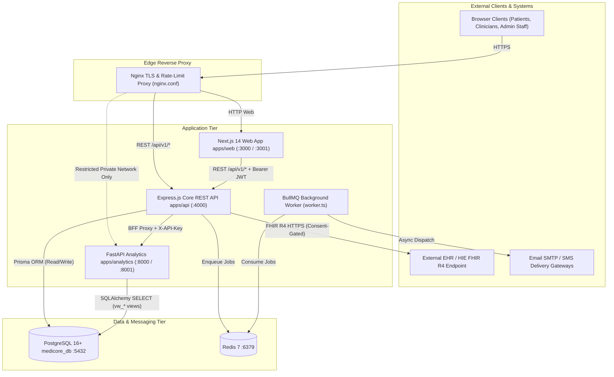
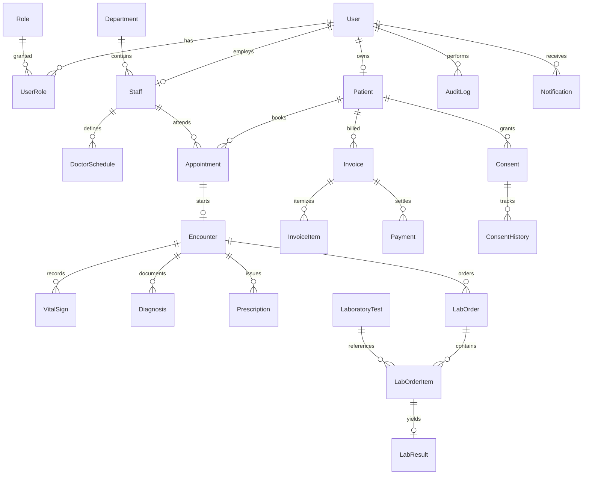
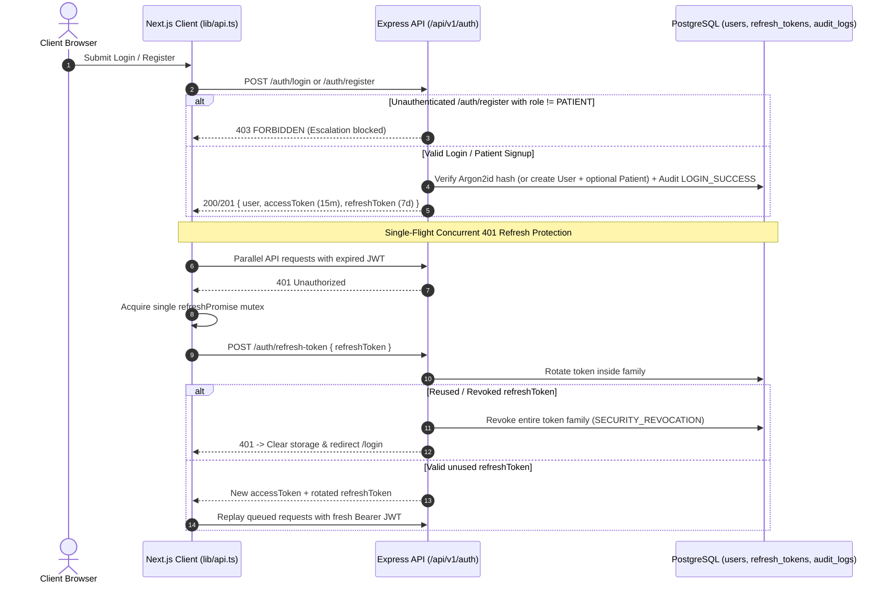
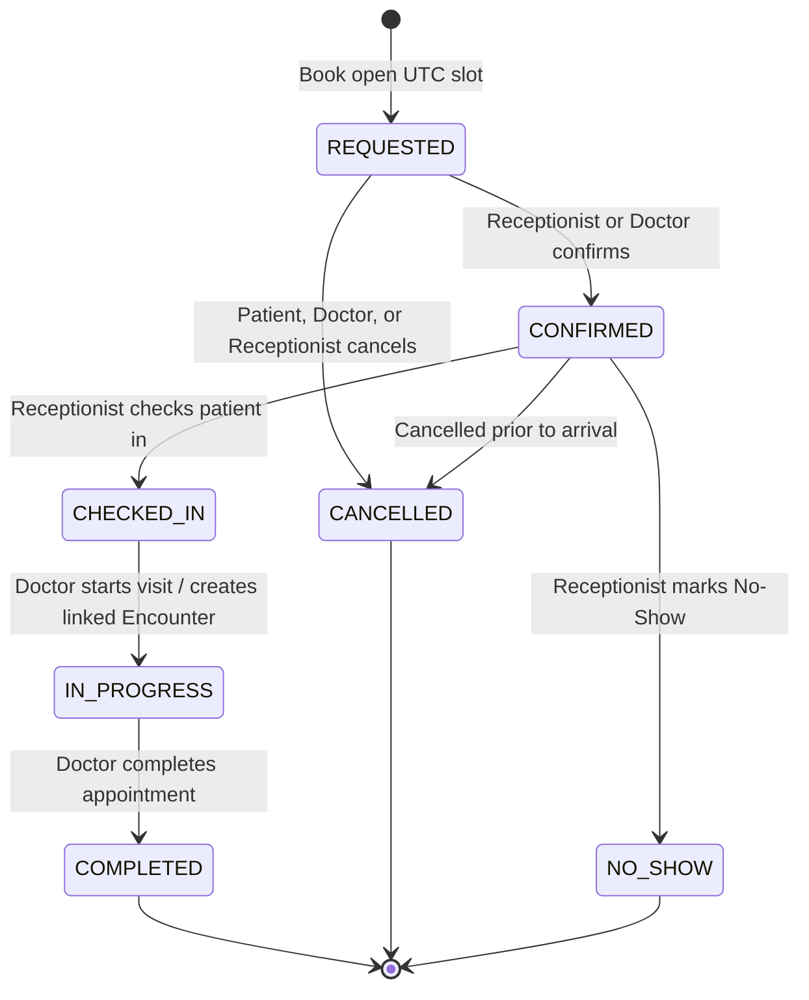
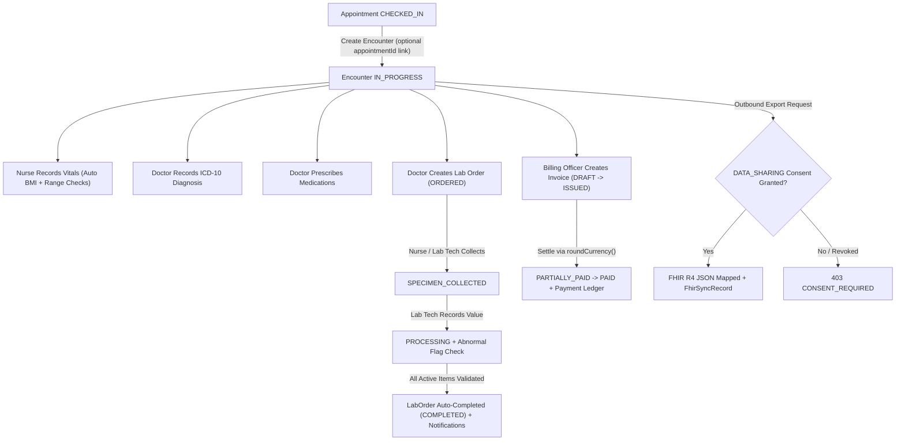

# MediCore — End-to-End Project & System Design Architecture

> **Document Scope:** Master single-source engineering blueprint covering the full MediCore repository—system topology, service boundaries, all 7 role-based web portals, all REST API modules, FastAPI analytics pipelines, 32-model PostgreSQL schema and triggers, security controls, end-to-end workflows, container infrastructure, CI/CD pipeline, and verification gates.  
> **Disclaimer:** MediCore is an educational healthcare engineering project using synthetic data only and does not claim medical, clinical, or regulatory certification.

---

## Table of Contents

1. [Executive Overview & Architectural Style](#1-executive-overview--architectural-style)
2. [Monorepo Structure & Layer Responsibilities](#2-monorepo-structure--layer-responsibilities)
3. [System Topology & Service Boundaries](#3-system-topology--service-boundaries)
4. [Presentation Tier Architecture (`apps/web`)](#4-presentation-tier-architecture-appsweb)
5. [Core Backend REST API Architecture (`apps/api`)](#5-core-backend-rest-api-architecture-appsapi)
6. [Analytics & Data Processing Microservice (`apps/analytics`)](#6-analytics--data-processing-microservice-appsanalytics)
7. [Relational Database Architecture (`PostgreSQL` & `Prisma`)](#7-relational-database-architecture-postgresql--prisma)
8. [End-to-End Workflows & State Machines](#8-end-to-end-workflows--state-machines)
9. [Security, Privacy & Compliance Architecture](#9-security-privacy--compliance-architecture)
10. [Infrastructure, Containers, CI/CD & Testing](#10-infrastructure-containers-cicd--testing)
11. [Current Baseline vs. Future Enterprise Hardening](#11-current-baseline-vs-future-enterprise-hardening)

---

## 1. Executive Overview & Architectural Style

**MediCore** is a full-stack Hospital, Appointment, and Patient Care Management Platform implemented as a polyglot **npm workspaces monorepo** uniting a TypeScript/React presentation tier (`apps/web`), a modular monolith Express.js transactional backend (`apps/api`), and a read-only Python FastAPI analytics microservice (`apps/analytics`), backed by **PostgreSQL** and **Redis**.

### Core Design Principles
- **Single Transactional Authority (`apps/api`):** Only the Node.js/Express API writes to operational clinical, financial, consent, and audit tables through Prisma transactions.
- **Strictly Decoupled Presentation (`apps/web`):** The Next.js App Router frontend has zero direct database or Redis connections and interacts exclusively over HTTP/JSON via JWT bearer tokens.
- **Isolated Read-Only Analytics (`apps/analytics`):** Aggregations, statistical calculations, and CSV/JSON batch validation run in Python (`Pandas` + `NumPy`) behind an internal `X-API-Key` gate and Express BFF proxy (`/api/v1/analytics/:metric`).
- **Database-Enforced Invariants:** Critical safety rules—overlap-free doctor scheduling (`btree_gist` exclusion constraint), non-negative financial totals (`CHECK`), and immutable audit history (`BEFORE UPDATE OR DELETE` trigger)—are enforced inside PostgreSQL itself, not solely in application memory.
- **Fail-Closed Security & Privacy:** Argon2id password hashing, JWT access + rotating refresh tokens with reuse-family revocation, strict RBAC, patient/provider anti-IDOR guards, clinical field redaction for non-clinical roles, and consent gates on external FHIR exports.

---

## 2. Monorepo Structure & Layer Responsibilities

```text
Medicore/
├── apps/
│   ├── web/                          # Next.js 14 App Router UI (:3000 dev default / :3001 local)
│   │   ├── app/                      # Route groups for auth + 7 role portals (42 pages total)
│   │   ├── components/
│   │   │   ├── features/             # Domain portal views (Admin, Clinical, Doctor/Nurse, Ops, Patient)
│   │   │   ├── layouts/              # DashboardLayout (RBAC route guard, query-cache wipe, notifications)
│   │   │   └── ui/                   # Reusable primitives, Toaster & ToastProvider
│   │   ├── hooks/                    # TanStack Query v5 hooks (useMedicore.ts)
│   │   ├── lib/                      # Axios JWT interceptor, single-flight refresh, helpers
│   │   ├── services/                 # Typed REST client methods (medicoreService)
│   │   └── tests/                    # Vitest + RTL tests & Playwright E2E spec
│   ├── api/                          # Express.js + TypeScript modular monolith (:4000)
│   │   ├── prisma/                   # 32-model schema.prisma, SQL migrations (0001, 0002), seed.ts
│   │   ├── src/
│   │   │   ├── config/               # Zod env auto-loader, Prisma client, Swagger OpenAPI 3.0
│   │   │   ├── middleware/           # auth, audit, validate (Zod), requestId, errorHandler, 404
│   │   │   ├── integrations/         # FHIR R4 client (retry + timeout), sandbox email/SMS clients
│   │   │   ├── jobs/                 # BullMQ queues & worker definitions
│   │   │   └── modules/              # 15 domain/proxy module directories (19 mounted routers)
│   │   └── tests/                    # Supertest full-stack suite (in-memory double) + live PG test suite
│   └── analytics/                    # FastAPI + Pandas + NumPy microservice (:8000 / :8001 local)
│       ├── app/
│       │   ├── api/v1/               # Utilization, wait times, lab turnaround, population & processing
│       │   ├── middleware/           # Constant-time X-API-Key guard
│       │   ├── repositories/         # Read-only SQLAlchemy queries on PostgreSQL vw_* views
│       │   ├── schemas/              # Pydantic v2 request/response models
│       │   └── services/             # Analytics aggregation + synthetic operational fallback
│       ├── datasets/                 # Sample JSON payloads for throughput benchmarks
│       └── tests/                    # Pytest + HTTPX ASGITransport tests (Ruff clean)
├── packages/                         # Shared contract packages (shared-types, api-contracts, shared-config)
├── database/                         # Canonical synced schema copy, SQL migrations, SCHEMA_OVERVIEW.md
├── infrastructure/
│   ├── docker/                       # Multi-stage non-root Dockerfiles (api, web, analytics, worker)
│   ├── nginx/                        # TLS/proxy reverse proxy with restricted /analytics/ access
│   ├── monitoring/                   # Prometheus scrape configuration
│   └── scripts/                      # PostgreSQL backup-db.sh & restore-db.sh
├── docs/                             # Detailed architecture, DB, API, security, testing, CI/CD & roadmap docs
├── postman/                          # Importable Postman collection (MediCore.postman_collection.json)
├── docker-compose.yml                # 6-service stack (postgres, redis, api, web, analytics, worker)
└── .github/workflows/ci.yml          # GitHub Actions CI/CD pipeline (8 jobs)
```

---

## 3. System Topology & Service Boundaries



### Runtime Service & Port Matrix

| Component | Entry Point | Default Compose Port | Local Override Example | Database / Queue Access |
| :--- | :--- | :---: | :---: | :--- |
| **Web Frontend** | `apps/web` (`next dev` / Next standalone server) | `3000` | `3001` | None (HTTP -> Express API only) |
| **Core REST API** | `apps/api/dist/server.js` (`createApp()`) | `4000` | `4000` | PostgreSQL (R/W via Prisma), Redis (`ioredis`/`bullmq`) |
| **Analytics Service** | `apps/analytics` (`uvicorn app.main:app`) | `8000` | `8001` | PostgreSQL read views (`vw_*`) + synthetic fallback |
| **Background Worker** | `apps/api/src/jobs/worker.ts` | — | Co-fallback inline in API when Redis absent | Redis (`bullmq`), PostgreSQL updates |
| **PostgreSQL** | `postgres:16-alpine` (or local PG 16/18) | `5432` | `5432` | Persistent volume `postgres_data` |
| **Redis** | `redis:7-alpine` | `6379` | `6379` | Persistent volume `redis_data` |

---

## 4. Presentation Tier Architecture (`apps/web`)

Built with **Next.js 14 (App Router)**, **React 18**, **TypeScript**, **Tailwind CSS**, **TanStack Query v5**, and **Recharts**.

### 4.1 Global Providers, Networking & Session Safety
- **App Wrapper ([providers.tsx](../apps/web/app/providers.tsx) & [toaster.tsx](../apps/web/components/ui/toaster.tsx)):** Wraps all pages in `QueryClientProvider` (`staleTime: 5m`, `retry: 1`) and `ToastProvider` so `useToast()` renders feedback notifications across any component tree.
- **Axios Client & Token Refresh Deduplication ([api.ts](../apps/web/lib/api.ts)):**
  - Automatically injects `Authorization: Bearer <accessToken>` from `localStorage`.
  - Uses a single-flight `refreshPromise` mutex when concurrent API calls receive `401` so only **one** `POST /auth/refresh-token` executes at a time, avoiding false refresh-token reuse revocation races.
  - Exposes shared UI/API utilities used uniformly across portals:
    - `buildAppointmentIdempotencyKey()` — builds deterministic/per-attempt keys strictly `<= 100` chars matching backend Zod validation (`min(1).max(100)`) while supporting cancel-and-rebook on previously cancelled slots.
    - `getApiErrorMessage()` — surfaces backend Zod `error.details[].message` alongside the top-level message.
    - `roundCurrency()` — prevents IEEE-754 floating-point subtraction overshoot on partial/full invoice settlement.
    - `buildVitalSignsPayload()` — omits blank numeric strings instead of sending `Number('') === 0`.
- **RBAC Layout Guard & Cache Isolation ([DashboardLayout.tsx](../apps/web/components/layouts/DashboardLayout.tsx)):**
  - Validates the stored user role against the active route group layout; mismatches or sign-outs immediately invoke `qc.clear()` before redirecting to `/login`, preventing cross-user React Query cache leakage.
  - Gates notification inbox queries behind `Boolean(user)` and supports click-to-mark-read and mark-all-read.

### 4.2 Complete Route & Role Portal Inventory (42 Pages)

| Role (`roles[]`) | Portal Route Group | App Router Pages Implemented | Primary UI Feature Modules |
| :--- | :--- | :--- | :--- |
| **Public / Auth** | `(auth)` + root | `/`, `/login`, `/register` (auto-creates linked Patient profile via DOB + gender) | Auth forms + demo credential quick-reference |
| **`PATIENT`** | `(patient)/patient/*` | `dashboard`, `appointments`, `records`, `prescriptions`, `lab-results`, `billing`, `profile` | [PatientPortalViews.tsx](../apps/web/components/features/PatientPortalViews.tsx) (inline self-onboarding fallback if profile absent, UTC slot booking modal, cancel, records/consents) |
| **`DOCTOR`** | `(doctor)/doctor/*` | `dashboard`, `appointments`, `patients`, `encounters`, `prescriptions`, `lab-orders`, `schedule` | [ClinicalViews.tsx](../apps/web/components/features/ClinicalViews.tsx), [DoctorSubViews.tsx](../apps/web/components/features/DoctorSubViews.tsx) |
| **`NURSE`** | `(nurse)/nurse/*` | `dashboard`, `patients`, `vitals`, `tasks` | [ClinicalViews.tsx](../apps/web/components/features/ClinicalViews.tsx), [DoctorSubViews.tsx](../apps/web/components/features/DoctorSubViews.tsx) |
| **`RECEPTIONIST`** | `(receptionist)/receptionist/*` | `dashboard`, `patients`, `appointments`, `check-in`, `waiting` | [OperationsViews.tsx](../apps/web/components/features/OperationsViews.tsx), [OperationsSubViews.tsx](../apps/web/components/features/OperationsSubViews.tsx), [AdminSubViews.tsx](../apps/web/components/features/AdminSubViews.tsx) |
| **`LAB_TECHNICIAN`** | `(laboratory)/laboratory/*` | `dashboard`, `orders`, `specimens`, `results`, `validation` | [OperationsViews.tsx](../apps/web/components/features/OperationsViews.tsx), [OperationsSubViews.tsx](../apps/web/components/features/OperationsSubViews.tsx) |
| **`BILLING_OFFICER`** | `(billing)/billing/*` | `dashboard`, `invoices`, `payments`, `reports` | [OperationsViews.tsx](../apps/web/components/features/OperationsViews.tsx), [OperationsSubViews.tsx](../apps/web/components/features/OperationsSubViews.tsx) |
| **`HOSPITAL_ADMIN`** | `(admin)/admin/*` | `dashboard`, `users`, `staff`, `departments`, `audit`, `analytics`, `settings` | [OperationsViews.tsx](../apps/web/components/features/OperationsViews.tsx), [AdminSubViews.tsx](../apps/web/components/features/AdminSubViews.tsx) |

---

## 5. Core Backend REST API Architecture (`apps/api`)

### 5.1 Request Pipeline & Middleware Stack ([app.ts](../apps/api/src/app.ts))
Every HTTP request passes through an ordered Express pipeline:
1. **`helmet` Security Headers:** Restricts default/script/image sources and configures CORS resource policy.
2. **Multi-Origin `cors`:** Supports comma-separated origins from `CORS_ORIGIN` (`http://localhost:3000,http://localhost:3001`), credentials, `Authorization`, `X-Request-ID`, `X-Idempotency-Key`, and `Idempotency-Key`.
3. **Unthrottled Probe Routes:** `/health`, `/ready`, `/api/v1/health`, and `/api/v1/ready` are registered *before* rate limiting so orchestration probes never hit `429`. `/ready` executes `SELECT 1` via Prisma and returns `503` if PostgreSQL is down.
4. **Global Rate Limiter:** `express-rate-limit` (`RATE_LIMIT_WINDOW_MS`, `RATE_LIMIT_MAX_REQUESTS`) returning standardized `{ success: false, error: { code: 'RATE_LIMIT_EXCEEDED' } }`.
5. **Parsing, Compression & Tracing:** `express.json`/`urlencoded` (`10mb`), `cookieParser`, `compression`, UUID `requestIdMiddleware`, and `morgan` piped to `pino` structured logs with automatic redaction (`authorization`, `cookie`, `password`, `passwordHash`, `token`, `refreshToken`, `ssn`, `nationalId`, `medicalNotes`, `clinicalNotes`, `allergies`).
6. **Swagger/OpenAPI Documentation:** Live Swagger UI at `/api-docs` and raw OpenAPI 3.0 JSON at `/api-docs.json` ([swagger.ts](../apps/api/src/config/swagger.ts)).
7. **Central Error Handling ([errorHandler.ts](../apps/api/src/middleware/errorHandler.ts)):** Maps Zod errors (`400`), custom `AppError` subclasses (`401`, `403`, `404`, `409`, `422`, `503`, `504`), and unexpected errors (`500`) into clean JSON envelopes without leaking stack traces or DB connection errors.

### 5.2 Environment Configuration ([environment.ts](../apps/api/src/config/environment.ts))
- Automatically loads `apps/api/.env` for unset keys when `NODE_ENV !== 'test'` (allowing direct runs via `node dist/server.js` or `tsx watch` without requiring manual `--env-file` flags).
- Validates variables through Zod at startup; in `NODE_ENV=production`, aborts startup via `process.exit(1)` if secrets or `ANALYTICS_API_KEY` are missing or left on placeholder defaults.

### 5.3 Mounted Modules & Endpoints (`/api/v1/*`)

Every module follows clean separation: **`*.routes.ts` -> `authenticate` / `authorize` / `validate(Zod)` -> `*.controller.ts` -> `*.service.ts` -> Prisma ORM & Audit**.

| Mount Prefix | Route Module | Core Capabilities & Notable Endpoints |
| :--- | :--- | :--- |
| `/api/v1/auth` | `auth.routes.ts` | Register (patient self-signup + optional auto `Patient` profile; blocks non-`PATIENT` escalation unless `HOSPITAL_ADMIN`), login, refresh-token rotation + reuse detection, logout, `/profile`, `/change-password` |
| `/api/v1/users` | `user.routes.ts` | Admin user directory, get/update user profile, deactivate account (`409` on self-deactivation) |
| `/api/v1/patients` | `patient.routes.ts` | Register patient (`MED-XXXXXX` + duplicate name/DOB detection + patient self-create), `/me`, `/search`, paginated list (`BILLING_OFFICER` included with PHI redacted), update profile |
| `/api/v1/staff` | `staff.routes.ts` | Admin staff onboarding, list staff, `/doctors` directory (`HOSPITAL_ADMIN`, `RECEPTIONIST`, `PATIENT`, `DOCTOR`, `NURSE`), filter by department |
| `/api/v1/departments` | `department.routes.ts` | CRUD for clinical departments and capacity metadata |
| `/api/v1/appointments` | `appointment.routes.ts` | `GET /available-slots`, conflict-free booking (`Serializable` tx + DB exclusion constraint + `idempotencyKey`), transitions (`/confirm`, `/check-in`, `/start`, `/complete`, `/cancel`, `/no-show`, `/reschedule`) |
| `/api/v1/encounters` | `encounter.routes.ts` | Outpatient/emergency/inpatient encounter creation (optional appointment link), summary list with `vitalSigns`, detailed chart read, vital signs capture (auto BMI calculation), completion |
| `/api/v1/diagnoses` | `diagnosis.routes.ts` | ICD-10 diagnosis recording, queries by encounter or patient |
| `/api/v1/prescriptions` | `prescription.routes.ts` | Medication catalog lookup (`/medications`), prescription creation, fulfillment status updates |
| `/api/v1/laboratories` | `laboratory.routes.ts` | Laboratory test catalog management (units, reference min/max, turnaround targets) |
| `/api/v1/lab-orders` | `labOrder.routes.ts` | Order creation (`DOCTOR`, etc.), specimen collection (`/collect` by `LAB_TECHNICIAN`/`NURSE`), item status update, result submission (`/:id/results` verifying order-to-patient chain) |
| `/api/v1/lab-results` | `labResult.routes.ts` | Validated query listing (UUID `patientId` validated), result lookup, result validation (`PATCH /:resultId/validate` auto-completing `LabOrder` when all active items are validated) |
| `/api/v1/billing`, `/api/v1/invoices` | `billing.routes.ts` | Draft invoice generation, line items/tax/discounts, patient summary (`/patient/:patientId`), issue & cancel actions |
| `/api/v1/payments` | `payment.routes.ts` | Payment ledger (`GET /`), per-invoice breakdown (`/invoice/:invoiceId`), settlement (`POST /` preventing overpayment via `roundCurrency`) |
| `/api/v1/consents` | `consent.routes.ts` | Patient consent grant (`TREATMENT`, `DATA_SHARING`, `RESEARCH`, `COMMUNICATION`), revocation (`/revoke`), immutable consent history |
| `/api/v1/audit-logs` | `audit.routes.ts` | `HOSPITAL_ADMIN` audit log viewer with resource/action/actor/outcome filtering |
| `/api/v1/notifications` | `notification.routes.ts` | Notification inbox, unread count (`/unread-count`), mark-read & read-all lifecycle |
| `/api/v1/fhir` | `fhir.routes.ts` | HL7 FHIR R4 export (`Patient`, `Appointment`, `Encounter`, `Observation` gated by `DATA_SHARING` consent), validated `POST /Patient/import`, sync records |
| `/api/v1/analytics` | `analytics.routes.ts` | `HOSPITAL_ADMIN` BFF proxy forwarding `appointment-utilization`, `waiting-times`, `lab-turnaround`, and `patient-population` to FastAPI with server-side `X-API-Key` + `AUDIT` log |

---

## 6. Analytics & Data Processing Microservice (`apps/analytics`)

Built with **Python 3.12+**, **FastAPI**, **Pydantic v2**, **Pandas**, **NumPy**, **SQLAlchemy**, and **structlog**.

- **Authentication & Boundary ([auth.py](../apps/analytics/app/middleware/auth.py)):** Every `/api/v1/analytics/*` endpoint requires `X-API-Key`, checked via constant-time `hmac.compare_digest` (`401` if missing, `403` if invalid). Never accepts end-user browser JWTs directly.
- **Health & Readiness ([main.py](../apps/analytics/app/main.py)):** `/health` confirms process availability; `/ready` probes PostgreSQL connectivity via `AnalyticsRepository().check_connection()` and reports `"database": "UP" | "SYNTHETIC_FALLBACK"`.
- **SQL View Queries & Synthetic Fallback ([analytics_repo.py](../apps/analytics/app/repositories/analytics_repo.py), [analytics_service.py](../apps/analytics/app/services/analytics_service.py)):**
  - `GET /api/v1/analytics/appointment-utilization` — queries `vw_appointment_utilization` (or filtered `appointments` join when `doctor_id` is given) by `date_from`, `date_to`, `department_id`, `doctor_id`; aggregates `by_department`, `by_day_of_week`, `by_type` with `data_source="database"`, falling back to synthetic metrics when no DB rows/driver exist.
  - `GET /api/v1/analytics/waiting-times` — queries `vw_waiting_times` filtered by `date_from`, `date_to`, `department_id`, computing mean/median/min/max/p90 across department, weekday, and check-in hour.
  - `GET /api/v1/analytics/lab-turnaround` — queries `vw_lab_turnaround` filtered by `category` and `priority`, computing target compliance and abnormal result rate.
  - `GET /api/v1/analytics/patient-population` — returns synthetic population demographics (non-diagnostic).
- **Batch Validation & Benchmarks (`data_processing.py` & `processing_service.py`):**
  - `POST /api/v1/analytics/process-lab-data` — validates lab units, reference min/max consistency, outlier bounds, missing values, and collection vs result chronology.
  - `POST /api/v1/analytics/process-appointment-data` — validates duration bounds, status enums, early check-ins, and intra-doctor schedule overlaps.
  - `POST /api/v1/analytics/data-quality` — returns completeness/consistency/recommendation metrics.

---

## 7. Relational Database Architecture (`PostgreSQL` & `Prisma`)

Defined canonically in [schema.prisma](../apps/api/prisma/schema.prisma) (synced identically under [database/schemas/schema.prisma](../database/schemas/schema.prisma)) with **32 Prisma models** and two versioned SQL migrations (`20261126000001_init` and `20261126000002_appointment_exclusion_and_views`).

### 7.1 Domain Schema Map (32 Models)

| Domain | Prisma Models | Key Constraints & Relations |
| :--- | :--- | :--- |
| **Auth & RBAC (6)** | `User`, `Role`, `Permission`, `UserRole`, `RolePermission`, `RefreshToken` | Unique `email`, Argon2id `passwordHash`, `RefreshToken.family` for replay-family revocation |
| **Patients (2)** | `Patient`, `PatientContact` | Unique `userId`, unique `registrationNumber` (`MED-XXXXXX`), primary/emergency contacts |
| **Organization (3)** | `Department`, `Staff`, `DoctorSchedule` | Unique department `code`, unique staff `employeeId` & `userId`, recurring weekly `dayOfWeek` blocks (`startTime`–`endTime`, `slotDuration`) |
| **Clinical Care (4)** | `Appointment`, `Encounter`, `VitalSign`, `Diagnosis` | Exclusion overlap constraint on doctor/time; optional 1:1 `Appointment` to `Encounter`; BMI computed in vitals service |
| **Pharmacy (3)** | `MedicationCatalog`, `Prescription`, `PrescriptionItem` | Encounter- and patient-linked prescriptions with medication catalog dosage/duration items |
| **Laboratory (4)** | `LaboratoryTest`, `LabOrder`, `LabOrderItem`, `LabResult` | Unique test `code`, 1:1 `LabOrderItem` to `LabResult`, abnormal flag calculation + `validatedBy`/`validatedAt` |
| **Billing (3)** | `Invoice`, `InvoiceItem`, `Payment` | Unique `invoiceNumber`, non-negative `CHECK` on monetary fields, partial/full payment settlement |
| **Governance & Async (7)** | `Consent`, `ConsentHistory`, `AuditLog`, `Notification`, `NotificationJob`, `FhirSyncRecord`, `IdempotencyRecord` | Consent revocation audit trail, append-only `audit_logs`, deduplicated notification jobs, FHIR sync states |

### 7.2 Core Entity-Relationship Diagram



### 7.3 Migration `0002` PostgreSQL Engine Guarantees
Implemented in [20261126000002_appointment_exclusion_and_views/migration.sql](../apps/api/prisma/migrations/20261126000002_appointment_exclusion_and_views/migration.sql):
1. **Extension:** `CREATE EXTENSION IF NOT EXISTS btree_gist;`
2. **Overlap Exclusion Constraint (`appointments_no_doctor_overlap`):** `EXCLUDE USING gist ("doctor_id" WITH =, tstzrange("scheduled_start", "scheduled_end", '[)') WITH &&) WHERE ("status" IN ('REQUESTED', 'CONFIRMED', 'CHECKED_IN', 'IN_PROGRESS'))` — triggers PostgreSQL SQLSTATE `23P01` if concurrent bookings collide.
3. **Integrity Checks:** `appointments_valid_time_range` (`"scheduled_end" > "scheduled_start"`) and `invoices_non_negative_amounts`.
4. **Immutable Audit Trigger:** `audit_logs_immutable_update` (`BEFORE UPDATE OR DELETE ON "audit_logs"`) executing `prevent_audit_log_mutation()` to reject any tampering with audit history.
5. **Read-Only Analytical Views:** `vw_appointment_utilization`, `vw_waiting_times`, and `vw_lab_turnaround`.

---

## 8. End-to-End Workflows & State Machines

### 8.1 Authentication & Refresh Token Family Revocation



### 8.2 Appointment Workflow State Machine & Slot Booking



- **Slot Discovery (`GET /api/v1/appointments/available-slots`):** Computes conflict-free UTC intervals (`{ startTime, endTime, durationMinutes }`) from `DoctorSchedule` subtracting active appointments (`REQUESTED`, `CONFIRMED`, `CHECKED_IN`, `IN_PROGRESS`, `COMPLETED`). Cancelled and `NO_SHOW` appointments automatically free their slots.
- **Double-Booking Defense:** Uses compact `<= 100`-char `idempotencyKey` (`book-<patient8>-<doctor8>-<slot>-<nonce>`), Prisma `Serializable` transactions, and PostgreSQL's `appointments_no_doctor_overlap` GiST index to map concurrency collisions to `409 Conflict`.

### 8.3 Clinical Encounter, Lab Order Completion, Billing & FHIR Data Flow



---

## 9. Security, Privacy & Compliance Architecture

| Layer / Control | Enforcement Details | Source Reference |
| :--- | :--- | :--- |
| **Password Security** | Argon2id (`memoryCost: 65536`, `timeCost: 3`, `parallelism: 4`) + complexity Zod schema | [auth.service.ts](../apps/api/src/modules/auth/auth.service.ts), [auth.schemas.ts](../apps/api/src/modules/auth/auth.schemas.ts) |
| **Role Hardening & RBAC** | 7 canonical roles; `POST /auth/register` rejects non-`PATIENT` self-signup with `403`; declarative `authorize(...)` on all protected routers | [auth.ts](../apps/api/src/middleware/auth.ts), [auth.service.ts](../apps/api/src/modules/auth/auth.service.ts) |
| **Anti-IDOR & Ownership** | Patients can only view/create/book/revoke their own records; cross-patient reads throw `403` and record `DENIED` audit events | [patient.controller.ts](../apps/api/src/modules/patients/patient.controller.ts), [consent.service.ts](../apps/api/src/modules/consent/consent.service.ts) |
| **PHI Masking & Field Guards** | `medicalNotes` & `allergies` stripped for `RECEPTIONIST`, `BILLING_OFFICER`, `LAB_TECHNICIAN`, `HOSPITAL_ADMIN`, and only editable by `DOCTOR`/`NURSE` | [patient.controller.ts](../apps/api/src/modules/patients/patient.controller.ts), [patient.service.ts](../apps/api/src/modules/patients/patient.service.ts) |
| **Consent Enforcement** | Outbound HL7 FHIR R4 export requires active `DATA_SHARING` consent (`403 CONSENT_REQUIRED` otherwise) | [fhir.routes.ts](../apps/api/src/modules/fhir/fhir.routes.ts) |
| **Log Sanitization** | Pino `redact` scrubs auth headers, cookies, passwords, tokens, `ssn`, `nationalId`, `medicalNotes`, `clinicalNotes`, `allergies` | [logger.ts](../apps/api/src/utils/logger.ts) |
| **Analytics Isolation** | Express BFF enforces `HOSPITAL_ADMIN` JWT + audit log; FastAPI validates internal `X-API-Key` via constant-time `hmac.compare_digest`; Nginx blocks public `/analytics/` | [analytics.routes.ts](../apps/api/src/modules/analytics/analytics.routes.ts), [auth.py](../apps/analytics/app/middleware/auth.py), [nginx.conf](../infrastructure/nginx/nginx.conf) |
| **Error Non-Leakage** | Global error handler suppresses stack traces and database connection errors (`500 INTERNAL_ERROR`) | [errorHandler.ts](../apps/api/src/middleware/errorHandler.ts) |

---

## 10. Infrastructure, Containers, CI/CD & Testing

### 10.1 Container & Deployment Architecture
- **`docker-compose.yml`:** Orchestrates 6 networked containers (`postgres:16-alpine`, `redis:7-alpine`, `api`, `web`, `analytics`, `worker`) on `medicore-network` with named volumes (`postgres_data`, `redis_data`) and health-checked startup ordering (`service_healthy`).
- **Dockerfiles (`infrastructure/docker/`):** Multi-stage builds using non-root OS users (`Dockerfile.api`, `Dockerfile.web`, `Dockerfile.analytics`, `Dockerfile.worker`).
- **Nginx & Ops Scripts (`infrastructure/`):** [nginx.conf](../infrastructure/nginx/nginx.conf) handles HTTPS TLS termination, API rate limits (`api_limit`), reverse routing to web/API/Swagger, and private-CIDR allowlisting on `/analytics/`. `backup-db.sh` and `restore-db.sh` provide `pg_dump`/`psql` recovery workflows.

### 10.2 GitHub Actions CI/CD Pipeline ([ci.yml](../.github/workflows/ci.yml))
Triggered on push (`main`, `develop`), PRs (`main`), and manual `workflow_dispatch`:
1. **`backend`:** Ephemeral Postgres 16 + Redis 7 services -> `prisma generate` -> `typecheck` -> `eslint` -> `prisma migrate deploy` -> `db:seed` -> `vitest run` (executes both mocked Supertest scenarios and live PostgreSQL exclusion/trigger tests via `TEST_DATABASE_URL`).
2. **`frontend`:** `tsc --noEmit` -> `next lint` -> `next build` -> `vitest run`.
3. **`analytics`:** `ruff check .` (strict, zero errors) -> `mypy` -> `python -m pytest`.
4. **`security`:** Dependency audit (`npm audit`) + static scan for accidental hardcoded passwords/secrets.
5. **`docker`:** Builds `Dockerfile.api`, `Dockerfile.web`, and `Dockerfile.analytics` container images after code/test gates pass.
6. **`migration-check`:** Validates clean `prisma migrate deploy` and `prisma validate` against fresh Postgres 16.
7. **`deploy-staging` & `deploy-production`:** Staging deployment step + manual `workflow_dispatch`-gated Production approval job.

### 10.3 Automated Test Coverage Summary
- **Backend (`apps/api/tests/`):**
  - `medicore.api.test.ts` — **11 test blocks** exercising security & clinical workflow scenarios over Supertest (auth lifecycle, duplicate registration, RBAC/IDOR/masking, concurrent slot contention, state-machine `422` guards, prescription/lab association & auto-completion, FHIR timeout/retry & consent blocking, notification idempotency, DB outage `/ready` `503`, Analytics BFF proxy).
  - `pg/postgres.live.test.ts` — **3 live SQL tests** asserting `btree_gist`, `appointments_no_doctor_overlap` (`23P01`), check constraints, immutable `audit_logs` trigger, and analytical `vw_*` views against real PostgreSQL.
- **Frontend (`apps/web/tests/`):**
  - `frontend.test.tsx` — **6 Vitest + React Testing Library tests** verifying UI primitives, login error flow, `DashboardLayout` role guard, `PatientDashboardView`, idempotency key/error/currency/vitals helpers, and `ToastProvider`.
  - `e2e/dashboards.spec.ts` — Playwright E2E spec skeleton (`/` & `/login`).
- **Analytics (`apps/analytics/tests/`):**
  - `test_analytics.py` — **16 Pytest + HTTPX tests** verifying health/readiness, `X-API-Key` `401`/`403` enforcement, all 4 analytics routes, both DB-view aggregation & synthetic fallback paths, batch data-processing validation, conflict detection, and 1,000-record throughput benchmark (`< 2s`).

---

## 11. Current Baseline vs. Future Enterprise Hardening

For transparent engineering governance, the following enterprise capabilities are documented across the design specifications (`SYSTEM_DESIGN.md`, `DATABASE_DESIGN.md`, `SECURITY_DESIGN.md`) and remain intentionally deferred beyond the current synthetic educational baseline:

- **Token & Session Upgrades:** Move refresh tokens from opaque DB strings to SHA-256 hashes + `HttpOnly; SameSite=Strict; Secure` cookies, add Redis JWT `jti` blocklisting for immediate logout revocation, and wire `forgot-password` / `reset-password` endpoints (Zod schemas already defined in `auth.schemas.ts`).
- **Database Role & Schema Hardening:** Provision separate PostgreSQL roles (`medicore_user` vs `SELECT`-only `medicore_readonly`) in SQL migrations for `analytics` containers, add an immutability trigger on `consent_history`, migrate monetary values from `Float` to exact `DECIMAL`/integer cents if multi-currency settlement expands, and introduce `clinical_rooms` / normalized `patient_allergies` tables as needed.
- **Worker & Observability Expansion:** Wire `fhir-sync` and `appointment-reminders` queues actively into domain producers (notifications currently queue/fall back inline), expose Prometheus `/metrics` endpoints matching `prometheus.yml`, add Redis-backed tiered rate limiters per route sensitivity, expand Playwright E2E coverage across all 7 logged-in portals, and share `packages/*` contracts across `apps/api` and `apps/web`.
