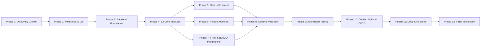

# MediCore Hospital Management Platform — Implementation Roadmap

> **Document Role:** Principal Software Architecture & Delivery Plan  
> **Platform:** MediCore — Hospital, Appointment & Patient Care Management Platform  
> **Version:** 1.0.0  
> **Status:** Active Execution (Phase 1 Completed; Phases 2–12 Planned)  
> **Repository Structure:** Monorepo (`apps/web`, `apps/api`, `apps/analytics`, `packages/*`, `database/`, `infrastructure/`, `docs/`, `postman/`)

---

## Executive Summary

This document defines the authoritative **12-phase implementation roadmap** for the **MediCore Hospital Management Platform**. MediCore is engineered as a modular, security-first, multi-service monorepo combining:

- **Web Client (`apps/web`):** Next.js (App Router, TypeScript), Tailwind CSS, shadcn/ui, TanStack Query, React Hook Form + Zod, and 7 role-specific clinical/operational dashboards.
- **Core Backend API (`apps/api`):** Express.js + TypeScript (`@medicore/api`), Prisma ORM + PostgreSQL, Argon2 password hashing, JWT access/refresh token rotation, RBAC enforcement, Zod validation, Swagger/OpenAPI, Pino structured logging, and 13 clean-architecture domain modules.
- **Analytics Service (`apps/analytics`):** Python FastAPI microservice with Pydantic validation, Pandas data pipelines, read-only PostgreSQL isolation, and 7 clinical/operational analytics endpoints.
- **Async & Interoperability Layer:** Redis + BullMQ background workers, FHIR R4 mock integration, and Email/SMS sandbox notifications with idempotency, exponential backoff retries, and strict timeouts.
- **Infrastructure & Quality:** Multi-stage non-root Docker images, Docker Compose orchestration, Nginx reverse proxy, GitHub Actions CI/CD, and full-pyramid automated testing (Vitest, Supertest, React Testing Library, Pytest + HTTPX, Playwright).

---

## High-Level Architecture & Phase Flow

---

## Master Phase Summary

| Phase | Name | Status | Complexity | Primary Dependencies | Mapped Assessments |
| :--- | :--- | :--- | :--- | :--- | :--- |
| **Phase 1** | Repository Discovery | **COMPLETED** | Low | None (Greenfield) | A01, A15 |
| **Phase 2** | Architecture and Database | Pending | High | Phase 1 | A01, A02 |
| **Phase 3** | Backend Foundation | Pending | High | Phase 2 | A03, A04, A05 |
| **Phase 4** | Core Business Modules | Pending | Very High | Phase 2, Phase 3 | A05, A06, A07, A08, A11 |
| **Phase 5** | Frontend Development | Pending | High | Phase 3, Phase 4 | A05, A09 |
| **Phase 6** | Python Analytics | Pending | Medium | Phase 2, Phase 4 | A10, A13 |
| **Phase 7** | Integrations | Pending | High | Phase 3, Phase 4 | A11, A12 |
| **Phase 8** | Security Validation | Pending | High | Phase 4, Phase 5, Phase 7 | A04, A05, A07, A08, A13 |
| **Phase 9** | Automated Testing | Pending | High | Phase 4, Phase 5, Phase 6, Phase 7, Phase 8 | A06, A08, A09, A10, A12, A13 |
| **Phase 10** | Infrastructure | Pending | Medium-High | Phase 3, Phase 5, Phase 6, Phase 7 | A14 |
| **Phase 11** | Documentation | Pending | Medium | Phase 2–10 | A01, A15 |
| **Phase 12** | Final Verification | Pending | High | Phases 1–11 | A01–A15 (All 15) |

---

## Assessment Framework (15 Core Assessments)

All engineering deliverables across the 12 phases are evaluated against **15 formal assessments (A01–A15)** covering architecture, data integrity, security, clinical workflows, analytics, integrations, testing, DevOps, and documentation.

### Master Assessment-to-Phase Traceability Matrix

| Assessment ID | Assessment Title | Evaluation Focus | Primary Implementation Phase(s) | Verification Phase(s) |
| :--- | :--- | :--- | :--- | :--- |
| **A01** | Monorepo & Workspace Architecture | Workspace boundaries, shared packages (`shared-types`, `api-contracts`, `shared-config`), TypeScript strictness | Phase 1, Phase 2 | Phase 11, Phase 12 |
| **A02** | Relational Schema & Data Integrity | 32+ Prisma models, normalized FK relations, indexes, migrations, realistic seed data | Phase 2 | Phase 4, Phase 12 |
| **A03** | Backend Core & Observability | Express.js setup, Zod request validation, global error handler, Swagger/OpenAPI, health probes, Pino JSON logging | Phase 3 | Phase 9, Phase 12 |
| **A04** | Authentication & Token Lifecycle | Argon2id password hashing, JWT access (15m) + refresh (7d) tokens, rotation, revocation | Phase 3 | Phase 8, Phase 9, Phase 12 |
| **A05** | Role-Based Access Control (RBAC) | Least-privilege enforcement across 7 hospital roles on API routes and UI views | Phase 3, Phase 4, Phase 5 | Phase 8, Phase 12 |
| **A06** | Core Clinical & Operational Modules | Complete controller/service/repository/route/schema/test layers for all 13 business modules | Phase 4 | Phase 9, Phase 12 |
| **A07** | Patient Consent & Immutable Audit Trail | Explicit patient consent enforcement on clinical data access + tamper-evident audit logging | Phase 4 | Phase 8, Phase 12 |
| **A08** | Concurrency & IDOR Prevention | Row-level ownership checks (anti-IDOR) and transactional/locking guarantees against appointment double-booking | Phase 4 | Phase 8, Phase 9, Phase 12 |
| **A09** | Role-Specific Frontend Experience | Next.js App Router, Tailwind + shadcn/ui, 7 role dashboards, TanStack Query, RHF + Zod, responsive layout | Phase 5 | Phase 9, Phase 12 |
| **A10** | Clinical & Operational Analytics | FastAPI service, 7 Pydantic-validated Pandas endpoints, read-only DB isolation, API key auth | Phase 6 | Phase 9, Phase 12 |
| **A11** | Healthcare Interoperability (FHIR R4) | Bi-directional FHIR R4 resource mapping and mock FHIR server integration | Phase 4, Phase 7 | Phase 9, Phase 12 |
| **A12** | Async Workers & Resilience | Redis + BullMQ queues, Email/SMS sandbox delivery, retry/backoff, timeouts, idempotency keys | Phase 7 | Phase 9, Phase 12 |
| **A13** | Automated Test Pyramid Coverage | Unit, integration, contract, security, and E2E suites (Vitest, Supertest, RTL, Pytest/HTTPX, Playwright) | Phase 4, Phase 6, Phase 8, Phase 9 | Phase 10, Phase 12 |
| **A14** | Containerization, Proxy & CI/CD | Non-root Dockerfiles with `HEALTHCHECK`, full Docker Compose stack, Nginx reverse proxy, GitHub Actions | Phase 10 | Phase 12 |
| **A15** | Documentation, Diagrams & Evidence | Architecture/ERD/sequence docs, OpenAPI export, Postman collection, assessment evidence bundle | Phase 1, Phase 11 | Phase 12 |

---

## Detailed 12-Phase Implementation Plan

---

### Phase 1 — Repository Discovery *(COMPLETED)*

- **Status:** `COMPLETED`
- **Estimated Complexity:** Low (Baseline initialization & structural verification)
- **Dependencies:** None (Greenfield repository baseline)
- **Assessment Mapping:** `A01`, `A15`

#### Objectives
- Verify clean greenfield repository boundaries, git initialization, and runtime prerequisites (Node.js `>=20.0.0`, npm `>=10.0.0`, Python 3.11+, Docker).
- Establish top-level monorepo directory layout separating deployable apps (`apps/*`), shared libraries (`packages/*`), database artifacts (`database/`), infrastructure (`infrastructure/`), API collections (`postman/`), and architecture documentation (`docs/`).
- Define baseline environment configuration template (`.env.example`), ignore rules (`.gitignore`), root workspace manifest (`package.json`), and initial backend workspace configuration (`apps/api/package.json`, `apps/api/tsconfig.json`).

#### Deliverables Checklist
- [x] Identified empty greenfield repository and initialized directory hierarchy (`apps/`, `packages/`, `database/`, `infrastructure/`, `docs/`, `postman/`).
- [x] Created root workspace `package.json` with npm workspaces (`apps/*`, `packages/*`) and unified orchestration scripts (`dev`, `build`, `test`, `lint`, `typecheck`, `db:*`, `docker:*`).
- [x] Created `.env.example` covering frontend, Express API, JWT/Argon2, PostgreSQL, Redis, FastAPI analytics, Mailtrap/SMS sandboxes, FHIR R4, and logging variables.
- [x] Created initial `apps/api/package.json` and `apps/api/tsconfig.json` with strict TypeScript path aliases.
- [x] Created foundational roadmap documentation (`docs/IMPLEMENTATION_ROADMAP.md`).

---

### Phase 2 — Architecture and Database

- **Status:** Pending
- **Estimated Complexity:** High (32+ interconnected clinical/financial/audit models + shared monorepo contracts)
- **Dependencies:** Phase 1
- **Assessment Mapping:** `A01`, `A02`

#### Objectives
- Complete monorepo initialization across all workspaces (`apps/web`, `apps/api`, `apps/analytics`, `packages/shared-types`, `packages/api-contracts`, `packages/shared-config`).
- Configure Prisma ORM against PostgreSQL with connection pooling, strict relational integrity, composite indexes, and soft-delete / audit conventions.
- Design and validate a comprehensive **32+ model** healthcare relational schema covering identity/RBAC, clinical operations, diagnostics, pharmacy, billing, consent, notifications, and FHIR interoperability.
- Establish repeatable migrations and deterministic, clinically realistic seed datasets for all 7 user roles and workflows.

#### Proposed 32+ Prisma Models by Domain

| Domain | Prisma Models (Target: 32–36 Models) |
| :--- | :--- |
| **Identity & Access (5)** | `User`, `Role`, `Permission`, `RolePermission`, `RefreshToken` |
| **Organization & Staff (4)** | `Department`, `StaffProfile`, `StaffSchedule`, `Ward` |
| **Patients & Clinical Core (6)** | `Patient`, `PatientAllergy`, `MedicalHistory`, `Appointment`, `AppointmentSlot`, `Encounter` |
| **Vitals, Diagnoses & Notes (4)** | `VitalSign`, `Diagnosis`, `ClinicalNote`, `Procedure` |
| **Pharmacy & Prescriptions (4)** | `Medication`, `Prescription`, `PrescriptionItem`, `DispensationRecord` |
| **Laboratory & Diagnostics (4)** | `LabTestCatalog`, `LabOrder`, `LabOrderItem`, `LabResult` |
| **Billing & Insurance (5)** | `InsurancePolicy`, `Invoice`, `InvoiceItem`, `Payment`, `BillingClaim` |
| **Governance, Comms & FHIR (5)** | `ConsentRecord`, `AuditLog`, `Notification`, `NotificationPreference`, `FhirSyncLog` |

#### Deliverables Checklist
- [ ] Create `package.json` and `tsconfig.json` for `apps/web`, `packages/shared-types`, `packages/api-contracts`, and `packages/shared-config`.
- [ ] Create `apps/analytics/pyproject.toml` / `requirements.txt` for Python workspace management.
- [ ] Configure `apps/api/prisma/schema.prisma` (and mirror/reference artifacts in `database/schemas/`) with PostgreSQL datasource and **32+ models**, enums, foreign keys, cascading rules, and performance indexes.
- [ ] Generate and verify initial Prisma migrations in `apps/api/prisma/migrations/` (and sync SQL/docs to `database/migrations/`).
- [ ] Implement idempotent seed script (`apps/api/prisma/seed.ts` + `database/seeds/`) populating roles, permissions, departments, staff, patients, schedules, medications, lab catalog, appointments, encounters, invoices, and consent records.
- [ ] Run relationship and constraint validation checks (`prisma validate`, `prisma migrate deploy`, seed execution, and relational integrity verification queries).

---

### Phase 3 — Backend Foundation

- **Status:** Pending
- **Estimated Complexity:** High (Security-critical auth, RBAC, validation, and observability core)
- **Dependencies:** Phase 2
- **Assessment Mapping:** `A03`, `A04`, `A05`

#### Objectives
- Build a production-grade Express.js + TypeScript application skeleton in `apps/api/src/` with clean separation of configuration, middleware, common utilities, and module routing.
- Implement cryptographic authentication using **Argon2** password hashing and **JWT dual-token flow** (short-lived 15m access tokens + rotating 7d refresh tokens persisted in PostgreSQL/Redis with revocation support).
- Build declarative **RBAC middleware** supporting the 7 MediCore roles (`SUPER_ADMIN`, `HOSPITAL_ADMIN`, `DOCTOR`, `NURSE`, `PHARMACIST`, `LAB_TECHNICIAN`, `RECEPTIONIST` / `PATIENT` scope enforcement — mapped precisely to the 7 platform dashboards).
- Standardize Zod request validation (`body`, `query`, `params`), centralized error handling (`AppError` hierarchy + Prisma/Zod error normalization), OpenAPI/Swagger UI docs, health checks (`/health/live`, `/health/ready`), and Pino structured JSON logging with correlation IDs.

#### Deliverables Checklist
- [ ] Core app bootstrap (`apps/api/src/app.ts`, `apps/api/src/server.ts`, `apps/api/src/config/env.ts`, `prisma.ts`, `redis.ts`).
- [ ] Security middleware stack: `helmet`, strict `cors`, `compression`, `cookie-parser`, `express-rate-limit`, and request correlation IDs.
- [ ] Authentication module & middleware: `authenticate` JWT guard, Argon2 hashing helper, `/api/v1/auth/*` (`register`, `login`, `refresh`, `logout`, `me`).
- [ ] RBAC authorization middleware: `authorizeRoles(...)` and `requirePermissions(...)` with centralized permission matrix.
- [ ] Zod validation middleware (`validateRequest`) and standardized API response/pagination envelopes.
- [ ] Global error-handling middleware translating `ZodError`, `PrismaClientKnownRequestError`, `JsonWebTokenError`, and domain exceptions into RFC-style JSON responses without leaking stack traces in production.
- [ ] Swagger/OpenAPI setup (`swagger-jsdoc` + `swagger-ui-express`) served at `/api/docs` and `/api/docs.json`.
- [ ] Liveness and readiness health check endpoints (`/api/v1/health`, `/api/v1/health/ready`) verifying PostgreSQL and Redis connectivity.
- [ ] Structured logging with `pino` (+ `pino-pretty` in dev) and PII/PHI field redaction (`password`, `token`, `ssn`, `authorization`).

---

### Phase 4 — Core Business Modules

- **Status:** Pending
- **Estimated Complexity:** Very High (13 domain modules × 6 architectural layers each = 78+ cohesive components)
- **Dependencies:** Phase 2, Phase 3
- **Assessment Mapping:** `A05`, `A06`, `A07`, `A08`, `A11`

#### Objectives
- Implement all **13 core business modules** under `apps/api/src/modules/<module>/` following strict layered architecture: **Controller → Service → Repository**, paired with **Routes**, **Zod Schemas**, and **Unit/Integration Tests**.
- Enforce domain invariants: double-booking prevention in `appointments`, clinical state transitions in `encounters` and `laboratories`, stock/dispensation checks in `prescriptions`, ledger accuracy in `billing`, explicit consent gates in `consent`, immutable logging in `audit`, and FHIR R4 transformations in `fhir`.

#### 13 Core Modules Matrix

Every module listed below **must** implement all 6 standardized artifacts: `*.controller.ts`, `*.service.ts`, `*.repository.ts`, `*.routes.ts`, `*.schema.ts`, and `*.test.ts`.

| # | Module | Core Responsibilities & Domain Invariants | Controller | Service | Repository | Routes | Schemas | Tests |
| :-: | :--- | :--- | :---: | :---: | :---: | :---: | :---: | :---: |
| 1 | `patients` | Patient registration, MRN generation, demographics, allergies, medical history, IDOR scoping | [ ] | [ ] | [ ] | [ ] | [ ] | [ ] |
| 2 | `staff` | Clinician/staff profiles, credentials, department assignment, shift availability | [ ] | [ ] | [ ] | [ ] | [ ] | [ ] |
| 3 | `departments` | Hospital departments, wards, bed/capacity metadata, head-of-department assignment | [ ] | [ ] | [ ] | [ ] | [ ] | [ ] |
| 4 | `appointments` | Slot scheduling, status lifecycle (`SCHEDULED` → `CHECKED_IN` → `COMPLETED`/`CANCELLED`), optimistic/row-lock concurrency | [ ] | [ ] | [ ] | [ ] | [ ] | [ ] |
| 5 | `encounters` | Clinical visits, triage vitals, SOAP notes, encounter linkage to appointments & admissions | [ ] | [ ] | [ ] | [ ] | [ ] | [ ] |
| 6 | `diagnoses` | ICD-10 coded diagnoses, primary/secondary classification, clinical certainty & notes | [ ] | [ ] | [ ] | [ ] | [ ] | [ ] |
| 7 | `prescriptions` | Medication ordering, dosage/frequency validation, pharmacist verification & dispensation | [ ] | [ ] | [ ] | [ ] | [ ] | [ ] |
| 8 | `laboratories` | Lab test catalog, order creation, specimen status workflow, verified result entry & critical flags | [ ] | [ ] | [ ] | [ ] | [ ] | [ ] |
| 9 | `billing` | Encounter/lab/pharmacy charge capture, insurance claims, itemized invoices, payment ledger | [ ] | [ ] | [ ] | [ ] | [ ] | [ ] |
| 10 | `consent` | Granular patient consent grant/revocation (treatment, data sharing, analytics, FHIR export) | [ ] | [ ] | [ ] | [ ] | [ ] | [ ] |
| 11 | `audit` | Append-only audit log interceptor & queryable compliance trail (actor, action, resource, IP, diff) | [ ] | [ ] | [ ] | [ ] | [ ] | [ ] |
| 12 | `notifications` | Notification inbox, read receipts, dispatch triggers (email/SMS/in-app) via queue abstraction | [ ] | [ ] | [ ] | [ ] | [ ] | [ ] |
| 13 | `fhir` | FHIR R4 resource mapping (`Patient`, `Practitioner`, `Encounter`, `Observation`, `MedicationRequest`) & sync state | [ ] | [ ] | [ ] | [ ] | [ ] | [ ] |

#### Deliverables Checklist
- [ ] Scaffold and register all 13 module routers under `/api/v1/*` with OpenAPI annotations.
- [ ] Implement shared repository base patterns for pagination, filtering, and Prisma transaction context passing.
- [ ] Wire `audit` middleware/service hooks across all PHI-mutating and PHI-reading endpoints.
- [ ] Wire `consent` verification checks before cross-department sharing or external FHIR export.
- [ ] Deliver comprehensive module-level Vitest + Supertest suites for all 13 modules.

---

### Phase 5 — Frontend Development

- **Status:** Pending
- **Estimated Complexity:** High (Multi-role UX, state synchronization, strict validation, responsive clinical tables)
- **Dependencies:** Phase 3, Phase 4
- **Assessment Mapping:** `A05`, `A09`

#### Objectives
- Build the `apps/web` frontend using **Next.js App Router** with **TypeScript**, **Tailwind CSS**, and **shadcn/ui** component primitives.
- Implement secure session management (token refresh interceptor, protected route layouts, role-based navigation guards).
- Deliver **7 dedicated, role-specific dashboards** tailored to each clinical and operational persona, backed by **TanStack Query** for server state caching/invalidation and **React Hook Form + Zod** (sharing schemas via `packages/api-contracts`) for type-safe forms.
- Ensure full responsive design across desktop workstations, tablets (ward rounds), and mobile viewports.

#### 7 Role-Specific Dashboards

| # | Role | Dashboard Route | Key Workflows & Widgets |
| :-: | :--- | :--- | :--- |
| 1 | **Hospital / System Admin** | `/dashboard/admin` | Staff & department CRUD, RBAC role overview, system audit logs, Python analytics executive KPIs |
| 2 | **Doctor (Physician)** | `/dashboard/doctor` | Daily appointment queue, active encounters, vitals/SOAP notes, ICD-10 diagnoses, e-prescribing, lab ordering |
| 3 | **Nurse** | `/dashboard/nurse` | Patient triage & check-in, vital signs recording, ward bed board, medication administration & consent checks |
| 4 | **Pharmacist** | `/dashboard/pharmacist` | Pending prescription verification queue, drug interaction/allergy alerts, dispensation workflow, stock status |
| 5 | **Lab Technician** | `/dashboard/lab` | Incoming lab orders, specimen collection tracking, result entry with reference range flags, urgent alerts |
| 6 | **Receptionist / Billing** | `/dashboard/reception` | Patient registration, appointment booking/rescheduling calendar, check-in desk, invoicing & payments |
| 7 | **Patient Portal** | `/dashboard/patient` | Upcoming appointments, visit summaries, prescriptions, lab reports, invoices, granular consent toggles |

#### Deliverables Checklist
- [ ] Initialize Next.js App Router app in `apps/web` with Tailwind CSS, shadcn/ui, Lucide icons, and theme tokens.
- [ ] Configure typed API client (Axios/Fetch wrapper with automatic JWT refresh and 401 handling) + TanStack Query provider & query key factories.
- [ ] Build shared UI patterns: responsive sidebar/topbar shell, data tables with pagination/search, status badges, accessible modals/drawers, toast feedback, and loading/error boundaries.
- [ ] Implement authentication flows (`/login`, `/register`, session persistence, role-based redirect).
- [ ] Implement all **7 role-specific dashboards** and core CRUD workflows using React Hook Form + Zod.
- [ ] Verify responsive breakpoints (`sm`, `md`, `lg`, `xl`) and keyboard accessibility across all core views.

---

### Phase 6 — Python Analytics

- **Status:** Pending
- **Estimated Complexity:** Medium (Dedicated FastAPI analytics service with Pandas aggregations & read-only DB security)
- **Dependencies:** Phase 2, Phase 4
- **Assessment Mapping:** `A10`, `A13`

#### Objectives
- Build the standalone **FastAPI** analytics microservice in `apps/analytics` operating on port `8000` with read-only PostgreSQL access (`ANALYTICS_DATABASE_URL`) and service-to-service API key authentication (`ANALYTICS_API_KEY`).
- Implement **7 specialized healthcare analytics endpoints** leveraging **Pandas** for time-series aggregation, cohort metrics, utilization ratios, and revenue analysis, strictly validated via **Pydantic v2** request/response models.
- Achieve high test reliability with **Pytest + HTTPX** integration and unit tests.

#### 7 Analytics Endpoints Specification

| # | Endpoint | Method | Analytics Domain & Pandas Computation |
| :-: | :--- | :---: | :--- |
| 1 | `/api/v1/analytics/overview` | `GET` | Hospital-wide executive KPIs (active patients, daily encounters, bed/slot occupancy, revenue MTD) |
| 2 | `/api/v1/analytics/appointments/trends` | `GET` | Appointment volume, no-show rate, cancellation trends, peak-hour heatmaps via Pandas resampling |
| 3 | `/api/v1/analytics/departments/utilization` | `GET` | Department throughput, average wait/encounter duration, clinician workload distribution |
| 4 | `/api/v1/analytics/clinical/diagnoses` | `GET` | Top ICD-10 diagnosis frequency, seasonal morbidity trends, readmission indicators |
| 5 | `/api/v1/analytics/pharmacy/prescriptions` | `GET` | Top prescribed medications, dispensation turnaround time, fulfillment rate metrics |
| 6 | `/api/v1/analytics/laboratory/turnaround` | `GET` | Lab test volume by category, median/p95 turnaround time (TAT), abnormal result rates |
| 7 | `/api/v1/analytics/billing/revenue` | `GET` | Revenue by department, claim approval vs. denial rates, aging receivables summary |

#### Deliverables Checklist
- [ ] Scaffold `apps/analytics/app/` (`main.py`, `core/config.py`, `core/security.py`, `db/session.py`, `schemas/`, `services/`, `routers/`).
- [ ] Implement `/health` endpoint and `X-API-Key` security dependency.
- [ ] Implement all **7 analytics endpoints** with Pydantic query filters (date range, department ID) and structured response schemas.
- [ ] Implement Pandas transformation pipelines with clean handling of empty datasets and NaN/timezone serialization.
- [ ] Write Pytest + HTTPX test suite (`apps/analytics/tests/`) covering endpoint contracts, validation errors, auth rejection, and Pandas aggregation logic.

---

### Phase 7 — Integrations

- **Status:** Pending
- **Estimated Complexity:** High (Distributed async messaging, interoperability mapping, and fault tolerance)
- **Dependencies:** Phase 3, Phase 4
- **Assessment Mapping:** `A11`, `A12`

#### Objectives
- Implement resilient external system integrations decoupled from synchronous API request paths using **Redis + BullMQ** background workers.
- Deliver **FHIR R4 mock integration** (`FHIR_BASE_URL=http://localhost:8080/fhir`) supporting resource serialization, outbound sync, and inbound bundle ingestion.
- Deliver **Email (SMTP/Mailtrap sandbox)** and **SMS sandbox** notification dispatchers for appointment reminders, lab result alerts, and billing receipts.
- Engineer production-grade resilience patterns: **idempotency keys**, **bounded timeouts**, **exponential backoff retries**, and **dead-letter queue (DLQ)** handling.

#### Deliverables Checklist
- [ ] Configure Redis connection manager and BullMQ queues (`notifications-email`, `notifications-sms`, `fhir-sync`, `audit-export`).
- [ ] Implement background worker processes with graceful `SIGTERM`/`SIGINT` shutdown and structured job logging.
- [ ] Implement FHIR R4 client adapter (`apps/api/src/modules/fhir/`) with `AbortController` timeouts (`FHIR_TIMEOUT_MS`), retry policy (`FHIR_RETRY_ATTEMPTS`, `FHIR_RETRY_DELAY_MS`), and FHIR R4 mock server/container profile.
- [ ] Implement Email sandbox dispatcher (`nodemailer` / Mailtrap SMTP) and SMS sandbox adapter with templated payloads and delivery status persistence.
- [ ] Enforce idempotency keys on queued jobs and webhook/sync endpoints to prevent duplicate notifications or duplicate FHIR resource creation.
- [ ] Add integration tests verifying retry exhaustion, timeout handling, DLQ routing, and idempotent replay behavior.

---

### Phase 8 — Security Validation

- **Status:** Pending
- **Estimated Complexity:** High (Adversarial security verification across auth, access control, privacy, and concurrency)
- **Dependencies:** Phase 4, Phase 5, Phase 7
- **Assessment Mapping:** `A04`, `A05`, `A07`, `A08`, `A13`

#### Objectives
- Conduct systematic security validation against OWASP API Security Top 10 risks tailored to healthcare PHI systems.
- Prove zero privilege escalation across all 7 roles (**RBAC testing**).
- Prove strict ownership isolation preventing horizontal/vertical **IDOR** (Insecure Direct Object Reference) attacks on patient records, lab results, prescriptions, and invoices.
- Verify mandatory **consent enforcement** (denied access when patient revokes sharing/FHIR consent, with audit logging of denied attempts).
- Stress-test **appointment concurrency** to guarantee zero double-booking under parallel race conditions.

#### Security Validation Matrix

| Security Control | Threat Vector Addressed | Verification Scenario |
| :--- | :--- | :--- |
| **RBAC Matrix Enforcement** | Vertical privilege escalation | Every role tested against forbidden endpoints (e.g., Patient/Receptionist attempting `POST /prescriptions` or `GET /audit` → `403 Forbidden`) |
| **IDOR Prevention** | Horizontal data leakage | Patient A / external clinician requesting Patient B's `/patients/:id`, `/encounters/:id`, `/lab-orders/:id`, or `/invoices/:id` → `403`/`404` |
| **Consent Enforcement** | Unauthorized PHI sharing/export | Revoking `ConsentRecord` blocks cross-department/FHIR sync and logs an `ACCESS_DENIED` entry in `AuditLog` |
| **Appointment Concurrency** | Double-booking race condition | 10+ concurrent `POST /appointments` requests for the same doctor + slot → exactly `1` succeeds (`201`), others fail cleanly (`409 Conflict`) |
| **Token & Input Hardening** | Token replay, injection, brute force | Expired/revoked refresh token reuse invalidates family; SQLi/XSS payloads rejected by Prisma/Zod; rate limiter triggers `429` |

#### Deliverables Checklist
- [ ] Automated RBAC permission matrix test suite covering all 7 roles × sensitive endpoints.
- [ ] Automated IDOR test suite verifying resource-ownership boundaries on patient, encounter, lab, prescription, and billing endpoints.
- [ ] Automated consent-gate test suite verifying grant, revocation, enforcement, and audit log capture.
- [ ] Concurrent load/race-condition test suite (`Promise.all` / parallel Supertest workers) validating atomic slot locking on `appointments`.
- [ ] Security validation report documenting findings, remediations, and passing evidence.

---

### Phase 9 — Automated Testing

- **Status:** Pending
- **Estimated Complexity:** High (Full-stack test pyramid across 3 runtimes + browser E2E)
- **Dependencies:** Phase 4, Phase 5, Phase 6, Phase 7, Phase 8
- **Assessment Mapping:** `A06`, `A08`, `A09`, `A10`, `A12`, `A13`

#### Objectives
- Consolidate and expand automated tests across every layer of the platform so all root scripts (`npm test`, `npm run test:api`, `npm run test:web`, `npm run test:analytics`, plus E2E) execute deterministically.
- Enforce coverage thresholds and clean test isolation (ephemeral test database / transaction rollbacks, mocked external sandboxes where appropriate, real browser E2E against running stack).

#### Test Pyramid Stack

| Layer | Target Workspace | Tooling | Scope & Focus |
| :--- | :--- | :--- | :--- |
| **Backend Unit & API Integration** | `apps/api` | **Vitest + Supertest** | Services, Zod schemas, auth/RBAC middleware, all 13 module endpoints, error cases, concurrency |
| **Frontend Component & Integration** | `apps/web` | **Vitest + React Testing Library** | Role dashboard rendering, form validation (RHF + Zod), TanStack Query states, RBAC UI guards |
| **Analytics Service Tests** | `apps/analytics` | **Pytest + HTTPX** | FastAPI `TestClient`/AsyncClient against all 7 endpoints, Pandas edge cases, API key security |
| **End-to-End (E2E) Flows** | `apps/web` + full stack | **Playwright** | Multi-role user journeys: Receptionist books → Nurse triages → Doctor diagnoses/prescribes → Lab/Pharmacy fulfills → Billing settles |

#### Deliverables Checklist
- [ ] Configure Vitest + `@vitest/coverage-v8` and isolated test database lifecycle for `apps/api`.
- [ ] Configure Vitest + React Testing Library + jsdom + MSW (or API mocks) in `apps/web`.
- [ ] Finalize Pytest + HTTPX suite with fixtures in `apps/analytics/tests/`.
- [ ] Configure Playwright (`apps/web/e2e/` or root `e2e/`) with multi-role E2E specs covering core clinical lifecycle and auth flows.
- [ ] Verify green execution of all test suites and capture coverage summaries.

---

### Phase 10 — Infrastructure

- **Status:** Pending
- **Estimated Complexity:** Medium-High (Production container hardening, networking, reverse proxy, and CI/CD)
- **Dependencies:** Phase 3, Phase 5, Phase 6, Phase 7
- **Assessment Mapping:** `A14`

#### Objectives
- Containerize all MediCore services (`web`, `api`, `worker`, `analytics`, plus `postgres`, `redis`, `fhir-mock`, `nginx`) with multi-stage builds, **non-root runtime users**, minimal base images, and explicit **`HEALTHCHECK`** directives.
- Orchestrate the complete multi-container environment via `docker-compose.yml` with isolated networks, persistent volumes, and dependency health ordering (`condition: service_healthy`).
- Configure **Nginx** as the unified reverse proxy routing `/`, `/api/v1/`, `/analytics/`, and `/api/docs` with security headers, rate/size limits, and gzip compression.
- Implement **GitHub Actions CI/CD** pipelines automating lint, typecheck, database migration validation, unit/integration tests, Docker image builds, and E2E verification.

#### Deliverables Checklist
- [ ] Multi-stage non-root Dockerfiles with `HEALTHCHECK` in `infrastructure/docker/` (or per-app `Dockerfile`s) for `apps/web`, `apps/api` (+ BullMQ worker entrypoint), and `apps/analytics`.
- [ ] Root `docker-compose.yml` (and optional override/dev profiles) wiring PostgreSQL, Redis, API, BullMQ Worker, FastAPI Analytics, Next.js Web, FHIR mock server, and Nginx.
- [ ] Nginx configuration (`infrastructure/nginx/nginx.conf`) with upstream health routing, security headers, WebSocket/HMR or proxy headers, and TLS-ready structure.
- [ ] Operational helper scripts in `infrastructure/scripts/` (e.g., DB init, health wait, backup/restore) and baseline monitoring config in `infrastructure/monitoring/`.
- [ ] GitHub Actions workflows (`.github/workflows/ci.yml`) running lint, typecheck, API tests, Web tests, Analytics tests, Docker build check, and Playwright E2E.

---

### Phase 11 — Documentation

- **Status:** Pending
- **Estimated Complexity:** Medium (Consolidation of architectural specs, visual diagrams, Postman suite, and evidence)
- **Dependencies:** Phases 2–10
- **Assessment Mapping:** `A01`, `A15`

#### Objectives
- Complete comprehensive technical, operational, and developer onboarding documentation across `docs/`, `database/documentation/`, and `postman/`.
- Generate clear visual architecture diagrams (System Context, Container/Deployment, ERD for 32+ models, Auth/RBAC Sequence, Appointment-to-Billing Clinical Flow) using Mermaid.
- Deliver an importable **Postman Collection + Environment** covering all auth, 13 core API modules, 7 analytics endpoints, and health checks.
- Assemble structured **Assessment Evidence** mapping every requirement (A01–A15) to concrete files, tests, logs, and screenshots/outputs.

#### Deliverables Checklist
- [ ] `README.md` (project overview, quickstart, local & Docker runbooks, default demo credentials).
- [ ] `docs/ARCHITECTURE.md` (system architecture, monorepo design, ADRs, security model, async patterns).
- [ ] `docs/API_SPECIFICATION.md` & exported OpenAPI JSON/YAML spec (`apps/api` Swagger output).
- [ ] `database/documentation/ERD.md` & schema dictionary documenting all 32+ Prisma models and relationships.
- [ ] Mermaid diagrams covering system topology, RBAC/JWT flow, clinical encounter lifecycle, and BullMQ/FHIR async flow.
- [ ] Postman collection & environment files in `postman/` covering Auth, 13 Core Modules, Health, and 7 Analytics endpoints.
- [ ] `docs/ASSESSMENT_EVIDENCE.md` compiling verifiable file paths, test execution outputs, and checklist sign-offs for A01–A15.

---

### Phase 12 — Final Verification

- **Status:** Pending
- **Estimated Complexity:** High (Full-stack cold-start validation and complete 15-assessment sign-off)
- **Dependencies:** Phases 1–11
- **Assessment Mapping:** `A01`, `A02`, `A03`, `A04`, `A05`, `A06`, `A07`, `A08`, `A09`, `A10`, `A11`, `A12`, `A13`, `A14`, `A15` *(All 15 Assessments)*

#### Objectives
- Perform a clean-slate end-to-end verification of the entire MediCore platform (`docker compose up --build`, automated migrations + seeding, live health checks across all containers).
- Execute the full automated quality gate (`lint`, `typecheck`, `build`, `test:api`, `test:web`, `test:analytics`, security validation suite, and Playwright E2E).
- Audit and verify that all **15 assessments (A01–A15)** have passing evidence, zero unresolved critical defects, and complete documentation parity.

#### Final Sign-Off Checklist
- [ ] Clean-environment Docker Compose boot succeeds with all containers reporting `healthy`.
- [ ] Prisma migrations and seed script execute cleanly against fresh PostgreSQL instance; all 32+ models verified.
- [ ] `npm run lint`, `npm run typecheck`, and `npm run build` pass with zero errors.
- [ ] `npm run test:api`, `npm run test:web`, `npm run test:analytics`, security tests, and Playwright E2E suite pass 100%.
- [ ] Nginx reverse proxy routes Web (`/`), API (`/api/v1`), Swagger (`/api/docs`), and Analytics (`/analytics`) cleanly.
- [ ] Redis + BullMQ workers process email/SMS sandbox and FHIR mock jobs with verified retry/idempotency logs.
- [ ] All **15 assessments (A01–A15)** audited, evidenced, and marked `VERIFIED` in final release report.

---

## Critical Path & Dependency Graph

1. **Foundation Path (Blocking Everything):** `Phase 1` → `Phase 2 (Monorepo & 32+ Prisma Models)` → `Phase 3 (Express Core, JWT, RBAC, Zod, Logging)` → `Phase 4 (13 Core Modules)`.
2. **Parallel Expansion Stream (After Phase 4 Core Contracts Stabilize):**
   - `Phase 5 (Next.js 7 Role Dashboards)`
   - `Phase 6 (Python FastAPI 7 Analytics Endpoints)`
   - `Phase 7 (Redis/BullMQ + FHIR R4 + Email/SMS Sandbox)`
3. **Hardening & Release Gate:** `Phase 8 (Security Validation)` → `Phase 9 (Full Test Pyramid)` → `Phase 10 (Docker, Nginx, CI/CD)` → `Phase 11 (Docs, Diagrams, Postman)` → `Phase 12 (Final E2E Verification)`.

---

*End of MediCore Implementation Roadmap (`docs/IMPLEMENTATION_ROADMAP.md`).*
