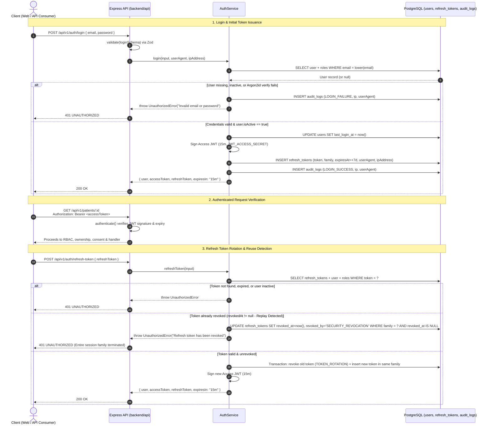
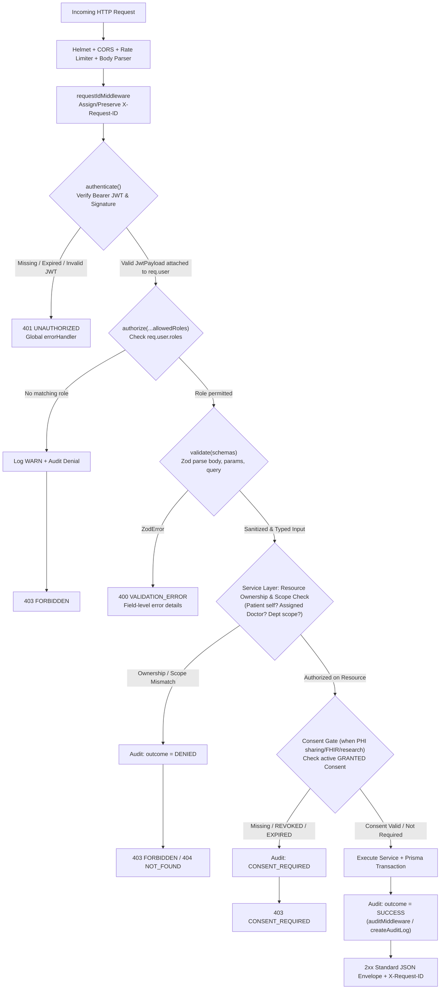

# MediCore Hospital Management Platform — Security Design Document

**Version:** `1.0.0`  
**Status:** Architecture & Security Baseline  
**Scope:** Authentication, Authorization (RBAC + Resource-Level), Consent Management, Data Protection, IDOR Prevention, Session Security, Infrastructure Hardening, Audit Trail, Threat Model, Security Headers, Rate Limiting, and Error Handling  
**Primary Services:** `backend/api` (Express.js + TypeScript + Prisma), `frontend` (Next.js), `backend/analytics` (FastAPI)

---

## Table of Contents

1. [Authentication](#1-authentication)
2. [Authorization (RBAC & Resource-Level Access)](#2-authorization-rbac--resource-level-access)
3. [Consent Management](#3-consent-management)
4. [Data Protection](#4-data-protection)
5. [IDOR Prevention](#5-idor-prevention)
6. [Session Security](#6-session-security)
7. [Infrastructure Security](#7-infrastructure-security)
8. [Audit Trail](#8-audit-trail)
9. [Threat Model (Top 10 Threats & Mitigations)](#9-threat-model-top-10-threats--mitigations)
10. [Security Headers](#10-security-headers)
11. [Rate Limiting](#11-rate-limiting)
12. [Error Handling & Safe Failure](#12-error-handling--safe-failure)

---

## 1. Authentication

MediCore implements stateless short-lived **JWT access tokens** paired with stateful, rotating **refresh tokens** persisted in PostgreSQL (`refresh_tokens`), **Argon2id** password hashing, and mandatory authentication event auditing.

### 1.1 Password Hashing (Argon2id)

Passwords are never stored in plaintext or reversible formats. Both registration and verification in `backend/api/src/modules/auth/auth.service.ts` use `argon2` configured with the **Argon2id** variant (hybrid of Argon2i side-channel resistance and Argon2d GPU/ASIC resistance):

| Parameter | Value / Env Variable | Purpose |
| :--- | :--- | :--- |
| **Algorithm** | `argon2.argon2id` | Recommended OWASP winner resistant to GPU cracking and side-channel attacks |
| **Memory Cost** | `65536` KiB (64 MiB) (`ARGON2_MEMORY_COST`) | Increases memory-hardness against parallel hardware cracking |
| **Time Cost** | `3` iterations (`ARGON2_TIME_COST`) | Balances authentication latency with brute-force resistance |
| **Parallelism** | `4` threads (`ARGON2_PARALLELISM`) | Matches multi-core server execution |
| **Password Policy** | Min 8 chars (Zod `registerSchema` / `resetPasswordSchema` / `changePasswordSchema`): uppercase, lowercase, digit, special character | Enforced prior to hashing at API boundary |

### 1.2 Dual-Token JWT Architecture

| Token Type | Lifetime | Signing / Format | Storage & Transport | Claims / Structure |
| :--- | :--- | :--- | :--- | :--- |
| **Access Token** | `15m` (`JWT_ACCESS_EXPIRY`) | Signed JWT (`jsonwebtoken`) using `JWT_ACCESS_SECRET` (min 32 chars) | `Authorization: Bearer <token>` header | `{ userId, email, roles }` (`JwtPayload`) + `iat` / `exp` |
| **Refresh Token** | `7d` (`JWT_REFRESH_EXPIRY`) | High-entropy opaque UUID pair (`uuidv4() + '.' + uuidv4()`) stored in `refresh_tokens` | Persisted in DB (`token`, `family`, `expiresAt`, `userAgent`, `ipAddress`); transmitted over HTTPS (`HttpOnly` cookie / secure client payload) | Linked to `User`, `family` UUID, expiration, and revocation metadata |

> **Key Separation:** `JWT_ACCESS_SECRET` and `JWT_REFRESH_SECRET` are strictly distinct secrets validated at startup via Zod in `backend/api/src/config/environment.ts` (each requiring at least 32 characters; startup aborts via `process.exit(1)` in `NODE_ENV=production` if invalid or missing).

### 1.3 Service-to-Service Authentication (`backend/analytics`)

Internal analytics requests from `backend/api` to the Python FastAPI service (`backend/analytics`) do not accept end-user JWTs directly. Instead, `backend/analytics/app/middleware/auth.py` enforces an `X-API-Key` header check (`verify_api_key`) against `ANALYTICS_API_KEY`:
- Missing `X-API-Key` header → `401 Unauthorized`
- Invalid `X-API-Key` value → `403 Forbidden`
- End-user RBAC and audit logging remain enforced in `backend/api` before proxying analytics queries.

### 1.4 Login Audit & Anti-Enumeration

- Every login attempt (`authService.login`) normalizes `email` to lowercase and queries `User` + `UserRole`.
- Missing user, inactive account (`!user.isActive`), and invalid Argon2id verification all return the **identical** generic `401 Unauthorized` error (`"Invalid email or password"`) to prevent user/account enumeration.
- Both `LOGIN_SUCCESS` and `LOGIN_FAILURE` events are recorded via `logLoginAttempt()` in `audit_logs` (`actorId`, `resourceType: 'AUTH'`, `resourceId: email`, `outcome`, `ipAddress`, `userAgent`, `metadata`).

### 1.5 Authentication Flow Diagram



---

## 2. Authorization (RBAC & Resource-Level Access)

MediCore enforces a **two-tier authorization model**:
1. **Coarse-grained Role-Based Access Control (RBAC)** in route middleware (`authorize(...allowedRoles)`).
2. **Fine-grained Resource-Level Authorization (Ownership & Care-Team Scoping)** inside the service/repository layer.

### 2.1 The 7 Hospital Roles

The canonical role enum defined in `backend/api/src/modules/auth/auth.schemas.ts` and `auth.routes.ts` consists of **7 roles**, backed by normalized `roles`, `permissions`, `user_roles`, and `role_permissions` tables in `database/schema.prisma`:

| # | Role Code | Persona | Scope & Primary Capabilities |
| :-: | :--- | :--- | :--- |
| 1 | `PATIENT` | Registered Patient | Self-service access to own demographics, appointments, encounters/diagnoses, prescriptions, verified lab results, invoices/payments, notifications, and consent management (`GRANTED`/`REVOKED`). |
| 2 | `RECEPTIONIST` | Front Desk / Scheduler | Register/update patient demographics & emergency contacts, manage appointment scheduling/check-in/cancellations, view department/doctor schedules. No clinical note authoring or lab result modification. |
| 3 | `DOCTOR` | Attending Physician | Full clinical workflow for assigned/department patients: manage encounters, record diagnoses (ICD-10), create prescriptions, order lab tests, view patient medical history & FHIR sync/export (with consent). |
| 4 | `NURSE` | Registered Nurse / Triage | Triage vitals (`vital_signs`), appointment check-in, clinical encounter nursing notes, specimen collection updates, view assigned/ward patient charts. Cannot prescribe medications or alter billing. |
| 5 | `LAB_TECHNICIAN` | Laboratory Technologist | View lab orders (`lab_orders`), update specimen processing statuses, record and validate `lab_results` with abnormal flags. Cannot access unrelated clinical notes or financial ledgers. |
| 6 | `BILLING_OFFICER` | Finance / Billing Specialist | Generate and issue `invoices`, manage `invoice_items`, record and reconcile `payments`, track overdue balances. Cannot read sensitive clinical notes or modify diagnoses/prescriptions. |
| 7 | `HOSPITAL_ADMIN` | Hospital / System Administrator | User and staff lifecycle management, role/permission assignment, department configuration, medication/lab catalog administration, read/export `audit_logs`, and operational analytics access. |

> **Privilege Escalation Guardrail on Registration:** Public `POST /api/v1/auth/register` must only provision `PATIENT` accounts by default; privileged staff roles (`DOCTOR`, `NURSE`, `LAB_TECHNICIAN`, `RECEPTIONIST`, `BILLING_OFFICER`, `HOSPITAL_ADMIN`) are restricted to authenticated `HOSPITAL_ADMIN` provisioning workflows so unauthenticated callers cannot self-assign elevated roles.

### 2.2 Resource-Level Authorization Rules

RBAC alone cannot enforce healthcare least privilege (e.g., a `PATIENT` must never view another patient's labs, and a `DOCTOR` must not browse charts of unassigned patients without clinical relationship). Every module enforces resource-level policy checks:

| Role | Resource-Level Scoping Rule |
| :--- | :--- |
| `PATIENT` | Strictly restricted to `resource.patientId === currentPatient.id` (derived from `req.user.userId` → `patients.user_id`). |
| `DOCTOR` | Clinical read/write on `encounters`, `diagnoses`, `prescriptions`, `lab_orders`, and `patients` scoped to patients with an active/historical `Appointment` or `Encounter` assigned to `doctor.id === currentStaff.id` (or same `departmentId` for on-call coverage, fully audited). |
| `NURSE` | Scoped to patients checked in or assigned within the nurse's `departmentId` / active care queue. |
| `LAB_TECHNICIAN` | Scoped to active `lab_orders` / `lab_order_items` / `lab_results` needed for diagnostic fulfillment (minimal demographic context only). |
| `RECEPTIONIST` | Scoped to scheduling, check-in, and demographic metadata; clinical fields (`clinicalNotes`, `diagnoses`, `labResults`) are omitted or denied. |
| `BILLING_OFFICER` | Scoped to `invoices`, `invoice_items`, `payments`, and minimal patient billing identifiers. |
| `HOSPITAL_ADMIN` | System-wide operational and audit visibility; clinical PHI mutations remain restricted to licensed clinical roles. |

### 2.3 Authorization Middleware Chain

Every protected Express route executes a deterministic pipeline before reaching the controller and service layers:



---

## 3. Consent Management

Patient privacy in MediCore is enforced server-side through explicit, purpose-based consent records (`consents` and `consent_history` tables in `database/schema.prisma`), never left to UI-only toggles.

### 3.1 Consent Data Model

- **`Consent` (`consents` table):**
  - `patientId` (FK to `patients`)
  - `category`: e.g., `TREATMENT`, `DATA_SHARING`, `RESEARCH`, `COMMUNICATION` (and interoperability/export purposes such as `FHIR_EXPORT`)
  - `purpose`: Human- and machine-readable scope description
  - `status`: `GRANTED` | `REVOKED` | `EXPIRED`
  - `grantedAt`, `revokedAt`, `expiresAt`
- **`ConsentHistory` (`consent_history` table):**
  - Append-only ledger linked to `consentId`
  - `action`: `GRANTED` | `REVOKED` | `RENEWED` | `EXPIRED`
  - `actorId`: UUID of the patient or authorized representative/admin performing the change
  - `reason` & `metadata` (JSON capturing IP address, user agent, policy version)
  - `createdAt`: Immutable UTC timestamp

### 3.2 Server-Side Enforcement Rules

1. **Purpose-Specific Verification:** Before performing secondary data use, external FHIR R4 synchronization/export (`/api/v1/fhir/*`), cross-organization `DATA_SHARING`, or non-essential `COMMUNICATION`/`RESEARCH` processing, the service queries `consents` for the target `patientId` and required `category`/`purpose`.
2. **Expiration & Revocation Checks:** A consent is valid **only** when `status === 'GRANTED'` AND (`expiresAt === null` OR `expiresAt > now()`).
3. **Fail-Closed Gate:** If a valid consent record is missing, revoked, or expired, the API aborts the operation by throwing `ConsentRequiredError` (`backend/api/src/middleware/errorHandler.ts`), returning HTTP `403 Forbidden` with error code `CONSENT_REQUIRED`, and writes a `DENIED` entry to `audit_logs`.
4. **Atomic History Recording:** Granting, renewing, or revoking a consent executes inside a Prisma `$transaction` that updates `consents` and appends an immutable row to `consent_history` simultaneously.

---

## 4. Data Protection

MediCore protects PHI and PII in transit and at rest through layered input, query, output, transport, and logging controls.

| Control Area | Implementation | Details & Configuration |
| :--- | :--- | :--- |
| **Input Validation & Mass-Assignment Prevention** | `validate({ body, params, query })` (`backend/api/src/middleware/validate.ts`) + **Zod** | Every route parses incoming `body`, `params` (UUID validation), and `query` through strict Zod schemas, stripping unknown/unrecognized fields and rejecting malformed types before business logic runs. |
| **SQL Injection Prevention** | **Prisma ORM** (`@prisma/client`) | All database queries use Prisma's parameterized query builder (`findUnique`, `findMany`, `create`, `update`, etc.). Raw SQL (`$queryRaw`) is restricted to tagged template literals (e.g., `SELECT 1` in `/ready`), preventing string-concatenated SQL injection. |
| **XSS Protection** | Strict JSON API + React/Next.js escaping + **Helmet CSP** | `backend/api` serves `application/json` exclusively (no server-rendered HTML templates outside Swagger UI), enforces `Content-Security-Policy` (`defaultSrc: ["'self'"]`, `scriptSrc: ["'self'"]`), and relies on React's automatic JSX escaping in `frontend`. |
| **Payload Size Bounds** | `express.json({ limit })` & `express.urlencoded({ limit })` | Configured via `MAX_REQUEST_SIZE=10mb` in `backend/api/src/app.ts` to mitigate large-payload DoS / memory exhaustion. |
| **Secure Headers** | `helmet` (`^8.0.0`) | Applied globally in `app.ts` (see [Section 10](#10-security-headers)). |
| **CORS Policy** | `cors` (`^2.8.5`) | Configured with explicit `origin: config.corsOrigin` (`CORS_ORIGIN=http://localhost:3000` in dev; production domain in prod), `credentials: true`, restricted methods (`GET, POST, PUT, PATCH, DELETE, OPTIONS`), and explicit allowed/exposed headers (`Content-Type`, `Authorization`, `X-Request-ID`, `X-Idempotency-Key`). |
| **Rate Limiting** | `express-rate-limit` (`^7.4.1`) | Global and endpoint-specific throttling (see [Section 11](#11-rate-limiting)). |
| **Log Redaction** | **Pino** (`backend/api/src/utils/logger.ts`) | Automatically redacts `req.headers.authorization`, `req.headers.cookie`, `password`, `passwordHash`, `token`, and `refreshToken` with `[REDACTED]` so credentials never reach log aggregators. |

---

## 5. IDOR Prevention

Insecure Direct Object Reference (IDOR) vulnerabilities are critical in healthcare applications where predictable or leaked UUIDs could expose another patient's medical history or invoices. MediCore prevents both **horizontal** and **vertical** IDOR across every endpoint:

1. **Authenticated Identity Derivation (`req.user`):** Ownership checks never trust `userId`, `patientId`, or `doctorId` supplied in request bodies or query parameters as proof of identity. The server derives the actor's identity strictly from the verified JWT payload (`req.user.userId` and `req.user.roles`).
2. **Compound Ownership Predicates in Queries:** For `PATIENT` callers, service/repository methods resolve `patient = await prisma.patient.findUnique({ where: { userId: req.user.userId } })` and inject `patientId: patient.id` directly into Prisma `where` clauses (or verify `record.patientId === patient.id` before returning data).
3. **Clinician & Care-Team Verification:** For `DOCTOR` and `NURSE` callers accessing `/patients/:id`, `/encounters/:id`, `/diagnoses/:id`, `/prescriptions/:id`, or `/lab-orders/:id`, services verify an active clinical relationship (`doctorId === staff.id` or shared active `departmentId` encounter) before returning PHI.
4. **Parent-Child Traversal Checks:** Nested endpoints (e.g., `/encounters/:encounterId/diagnoses`, `/invoices/:invoiceId/payments`, `/lab-orders/:orderId/results`) verify ownership/scope against the parent `patientId` / `encounterId` rather than querying the child table by `:id` alone.
5. **Non-Leaky Error Responses & Audit:** Unauthorized resource access logs an audit event (`outcome: 'DENIED'`) and returns `403 Forbidden` (or `404 Not Found` where resource existence itself is sensitive), never leaking record attributes.

---

## 6. Session Security

MediCore treats refresh tokens as stateful, revocable session artifacts tracked in the `refresh_tokens` table (`database/schema.prisma`):

| Session Control | Mechanism | Implementation Reference |
| :--- | :--- | :--- |
| **Refresh Token Rotation** | Every call to `POST /api/v1/auth/refresh-token` atomically revokes the presented token (`revokedAt = now()`, `revokedBy = 'TOKEN_ROTATION'`) and issues a fresh access/refresh token pair within a Prisma `$transaction`. | `authService.refreshToken` (`backend/api/src/modules/auth/auth.service.ts`) |
| **Token Reuse / Theft Detection** | All rotated tokens within a login session share a `family` UUID. If an already-revoked token (`revokedAt !== null`) is replayed, MediCore assumes token theft, immediately revokes **all active tokens in that `family`** (`revokedBy = 'SECURITY_REVOCATION'`), logs a security warning, and forces re-authentication. | `authService.refreshToken` |
| **Explicit Logout Revocation** | `POST /api/v1/auth/logout` (authenticated) marks the submitted refresh token as revoked (`revokedBy = 'USER_LOGOUT'`) and creates a `LOGOUT` audit log entry. | `authService.logout` & `authController.logout` |
| **Password Change / Reset Revocation** | Upon password reset or password change (`changePasswordSchema` / `resetPasswordSchema`), all non-revoked `refresh_tokens` belonging to `userId` are revoked (`revokedBy = 'PASSWORD_CHANGE'` / `'PASSWORD_RESET'`), invalidating every active device session. | Auth session lifecycle policy |
| **Account Deactivation Check** | Both `login` and `refreshToken` verify `user.isActive === true`; deactivated accounts (`isActive: false`) cannot authenticate or refresh tokens. | `authService.login` & `authService.refreshToken` |
| **Device & Network Tracking** | Each `RefreshToken` record captures `userAgent` (up to 500 chars) and `ipAddress` (IPv4/IPv6 up to 45 chars), enabling device-level session auditing and anomaly review. | `RefreshToken` model in `schema.prisma` |

---

## 7. Infrastructure Security

MediCore's deployment topology isolates public ingress, application runtimes, and stateful data stores:

### 7.1 Transport Security (HTTPS / TLS)
- **Edge TLS Termination:** Nginx (`infrastructure/nginx/`) terminates all external client connections over **HTTPS (TLS 1.2 / TLS 1.3)** on port `443`, redirecting HTTP (`:80`) traffic to HTTPS and forwarding requests over the private container network to `frontend` (`:3000`) and `backend/api` (`:4000`).
- **Internal Service Isolation:** `backend/analytics` (`:8000`), PostgreSQL (`:5432`), and Redis (`:6379`) are **not** exposed directly to the public internet; `backend/analytics` is reachable only on the internal network with `X-API-Key` authentication.

### 7.2 Container Hardening (Non-Root Execution)
- Service Dockerfiles (`frontend`, `backend/api`, `backend/analytics`) use multi-stage builds (compiling TypeScript/Next.js artifacts in a builder stage and copying only runtime dependencies into minimal production images).
- Containers drop root privileges and execute under dedicated non-root system users (e.g., `USER node` / unprivileged UID `1001`) with `HEALTHCHECK` directives probing `/health` and `/ready`.

### 7.3 Private Database Network & Least-Privilege DB Principals
- PostgreSQL and Redis run inside an isolated private Docker network (`data` / `backend` tier) inaccessible from external hosts in production.
- **Database Role Separation** (`.env.example`, `backend/analytics/app/config.py`):
  - `medicore_user` (`DATABASE_URL`): Used by `backend/api` for transactional read/write access (restricted to `SELECT, INSERT` on append-only audit/consent history tables).
  - `medicore_readonly` (`ANALYTICS_DATABASE_URL`): Used exclusively by `backend/analytics` with `SELECT`-only privileges so analytical workloads or SQL bugs cannot mutate clinical or billing data.

### 7.4 Secret Management
- Secrets (`JWT_ACCESS_SECRET`, `JWT_REFRESH_SECRET`, `DATABASE_URL`, `REDIS_PASSWORD`, `ANALYTICS_API_KEY`, `SMTP_PASS`, `SMS_API_KEY`, `FHIR_AUTH_TOKEN`) are injected exclusively via environment variables or orchestrator secret stores—never hardcoded in source code or committed to git (`.env*` excluded in `.gitignore`).
- `backend/api/src/config/environment.ts` validates all critical environment variables at startup using Zod (`envSchema`) and terminates immediately (`process.exit(1)`) in `production` if required secrets are absent or weaker than minimum length (`32` characters for JWT secrets).

---

## 8. Audit Trail

Healthcare compliance requires non-repudiation and complete visibility into who accessed or modified Protected Health Information (PHI).

### 8.1 Append-Only `audit_logs` Schema

Defined in `database/schema.prisma` (`AuditLog` model, mapped to `audit_logs`):

| Field | Type | Purpose |
| :--- | :--- | :--- |
| `id` | `UUID` | Unique immutable event identifier |
| `actorId` | `UUID?` | Authenticated `users.id` (nullable for failed anonymous login attempts) |
| `action` | `VARCHAR(50)` | Event verb (`CREATE`, `READ`, `UPDATE`, `DELETE`, `LOGIN_SUCCESS`, `LOGIN_FAILURE`, `LOGOUT`, `CONSENT_GRANTED`, `CONSENT_REVOKED`, etc.) |
| `resourceType` | `VARCHAR(50)` | Domain entity (`AUTH`, `PATIENT`, `APPOINTMENT`, `ENCOUNTER`, `DIAGNOSIS`, `PRESCRIPTION`, `LAB_RESULT`, `INVOICE`, `CONSENT`, `FHIR`) |
| `resourceId` | `VARCHAR(100)?` | Target entity UUID or identifier (e.g., email on failed login) |
| `outcome` | `VARCHAR(20)` | `SUCCESS`, `FAILURE`, or `DENIED` |
| `reason` | `TEXT?` | Optional denial or clinical override reason |
| `metadata` | `JSON?` | Structured contextual details (never containing raw passwords or tokens) |
| `requestId` | `VARCHAR(100)?` | Correlation ID linking audit record to HTTP logs and error traces |
| `ipAddress` | `VARCHAR(45)?` | Client source IP (`req.ip` / `req.socket.remoteAddress`) |
| `userAgent` | `VARCHAR(500)?` | Client User-Agent header |
| `createdAt` | `TIMESTAMPTZ` | Server-generated UTC timestamp (indexed; no `updatedAt`) |

### 8.2 Immutability & Request Correlation

- **Append-Only Enforcement:** `audit_logs` has no `updatedAt` column and no update/delete API endpoints. At the database layer, `medicore_user` is granted only `SELECT` and `INSERT` on `audit_logs` (backed by defensive `BEFORE UPDATE OR DELETE` PostgreSQL triggers rejecting modification).
- **Non-Blocking Failure Safety:** `createAuditLog()` (`backend/api/src/middleware/audit.ts`) catches persistence errors and logs them via Pino so audit DB transient errors do not crash user responses while still alerting operations.
- **Automatic Route Auditing:** `auditMiddleware(action, resourceType)` wraps `res.json` to emit `SUCCESS` audit records automatically for `2xx` responses with the resolved `resourceId`.
- **End-to-End Correlation (`X-Request-ID`):** `requestIdMiddleware` (`backend/api/src/middleware/requestId.ts`) reads incoming `X-Request-ID` or generates a UUID v4, attaches `req.requestId`, returns `X-Request-ID` in response headers, and propagates it to `AuditLog.requestId`, Pino structured logs, and API error responses.

---

## 9. Threat Model (Top 10 Threats & Mitigations)

| # | Threat | Attack Vector / Scenario | Impact | MediCore Mitigations |
| :-: | :--- | :--- | :--- | :--- |
| 1 | **Broken Object Level Authorization (IDOR)** | A patient or clinician swaps `:id` in `/patients/:id`, `/encounters/:id`, or `/invoices/:id` to view another person's PHI or billing records. | Critical (Unauthorized PHI exposure) | Mandatory ownership/care-team scoping in service/repository queries using `req.user.userId`; parent-child relationship verification; `DENIED` audit logging. |
| 2 | **Broken Authentication & Credential Stuffing** | Automated brute-force against `/auth/login`, weak password hashes leaked, or stolen refresh tokens replayed. | Critical (Account takeover) | Argon2id (`64 MiB`, `t=3`, `p=4`), strict auth rate limiting (`10 req / 15m`), generic `401` responses (no user enumeration), 15m access JWTs, refresh token rotation + `family` reuse revocation, login audit trail. |
| 3 | **Privilege Escalation (Vertical / Mass Assignment)** | Attacker registers with `role: "HOSPITAL_ADMIN"` or injects `isActive` / `roles` into profile update payloads. | Critical (Full system compromise) | Zod schema validation strips unexpected fields; production registration locks public signup to `PATIENT`; `authorize(...allowedRoles)` checks signed JWT roles on every route. |
| 4 | **SQL Injection** | Malicious SQL payloads in search queries, filters, or IDs targeting PostgreSQL PHI tables. | Critical (DB dump / tampering) | Prisma ORM parameterized queries throughout `backend/api`; Zod UUID/enum/type validation before DB layer; `medicore_readonly` isolation for `backend/analytics`. |
| 5 | **Cross-Site Scripting (XSS)** | Stored malicious script in patient notes, names, or addresses executing in clinician/admin browsers. | High (Session/token theft, unauthorized clinical actions) | Strict JSON API responses, Helmet `Content-Security-Policy` (`script-src 'self'`), Zod input constraints, React automatic output encoding in `frontend`, `HttpOnly` refresh token cookies. |
| 6 | **Unauthorized PHI Sharing / Consent Bypass** | Exporting patient records via `/fhir/*` or sharing clinical data after a patient has revoked consent. | High (HIPAA/GDPR violation) | Server-side `Consent` status + `expiresAt` check before FHIR sync/export or secondary sharing; throws `403 CONSENT_REQUIRED`; immutable `consent_history` & `audit_logs`. |
| 7 | **Sensitive Data Exposure in Logs & Errors** | Stack traces, Prisma SQL errors, JWTs, or passwords leaked in HTTP 500 responses or JSON logs. | High (Reconnaissance / credential leak) | Global `errorHandler` maps Prisma/Zod errors to safe codes and returns generic `500 INTERNAL_ERROR`; Pino `redact` masks `authorization`, `cookie`, `password`, `passwordHash`, `token`, `refreshToken`. |
| 8 | **Race Conditions & Double-Booking / Double-Charging** | Concurrent `POST /appointments` or `POST /payments` requests bypassing availability or balance checks. | Medium-High (Clinical conflict / financial loss) | PostgreSQL transactions (`prisma.$transaction`), database exclusion/unique constraints, and `idempotency_records` / `Idempotency-Key` deduplication. |
| 9 | **CORS Misconfiguration & CSRF** | Malicious third-party origin making credentialed cross-origin requests to `/api/v1/*`. | High (Unauthorized state changes) | Strict `CORS_ORIGIN` allowlist (no wildcard `*` with `credentials: true`), explicit allowed methods/headers, `SameSite` cookie attributes, and Bearer token verification. |
| 10 | **Container / Database Compromise & Secret Leakage** | Exploited app process running as `root`, analytics service writing to DB, or leaked `.env` secrets. | Critical (Lateral movement / data tampering) | Non-root container users, private Docker networks, separate `medicore_readonly` DB role for analytics, append-only `audit_logs` permissions, `.env` gitignored and Zod-validated on boot. |

---

## 10. Security Headers

`backend/api/src/app.ts` configures **Helmet (`^8.0.0`)** as the first middleware in the Express pipeline before route handlers:

```typescript
app.use(helmet({
  contentSecurityPolicy: {
    directives: {
      defaultSrc: ["'self'"],
      scriptSrc: ["'self'"],
      styleSrc: ["'self'", "'unsafe-inline'"],
      imgSrc: ["'self'", 'data:'],
    },
  },
  crossOriginResourcePolicy: { policy: 'cross-origin' },
}));
```

### Emitted Security Headers

| Header | Configured / Default Value | Security Purpose |
| :--- | :--- | :--- |
| **`Content-Security-Policy`** | `default-src 'self'; script-src 'self'; style-src 'self' 'unsafe-inline'; img-src 'self' data:` | Blocks unauthorized inline scripts, remote script injection, and unexpected object/frame origins. |
| **`Cross-Origin-Resource-Policy`** | `cross-origin` | Permits controlled cross-origin API/asset consumption by the decoupled `frontend` origin. |
| **`Strict-Transport-Security`** | Helmet default (`max-age=15552000; includeSubDomains` / reinforced at Nginx TLS edge) | Forces browsers to use HTTPS and prevents SSL-stripping downgrade attacks. |
| **`X-Content-Type-Options`** | `nosniff` | Prevents browsers from MIME-sniffing responses away from declared `application/json`. |
| **`X-Frame-Options`** | `SAMEORIGIN` | Mitigates clickjacking by preventing unauthorized framing of API/Swagger endpoints. |
| **`Referrer-Policy`** | `no-referrer` | Prevents leaking sensitive URL paths or patient identifiers in `Referer` headers. |
| **`X-Powered-By`** | Removed (`false`) | Hides the `Express` framework fingerprint from automated scanners. |

---

## 11. Rate Limiting

MediCore applies **multi-tier rate limiting** using `express-rate-limit` (`^7.4.1`) in `backend/api/src/app.ts` (backed by Redis in multi-replica deployments) complemented by Nginx edge connection/request throttling.

### 11.1 Configured & Tiered Limits

| Tier | Scope / Endpoints | Keying Strategy | Window | Max Requests | Purpose |
| :--- | :--- | :--- | :--- | :--- | :--- |
| **Global Baseline** *(implemented in `app.ts`)* | All routes (`RATE_LIMIT_WINDOW_MS`, `RATE_LIMIT_MAX_REQUESTS`) | Client IP (or `userId` when authenticated) | `15 min` (`900000ms`) | `100` (configurable via `.env`) | Baseline volumetric DoS protection |
| **Auth Strict** | `/api/v1/auth/login`, `/register`, `/forgot-password`, `/reset-password` | Client IP + normalized `email` | `15 min` | `10` | Blocks brute-force, credential stuffing, and account spam |
| **Token Refresh** | `/api/v1/auth/refresh-token` | Client IP + `userId` | `15 min` | `30` | Permits legitimate multi-tab refreshes while capping token abuse |
| **Clinical / Staff High-Throughput** | Authenticated clinical staff (`DOCTOR`, `NURSE`, `LAB_TECHNICIAN`, `RECEPTIONIST`, `HOSPITAL_ADMIN`) | `userId` | `15 min` | `1,000` | Prevents active hospital workstations behind shared NAT IPs from throttling |
| **Heavy / Export / FHIR** | `/api/v1/audit-logs/export`, `/api/v1/fhir/*` | `userId` | `15 min` | `20` | Protects DB and external FHIR server from expensive batch/export spikes |
| **Payment Mutations** | `POST /api/v1/payments`, refunds | `userId` + Client IP | `1 min` | `10` | Prevents rapid payment retry storms (paired with `X-Idempotency-Key`) |
| **Health Probes** | `GET /health`, `GET /ready` | Exempt | — | Unlimited | Ensures orchestrator and Nginx liveness/readiness checks never fail |

### 11.2 Rate-Limit Headers & `429` Response Contract

- `standardHeaders: true` emits IETF `RateLimit-*` headers (`RateLimit-Limit`, `RateLimit-Remaining`, `RateLimit-Reset`) and `legacyHeaders: false` disables deprecated `X-RateLimit-*` headers.
- Exceeding the limit returns HTTP `429 Too Many Requests` with the standardized error envelope (`backend/api/src/app.ts`):

```json
{
  "success": false,
  "message": "Too many requests, please try again later.",
  "error": {
    "code": "RATE_LIMIT_EXCEEDED",
    "details": []
  }
}
```

---

## 12. Error Handling & Safe Failure

MediCore enforces centralized error normalization in `backend/api/src/middleware/errorHandler.ts`, `notFoundHandler.ts`, and `backend/api/src/utils/apiResponse.ts` so internal implementation details are never leaked to callers.

### 12.1 Zero-Leakage Rules

1. **No Stack Traces in HTTP Responses:** `errorHandler` logs `err.stack` internally via Pino **only** when `process.env.NODE_ENV === 'development'`. The HTTP JSON body sent via `errorResponse()` contains strictly `{ success: false, message, error: { code, details }, requestId }`.
2. **Database Error Sanitization:** `PrismaClientKnownRequestError` exceptions never expose SQL statements, table/column names, or constraint identifiers:
   - `P2002` (unique constraint) → `409 Conflict` (`code: 'CONFLICT'`, message: `'A record with this value already exists'`)
   - `P2025` (record not found) → `404 Not Found` (`code: 'NOT_FOUND'`, message: `'Record not found'`)
   - Any other Prisma error code → `500 Internal Server Error` (`code: 'DATABASE_ERROR'`, message: `'Database operation failed'`)
3. **Validation Error Normalization:** `ZodError` instances map strictly to `400 Bad Request` (`code: 'VALIDATION_ERROR'`) with `{ field, message, code }` entries—never exposing raw schema definitions or internal object dumps.
4. **Domain `AppError` Hierarchy:** Operational exceptions use typed subclasses (`ValidationError`, `UnauthorizedError`, `ForbiddenError`, `NotFoundError`, `ConflictError`, `AppointmentConflictError`, `InvalidStateTransitionError`, `ConsentRequiredError`) with explicit safe client messages.
5. **Catch-All Fallback:** Unhandled runtime exceptions default to `500 Internal Server Error` (`code: 'INTERNAL_ERROR'`, message: `'An unexpected error occurred'`), correlated via `requestId` for secure server-side investigation.
6. **404 Normalization:** Unmatched routes pass through `notFoundHandler` and return `404 NOT_FOUND` in the identical standard error envelope.
