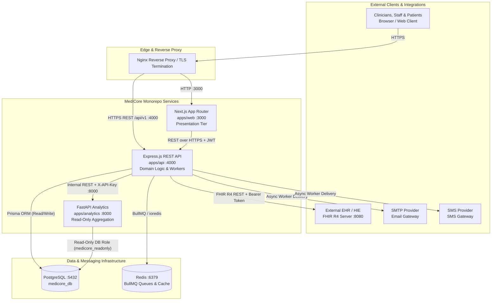
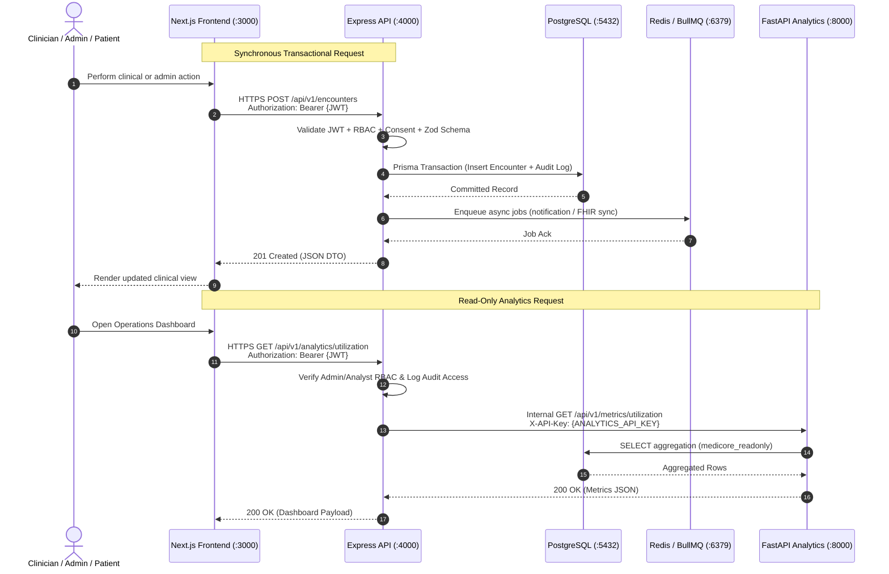
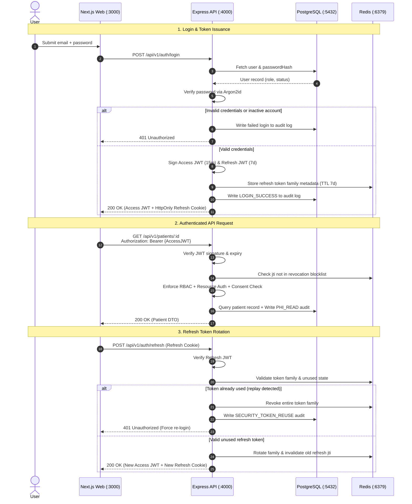
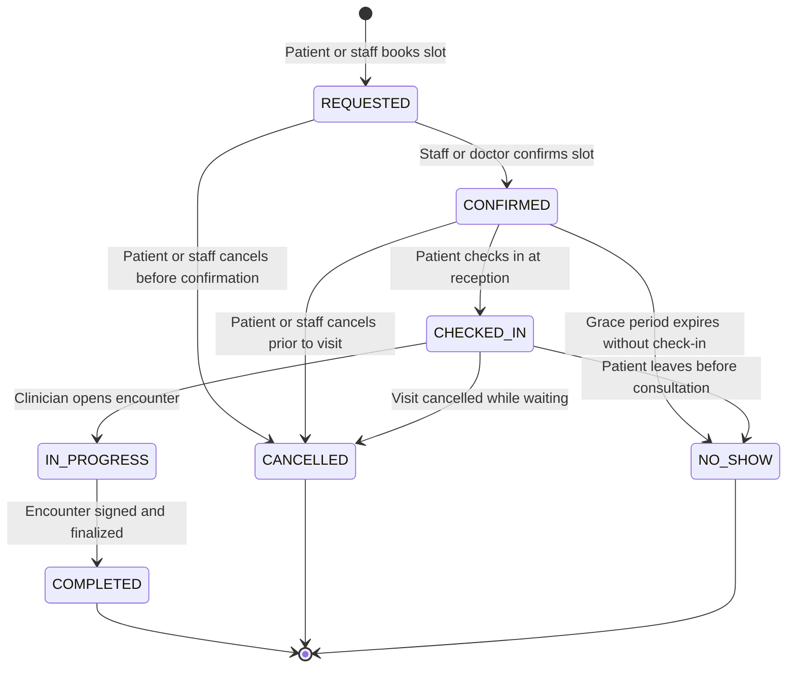
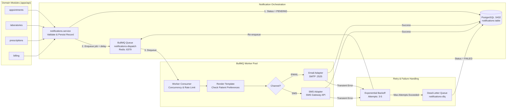
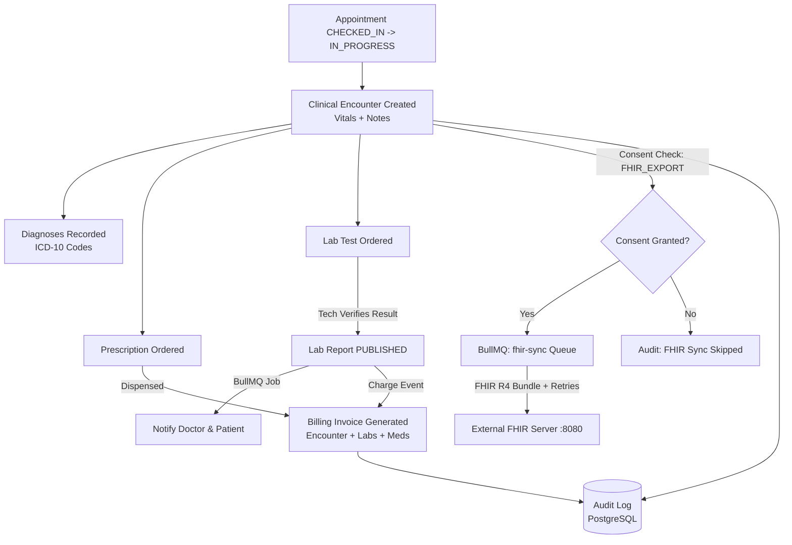

# MediCore Hospital Management Platform — System Design Document

**Version:** 1.0.0  
**Status:** Architecture Baseline  
**Scope:** End-to-End Platform Architecture, Service Boundaries, Domain Modules, Security, Data Flows, and Scalability

---

## Table of Contents

1. [System Overview](#1-system-overview)
2. [Architecture](#2-architecture)
3. [Service Boundaries](#3-service-boundaries)
4. [Module Architecture](#4-module-architecture)
5. [Communication Patterns](#5-communication-patterns)
6. [Security Architecture](#6-security-architecture)
7. [Data Flow Diagrams](#7-data-flow-diagrams)
8. [Scalability Considerations](#8-scalability-considerations)

---

## 1. System Overview

**MediCore** is an enterprise-grade, modular Hospital, Appointment, and Patient Care Management Platform designed to digitize clinical, administrative, diagnostic, financial, and regulatory interoperability workflows across healthcare facilities.

### Core Capabilities

| Capability Area | Description |
| :--- | :--- |
| **Patient Registration & Demographics** | Master Patient Index (MPI), Medical Record Number (MRN) generation, demographics, emergency contacts, and insurance profiles. |
| **Appointment Scheduling** | Slot management, clinician availability, booking lifecycle (`REQUESTED` to `COMPLETED`, `CANCELLED`, `NO_SHOW`), and automated reminders. |
| **Clinical Encounters & Diagnoses** | Outpatient/inpatient visit documentation, vitals, SOAP notes, ICD-10 diagnosis coding, and clinical status tracking. |
| **Prescriptions & Pharmacy** | Medication orders, dosage/frequency schedules, allergy/interaction flags, dispensing status, and e-prescription tracking. |
| **Laboratory Management** | Lab test orders, specimen tracking, diagnostic workflows, reference ranges, and verified result publication. |
| **Billing & Revenue Cycle** | Encounter-linked itemized invoicing, insurance claims/adjustments, payment recording, and receipt generation. |
| **Patient Consent Management** | Granular opt-in/opt-out consent policies (treatment, data sharing, analytics, external FHIR exchange) with versioning and revocation. |
| **Immutable Audit Logging** | Tamper-evident audit trail capturing authentication events, PHI access, clinical mutations, and administrative actions. |
| **FHIR R4 Interoperability** | Standards-based bidirectional synchronization and resource mapping (`Patient`, `Encounter`, `Observation`, `MedicationRequest`, `DiagnosticReport`) with external EHR/HIE systems. |
| **Multi-Channel Notifications** | Asynchronous, retry-resilient delivery of appointment reminders, lab-ready alerts, billing notices, and security alerts via Email (SMTP) and SMS. |
| **Operational & Clinical Analytics** | Read-only reporting for bed/appointment utilization, turnaround times, revenue metrics, and anonymized clinical trends. |

### Architectural Goals

- **Single Source of Truth:** All transactional healthcare data is owned and mutated exclusively by the core API service.
- **Strict Compliance & Security:** Defense-in-depth combining Argon2id password hashing, short-lived JWTs with rotating refresh tokens, RBAC, resource-level authorization, explicit consent gates, and comprehensive audit logs.
- **Asynchronous Resilience:** Non-blocking execution of notifications, FHIR synchronization, and heavy side effects via Redis-backed BullMQ queues.
- **Clean Separation of Concerns:** Presentation (`apps/web`), transactional business logic (`apps/api`), and read-only analytics (`apps/analytics`) remain cleanly decoupled within a unified monorepo.

---

## 2. Architecture

MediCore is organized as an **npm workspaces monorepo** containing three primary deployable runtime services, two backing data stores, shared internal packages, and infrastructure definitions.

### Repository & Service Topology

| Component | Path | Technology Stack | Port | Responsibility |
| :--- | :--- | :--- | :--- | :--- |
| **Web Frontend** | `apps/web` | Next.js (App Router), TypeScript, React | `3000` | Role-specific clinical, administrative, and patient portals; presentation and SSR/CSR routing. |
| **Core REST API** | `apps/api` | Express.js, TypeScript, Prisma ORM, Zod, BullMQ, Pino, Swagger | `4000` | All domain business logic, transactional persistence, auth/RBAC, consent checks, audit logging, queue producers/workers, FHIR sync. |
| **Analytics Service** | `apps/analytics` | Python, FastAPI, Uvicorn | `8000` | Read-only operational/clinical aggregations, KPIs, and statistical queries via internal API. |
| **Primary Database** | `database/` | PostgreSQL | `5432` | ACID-compliant relational storage for all clinical, operational, billing, consent, and audit records. |
| **Cache & Queue Broker** | — | Redis (`ioredis`) | `6379` | BullMQ job queues, delayed/scheduled jobs, token/session revocation state, and short-lived caching. |
| **Shared Packages** | `packages/*` | TypeScript (`api-contracts`, `shared-types`, `shared-config`) | — | Shared DTOs, Zod/contract definitions, error schemas, constants, and linting/TS configs. |
| **Infrastructure** | `infrastructure/` | Docker Compose, Nginx, Monitoring scripts | `80/443` | Reverse proxy/TLS termination, container orchestration, and health/observability tooling. |

### High-Level Architecture Diagram



---

## 3. Service Boundaries

Strict service boundaries prevent split-brain business logic, accidental PHI exposure, and tight database coupling across teams and runtimes.

### Boundary Matrix

| Responsibility | `apps/web` (Next.js) | `apps/api` (Express.js) | `apps/analytics` (FastAPI) |
| :--- | :--- | :--- | :--- |
| **UI Rendering & Client Navigation** | **Owner** | None | None |
| **Business Rules & State Transitions** | None (UX hints only) | **Owner** | None |
| **Transactional Writes (CRUD)** | None | **Owner (Exclusive)** | None (Strictly Prohibited) |
| **Authentication & Token Issuance** | Token storage/forwarding | **Owner** | Validates internal API key only |
| **RBAC, Resource Auth & Consent** | Route/menu gating (UX) | **Enforced Authoritatively** | Receives pre-authorized scope |
| **Audit Log Generation** | None | **Owner** | None |
| **Queue Production & Processing** | None | **Owner** | None |
| **Complex Analytical Aggregations** | Renders charts/tables | Proxies & enforces RBAC | **Owner (Read-Only)** |
| **Direct PostgreSQL Access** | Forbidden | Read/Write (`medicore_user`) | Read-Only (`medicore_readonly`) |
| **Direct Redis Access** | Forbidden | Read/Write | Optional read cache only |

### Boundary Rules

1. **Express API (`apps/api`) Owns ALL Business Data:**
   - All domain entities (`patients`, `staff`, `departments`, `appointments`, `encounters`, `diagnoses`, `prescriptions`, `laboratories`, `billing`, `consent`, `audit`, `notifications`, `fhir`) are exclusively created, updated, and validated inside `apps/api`.
   - Every mutation passes through Zod schema validation, authentication middleware, RBAC + resource-level authorization, consent checks (where PHI access/sharing applies), and Prisma transactions.
   - `apps/api` acts as the **API Gateway / BFF** for analytics requests: `apps/web` requests analytics through `apps/api` (or via authenticated API-mediated endpoints) so user JWTs, RBAC permissions, and audit trails are consistently enforced before calling `apps/analytics`.

2. **FastAPI Analytics (`apps/analytics`) Provides READ-ONLY Analytics:**
   - Exposes internal endpoints (e.g., `/api/v1/analytics/appointments`, `/api/v1/analytics/revenue`, `/api/v1/analytics/lab-turnaround`) protected by `ANALYTICS_API_KEY`.
   - Connects to PostgreSQL using a dedicated, least-privilege **read-only** database principal (`medicore_readonly`) with `SELECT`-only grants on approved tables/materialized views.
   - Never mutates operational tables, never issues user tokens, and is never exposed directly to unauthenticated public traffic.

3. **Next.js Frontend (`apps/web`) Handles Presentation Only:**
   - Built with Next.js App Router for Server Components, Client Components, form UX, dashboards, and role-based layouts.
   - Contains zero direct database drivers, zero Redis clients, and zero authoritative authorization logic.
   - All state mutations and protected data fetches flow over HTTPS to `apps/api` (`/api/v1/*`) using JWT bearer credentials.

---

## 4. Module Architecture

The Express.js backend (`apps/api/src/modules/`) follows a **modular monolith** pattern. Each module encapsulates its own routes, controllers, services, repositories (via Prisma), Zod validators, and domain types, communicating across module boundaries through well-defined service interfaces or internal domain events.

> **Note:** MediCore organizes **14 domain and platform modules** (spanning the 13 clinical/operational/platform modules plus `diagnoses` as a dedicated clinical sub-domain alongside `encounters`) under `apps/api/src/modules/`:

### Module Inventory

| # | Module | Core Responsibilities & Owned Entities | Key Integrations / Interactions |
| :-: | :--- | :--- | :--- |
| 1 | **`auth`** | User registration/login, Argon2id password hashing, JWT access (`15m`) & refresh (`7d`) token lifecycle, token rotation/revocation, MFA/session management. | `staff`, `patients`, `audit`, Redis (token blocklist/sessions). |
| 2 | **`patients`** | Patient demographic records, MRN assignment, emergency contacts, insurance details, patient search, and profile lifecycle. | `auth`, `consent`, `audit`, `fhir`. |
| 3 | **`staff`** | Clinician & hospital employee profiles, medical licenses, specialties, shift schedules, and role assignments. | `auth`, `departments`, `appointments`, `audit`. |
| 4 | **`departments`** | Hospital departments/wards, clinical service lines, room/resource capacity, and department head assignments. | `staff`, `appointments`, `encounters`. |
| 5 | **`appointments`** | Slot availability, appointment booking, strict state machine enforcement (`REQUESTED` to `COMPLETED`/`CANCELLED`/`NO_SHOW`), rescheduling. | `patients`, `staff`, `departments`, `encounters`, `notifications`, `audit`. |
| 6 | **`encounters`** | Clinical visit records (outpatient, emergency, inpatient), triage vitals, chief complaints, clinical notes, discharge summaries. | `appointments`, `patients`, `staff`, `diagnoses`, `prescriptions`, `laboratories`, `billing`, `fhir`, `audit`. |
| 7 | **`diagnoses`** | ICD-10 / SNOMED diagnosis recording, primary vs. secondary classification, chronic/active problem lists, clinical resolution tracking. | `encounters`, `patients`, `fhir`, `audit`. |
| 8 | **`prescriptions`** | Medication orders, dosage/route/frequency/duration, drug-allergy/interaction checks, pharmacy fulfillment status (`ORDERED`, `DISPENSED`, `CANCELLED`). | `encounters`, `patients`, `staff`, `notifications`, `fhir`, `audit`. |
| 9 | **`laboratories`** | Lab test catalog, test orders, specimen collection/accessioning, analyzer/tech result entry, critical value flags, report verification. | `encounters`, `patients`, `staff`, `notifications`, `billing`, `fhir`, `audit`. |
| 10 | **`billing`** | Charge capture from encounters/labs/prescriptions, itemized invoices, tax/discount rules, insurance claim metadata, payments, refunds, ledger status. | `encounters`, `laboratories`, `prescriptions`, `patients`, `notifications`, `audit`. |
| 11 | **`consent`** | Patient consent policies (`TREATMENT`, `DATA_SHARING`, `FHIR_EXPORT`, `ANALYTICS`), consent capture, versioning, expiration, and revocation enforcement. | `patients`, `encounters`, `fhir`, `audit`. |
| 12 | **`audit`** | Append-only audit log writer & query API capturing `actorId`, `role`, `action`, `resourceType`, `resourceId`, `ipAddress`, `correlationId`, and field diffs. | All modules (cross-cutting middleware + explicit domain audit hooks). |
| 13 | **`notifications`** | Template rendering, channel preference resolution, BullMQ job scheduling, email (SMTP) & SMS dispatch, delivery status tracking, retry/DLQ handling. | `appointments`, `laboratories`, `prescriptions`, `billing`, `auth`, Redis/BullMQ. |
| 14 | **`fhir`** | HL7 FHIR R4 resource mappers (`Patient`, `Practitioner`, `Encounter`, `Condition`, `MedicationRequest`, `DiagnosticReport`), outbound/inbound sync, retry/backoff via BullMQ. | `patients`, `encounters`, `diagnoses`, `prescriptions`, `laboratories`, `consent`, `audit`, Redis/BullMQ. |

### Internal Layering per Module

```text
apps/api/src/modules/<module>/
├── <module>.routes.ts       # Express router + OpenAPI annotations + middleware chain
├── <module>.controller.ts   # HTTP request/response mapping & status codes
├── <module>.service.ts      # Business logic, state transitions, consent & event emission
├── <module>.schema.ts       # Zod request/response validation schemas
├── <module>.repository.ts   # Prisma queries & transaction wrappers
└── <module>.types.ts        # Module-scoped interfaces & DTOs
```

---

## 5. Communication Patterns

MediCore enforces explicit, typed, and authenticated communication protocols across every boundary.

| Link | Protocol & Transport | Auth Mechanism | Key Libraries / Config |
| :--- | :--- | :--- | :--- |
| **Frontend → Express API** | REST over HTTPS (JSON), `/api/v1/*` | Bearer JWT Access Token (`15m`) + HttpOnly/secure Refresh Token (`7d`) | `fetch` / typed client (`packages/api-contracts`), `CORS_ORIGIN`, `helmet`, `express-rate-limit` |
| **Express API → Analytics** | Internal REST over HTTP/HTTPS (private network), `/api/v1/*` | Static/rotated Internal API Key header (`X-API-Key: ANALYTICS_API_KEY`) | `ANALYTICS_PORT=8000`, internal HTTP client with timeouts |
| **Express API → PostgreSQL** | TCP / TLS (`5432`) via Prisma Client | DB user credentials (`DATABASE_URL`) | `@prisma/client`, connection pool (`DATABASE_POOL_MIN=2`, `DATABASE_POOL_MAX=10`) |
| **Analytics → PostgreSQL** | TCP / TLS (`5432`) via SQLAlchemy / asyncpg | Read-only DB role (`ANALYTICS_DATABASE_URL`, `medicore_readonly`) | Read-only SQL queries & materialized views |
| **Express API → Redis** | RESP over TCP / TLS (`6379`) | Optional `REDIS_PASSWORD` (`REDIS_URL`) | `ioredis` + `bullmq` (queues, delayed reminders, retries, DLQ, token revocation cache) |
| **Express API → External FHIR** | REST over HTTPS (FHIR R4 JSON/Bundle) | `FHIR_AUTH_TOKEN` (Bearer/OAuth2) | Async BullMQ worker, `FHIR_TIMEOUT_MS=30000`, `FHIR_RETRY_ATTEMPTS=3`, `FHIR_RETRY_DELAY_MS=1000` |
| **Express API → SMTP / SMS** | SMTP/TLS (`SMTP_PORT=2525`) & HTTPS SMS API | SMTP credentials / `SMS_API_KEY` | BullMQ `notifications` worker |

### Service Communication Flow



---

## 6. Security Architecture

Healthcare data (PHI/PII) demands zero-trust enforcement inside `apps/api` regardless of client behavior.

### 6.1 Authentication & Token Lifecycle

- **Password Hashing:** Passwords are hashed using **Argon2id** (`argon2`) tuned with `ARGON2_MEMORY_COST=65536` (64 MiB), `ARGON2_TIME_COST=3`, and `ARGON2_PARALLELISM=4`.
- **Short-Lived Access Tokens:** Signed JWT (`HS256`/`RS256` via `JWT_ACCESS_SECRET`) with `JWT_ACCESS_EXPIRY=15m`, carrying `sub` (userId), `role`, `staffId`/`patientId`, `departmentId`, and `jti` (unique token ID).
- **Refresh Token Rotation & Revocation:**
  - Issued with `JWT_REFRESH_EXPIRY=7d` (`JWT_REFRESH_SECRET`), stored securely (`HttpOnly`, `SameSite=Strict`, `Secure` cookie or hashed token record).
  - Every `/auth/refresh` call rotates the refresh token and invalidates the previous token family in Redis/PostgreSQL.
  - Reuse of a revoked refresh token triggers immediate **family revocation** (forcing re-authentication across sessions).
- **Logout / Forced Revocation:** Active `jti` values can be blocklisted in Redis with TTL equal to remaining access token lifetime.

### 6.2 Role-Based Access Control (RBAC)

Every protected endpoint declares required roles via declarative middleware (`authorizeRoles([...])`):

| Role | Scope & Primary Permissions |
| :--- | :--- |
| **`SUPER_ADMIN`** | System configuration, department setup, user/role administration, full audit log inspection. |
| **`HOSPITAL_ADMIN`** | Staff onboarding, scheduling oversight, operational analytics, billing overrides. |
| **`DOCTOR`** | Assigned/department patient encounters, diagnoses, prescriptions, lab orders, clinical notes. |
| **`NURSE`** | Triage vitals, appointment check-in, care-team encounter updates, specimen collection. |
| **`LAB_TECHNICIAN`** | View ordered lab tests, update specimen status, enter & verify lab results. |
| **`PHARMACIST`** | View active prescriptions, verify drug interactions, mark prescriptions dispensed. |
| **`RECEPTIONIST` / `BILLING_CLERK`** | Patient registration, appointment booking/check-in, invoice generation, payment capture. |
| **`PATIENT`** | Self-service profile, own appointments, own verified lab reports, prescriptions, invoices, and consent management. |

### 6.3 Resource-Level Authorization

RBAC alone is insufficient in healthcare ("a doctor cannot read every patient's chart without clinical justification"). MediCore enforces **resource-level authorization** in the service/policy layer:
- **Patient Self-Access:** A `PATIENT` can only read/mutate records where `resource.patientId === req.user.patientId`.
- **Care-Team / Department Scoping:** Clinicians (`DOCTOR`, `NURSE`) access encounter/clinical records when assigned as the attending/consulting provider, sharing the patient's active department encounter, or invoking an audited **break-glass** emergency override.
- **Laboratory & Pharmacy Scoping:** Technicians and pharmacists only view fields required for fulfillment (order metadata, relevant patient identifiers/allergies), without unrestricted financial or unrelated clinical history access.

### 6.4 Patient Consent Checks

Before returning sensitive clinical records, exporting to external FHIR servers, or including identifiable records in secondary workflows, `apps/api` invokes the `consent` module:
- Evaluates active consent records (`patientId`, `purpose`: `TREATMENT` | `DATA_SHARING` | `FHIR_EXPORT` | `ANALYTICS`, `status`: `GRANTED` | `REVOKED`, `expiresAt`).
- Denies external FHIR export (`403 Forbidden` — `CONSENT_REQUIRED`) if `FHIR_EXPORT` consent is absent or revoked.
- Records every consent grant, update, revocation, and consent-gate decision in the immutable `audit` log.

### 6.5 Transport, Input & Infrastructure Hardening

- **HTTP Security Headers:** `helmet` middleware enforces CSP, HSTS, `X-Frame-Options`, and MIME-sniffing protections.
- **CORS & Rate Limiting:** Strict `CORS_ORIGIN` allowlist (`http://localhost:3000` in dev) and `express-rate-limit` (`RATE_LIMIT_WINDOW_MS=900000`, `RATE_LIMIT_MAX_REQUESTS=100`, with tighter thresholds on `/auth/*`).
- **Payload Validation:** Strict `zod` schema validation on all params, queries, and bodies (`MAX_REQUEST_SIZE=10mb`), stripping unknown fields to prevent mass-assignment attacks.
- **Structured Logging & PHI Redaction:** `pino` JSON logging redacts authorization headers, passwords, tokens, and sensitive PHI fields while preserving `correlationId` for distributed tracing.

---

## 7. Data Flow Diagrams

### 7.1 Authentication Flow (Login, Access, Refresh & Revocation)



### 7.2 Appointment Workflow State Machine

Appointments follow a deterministic finite state machine enforced inside `appointments.service.ts` within a Prisma transaction. Invalid transitions return `409 Conflict` (`INVALID_STATE_TRANSITION`).



#### State Side Effects

| Transition | Synchronous Side Effects (PostgreSQL) | Asynchronous Side Effects (BullMQ) |
| :--- | :--- | :--- |
| `* -> REQUESTED` | Reserve slot lock, create appointment, write audit log | Enqueue booking-received notification |
| `REQUESTED -> CONFIRMED` | Confirm slot, write audit log | Enqueue confirmation + scheduled reminder jobs |
| `CONFIRMED -> CHECKED_IN` | Record arrival timestamp, notify care queue | Update waiting room display / nurse alert |
| `CHECKED_IN -> IN_PROGRESS` | Create/link clinical `Encounter` record | None |
| `IN_PROGRESS -> COMPLETED` | Finalize appointment, trigger encounter billing capture | Enqueue post-visit summary & FHIR encounter sync |
| `* -> CANCELLED` / `NO_SHOW` | Release slot capacity, record reason & actor | Cancel pending reminder jobs; send cancellation notice |

### 7.3 Notification Processing Flow

Notifications are decoupled from HTTP request latency using **BullMQ** backed by Redis, ensuring reliable delivery, exponential backoff retries, and dead-letter visibility.



### 7.4 End-to-End Clinical, Billing & FHIR Data Flow



---

## 8. Scalability Considerations

MediCore is designed to scale smoothly from a single clinic deployment to a multi-department hospital network.

### 8.1 Horizontal Scaling of Stateless Services

- **Next.js (`apps/web`) & Express API (`apps/api`):** Both services are stateless in request handling (JWTs are self-contained; session/revocation state and queues live in Redis/PostgreSQL). Multiple replicas can run behind **Nginx** or a cloud load balancer with health checks (`/health` / `/ready`).
- **Worker Separation:** BullMQ workers (`notifications`, `fhir`) currently co-located or launched from `apps/api` can be scaled into dedicated worker replicas by running only the worker entrypoint, preventing heavy background bursts (e.g., batch reminders or FHIR sync retries) from degrading API P99 latency.

### 8.2 Database Scaling & Query Optimization (PostgreSQL)

- **Connection Pooling:** `apps/api` manages bounded pools (`DATABASE_POOL_MIN=2`, `DATABASE_POOL_MAX=10` per instance). At higher API replica counts, introduce **PgBouncer** in transaction-pooling mode in front of PostgreSQL to prevent connection exhaustion.
- **Read Replicas for Analytics & Reporting:** Currently `apps/analytics` uses `medicore_readonly` against PostgreSQL. Under heavy analytical load, point `ANALYTICS_DATABASE_URL` directly to a dedicated **PostgreSQL Read Replica** so OLAP aggregations never contend with OLTP clinical writes.
- **Indexing & Table Partitioning:**
  - Composite B-tree indexes on high-cardinality query paths: `(patientId, createdAt)`, `(departmentId, scheduledAt, status)`, and `(actorId, timestamp)`.
  - Time-based range partitioning (monthly/quarterly) on high-volume append-only tables such as `audit_logs` and `notifications`, enabling fast retention archival without table bloat.

### 8.3 Redis & Queue Resilience

- **Backpressure & Rate Shaping:** BullMQ queues configure per-worker concurrency limits and external provider rate limiters (e.g., SMTP/SMS provider quotas, external FHIR server throughput) to avoid cascading failures.
- **Dead-Letter Queues (DLQ) & Idempotency:** Every queued job carries a deterministic idempotency key (e.g., `appt-reminder:{appointmentId}:{window}` or `fhir-sync:{resourceType}:{resourceId}:{version}`), ensuring safe retries without duplicate patient notifications or duplicate FHIR resources.
- **High Availability:** Production deployments should run Redis with **Sentinel** or **Redis Cluster** (with AOF persistence enabled) so scheduled reminder jobs survive node restarts.

### 8.4 Caching & Payload Optimization

- **Hot Reference Data Caching:** Department catalogs, staff availability templates, lab test catalogs, and active consent policy lookups are strong candidates for short-TTL Redis caching with explicit write-through invalidation on updates.
- **Analytics Pre-Aggregation:** Expensive hospital-wide KPIs (monthly occupancy, lab turnaround percentiles, revenue summaries) in `apps/analytics` should leverage **PostgreSQL materialized views** refreshed on a schedule plus Redis response caching keyed by query parameters and time bucket.
- **Compression & Pagination:** `apps/api` enables `compression` middleware and enforces cursor/keyset or bounded offset pagination on all list endpoints (`patients`, `appointments`, `audit`, `encounters`) to bound memory and network overhead.

### 8.5 External Integration Resilience (FHIR & Notification Providers)

- **Timeouts & Bounded Retries:** External FHIR calls enforce `FHIR_TIMEOUT_MS=30000` with `FHIR_RETRY_ATTEMPTS=3` and exponential backoff (`FHIR_RETRY_DELAY_MS=1000`).
- **Circuit Breaking:** If an external FHIR endpoint or SMS gateway experiences sustained downtime, worker circuits trip to pause immediate retries and preserve local API responsiveness while queuing jobs for deferred replay.
